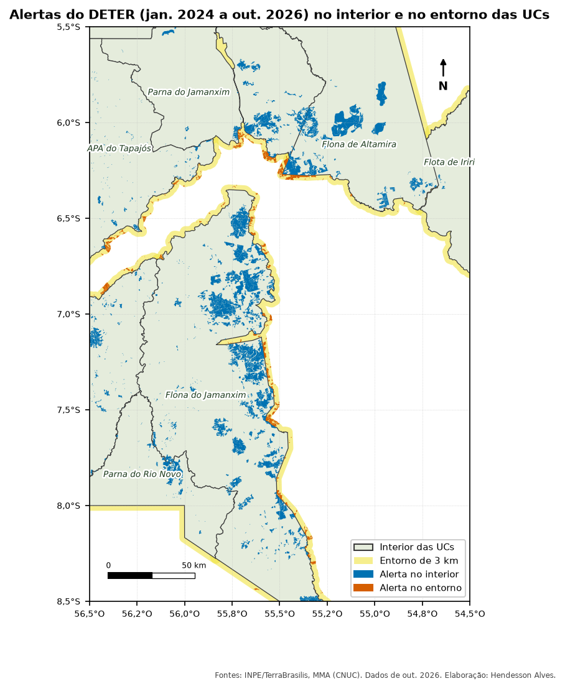
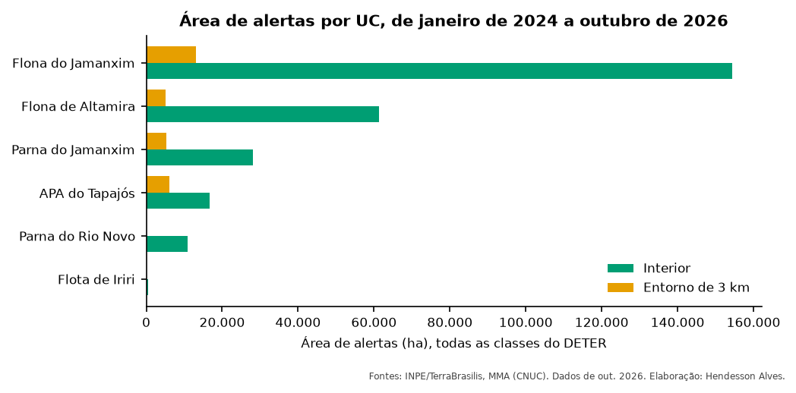

::: {.ficha}
[Nível]{.rotulo} Iniciante
[Leitura]{.rotulo} 9 min
[Dados]{.rotulo} outubro de 2026
[Programas]{.rotulo} [ArcGIS]{.selo-texto} {fig-alt="QGIS"} {fig-alt="PostGIS"} {fig-alt="Python"}
:::

Quase todo relatório de monitoramento responde à mesma pergunta: **quanto do desmatamento (ou do fogo)
aconteceu dentro da UC e quanto aconteceu logo ao lado?** O entorno importa porque é por ali que a
pressão chega.

Nos scripts que eu usava, isso era feito com uma camada de UCs que já trazia o entorno, um campo `0/1`
e um `Intersect` do ArcGIS. Aqui você vai montar essa camada do zero e fazer o cruzamento em quatro
programas.

{fig-alt="Mapa da região de Novo Progresso com as UCs em verde, uma faixa amarela de 3 km em volta delas e alertas do DETER em azul no interior e em laranja no entorno. Onde duas UCs se encostam, não há faixa amarela."}

## O que você vai fazer

```{mermaid}
%%| eval: true
%%| fig-cap: "Etapas do cruzamento"
flowchart LR
    A["UCs"] --> B["Buffer de 3 km<br/>(em metros)"]
    B --> C["Apagar todas<br/>as UCs"]
    C --> D["Entorno"]
    A --> E["Interior"]
    D --> F["Juntar<br/>campo local"]
    E --> F
    F --> G["Interseção<br/>com os alertas"]
    G --> H["Área em ha<br/>e tabela resumo"]
```

0. **Corrigir as geometrias.** 830 dos 7.823 alertas do recorte (11%) têm geometria inválida, e alguns
   programas param no meio do cruzamento por causa disso.
1. **Entorno:** buffer de 3 km em volta de cada UC, menos a área de **todas** as UCs. Assim, um alerta
   dentro de uma UC vizinha conta como interior dela, e não como entorno da outra.
2. **Zonas:** juntar interior e entorno numa camada só, com um campo `local`.
3. **Interseção:** cortar cada alerta pelas zonas. Um alerta que cruza a divisa vira dois pedaços.
4. **Área e resumo:** área em hectares de cada pedaço e soma por UC e local.

## Dados

Use o GeoPackage dos artigos (camadas `ucs` e `deter`). Veja como baixar em
[Dados dos artigos](sobre.qmd#dados).

## O código

::: {.panel-tabset group="programa"}

## ArcGIS Pro

```python
import arcpy

arcpy.env.overwriteOutput = True
gpkg = r"C:\dados\artigos.gpkg"
gdb = r"C:\dados\resultados.gdb"          # crie antes com CreateFileGDB

# 0. Copiar para a memória e corrigir as geometrias
ucs = arcpy.analysis.Select(gpkg + r"\main.ucs", r"memory\ucs", "regiao = 'Amazonia'")
deter = arcpy.management.CopyFeatures(gpkg + r"\main.deter", r"memory\deter")
arcpy.management.RepairGeometry(ucs)
arcpy.management.RepairGeometry(deter)

# 1. Entorno: buffer geodésico de 3 km menos todas as UCs
faixa = arcpy.analysis.PairwiseBuffer(ucs, r"memory\faixa", "3000 Meters", method="GEODESIC")
entorno = arcpy.analysis.PairwiseErase(faixa, ucs, r"memory\entorno")

# 2. Campo "local" e junção das duas camadas
arcpy.management.CalculateField(ucs, "local", "'interior'", "PYTHON3", field_type="TEXT")
arcpy.management.CalculateField(entorno, "local", "'entorno'", "PYTHON3", field_type="TEXT")
zonas = arcpy.management.Merge([ucs, entorno], r"memory\zonas")

# 3. Interseção dos alertas com as zonas
cruzado = arcpy.analysis.PairwiseIntersect([deter, zonas], gdb + r"\deter_interior_entorno")

# 4. Área geodésica em hectares e tabela resumo
arcpy.management.CalculateGeometryAttributes(
    cruzado, [["area_ha", "AREA_GEODESIC"]], area_unit="HECTARES")
arcpy.analysis.Statistics(cruzado, gdb + r"\resumo_interior_entorno",
                          [["area_ha", "SUM"], ["gid", "COUNT"]], ["nome_uc", "local"])
```

::: {.callout-note}
No **ArcMap**, a ferramenta `Erase` só existe na licença Advanced. Com licença Basic, faça um `Union`
da faixa com as UCs e apague as partes que têm UC. No ArcGIS Pro, use `PairwiseErase`.
:::

## QGIS

**Pelos menus** (Caixa de Ferramentas de Processamento, `Ctrl+Alt+T`):

1. **Corrigir geometrias** nas camadas `ucs` e `deter`.
2. **Reprojetar camada** `ucs` para EPSG:5880 (em metros).
3. **Buffer** de 3000 m, sem dissolver.
4. **Diferença**: entrada = buffer, sobreposição = UCs. O resultado é o entorno.
5. **Calculadora de campo** nas duas camadas: novo campo `local` com `'interior'` ou `'entorno'`.
6. **Mesclar camadas vetoriais** e **Corrigir geometrias** de novo.
7. **Interseção**: entrada = alertas, sobreposição = zonas.
8. **Calculadora de campo**: `area_ha` = `area(transform($geometry, 'EPSG:4674', 'ESRI:102033')) / 10000`.
9. **Estatísticas por categorias**: campo `area_ha`, categorias `nome_uc` e `local`.

**No console Python** (`Ctrl+Alt+P`), os mesmos passos:

```python
import processing
G = "C:/dados/artigos.gpkg"

def rodar(alg, **p):
    p.setdefault("OUTPUT", "memory:")
    return processing.run(alg, p)["OUTPUT"]

# 0 e 1. UCs da Amazônia em metros, buffer de 3 km e diferença
ucs = rodar("native:extractbyexpression", INPUT=f"{G}|layername=ucs",
            EXPRESSION="regiao = 'Amazonia'")
ucs = rodar("native:fixgeometries", INPUT=ucs)
ucs_m = rodar("native:reprojectlayer", INPUT=ucs, TARGET_CRS="EPSG:5880")
faixa = rodar("native:buffer", INPUT=ucs_m, DISTANCE=3000, SEGMENTS=16, DISSOLVE=False)
entorno = rodar("native:difference", INPUT=faixa, OVERLAY=ucs_m)

# 2. Campo "local" e junção
interior = rodar("native:fieldcalculator", INPUT=ucs_m, FIELD_NAME="local",
                 FIELD_TYPE=2, FIELD_LENGTH=10, FORMULA="'interior'")
entorno = rodar("native:fieldcalculator", INPUT=entorno, FIELD_NAME="local",
                FIELD_TYPE=2, FIELD_LENGTH=10, FORMULA="'entorno'")
zonas = rodar("native:mergevectorlayers", LAYERS=[interior, entorno], CRS="EPSG:4674")
zonas = rodar("native:fixgeometries", INPUT=zonas)

# 3. Alertas corrigidos × zonas
deter = rodar("native:fixgeometries", INPUT=f"{G}|layername=deter")
cruzado = rodar("native:intersection", INPUT=deter, OVERLAY=zonas,
                OVERLAY_FIELDS=["cnuc", "nome_uc", "local"])
cruzado = rodar("native:deletecolumn", INPUT=cruzado, COLUMN=["fid"])  # veja a armadilha 3

# 4. Área em hectares e resumo
cruzado = rodar("native:fieldcalculator", INPUT=cruzado, FIELD_NAME="area_ha",
                FIELD_TYPE=0, FIELD_PRECISION=4,
                FORMULA="area(transform($geometry, 'EPSG:4674', 'ESRI:102033')) / 10000",
                OUTPUT="C:/dados/deter_interior_entorno.gpkg")
resumo = rodar("qgis:statisticsbycategories", INPUT=cruzado, VALUES_FIELD_NAME="area_ha",
               CATEGORIES_FIELD_NAME=["nome_uc", "local"])
QgsProject.instance().addMapLayers([zonas, resumo])
```

## PostGIS

```sql
-- 1 e 2. Zonas: interior (a própria UC) e entorno (3 km menos todas as UCs)
CREATE TABLE artigos.zonas_ucs AS
WITH ucs AS (
    SELECT cnuc, nome_uc, ST_MakeValid(geom) AS geom
    FROM artigos.ucs
    WHERE regiao = 'Amazonia'
),
todas AS (
    SELECT ST_Union(geom) AS geom FROM ucs
)
SELECT cnuc, nome_uc, 'interior' AS local, geom
FROM ucs
UNION ALL
SELECT u.cnuc, u.nome_uc, 'entorno',
       ST_Multi(ST_Difference(ST_Buffer(u.geom::geography, 3000)::geometry, t.geom))
FROM ucs u, todas t;

CREATE INDEX ON artigos.zonas_ucs USING gist (geom);

-- 0 e 3. Alertas corrigidos × zonas
CREATE TABLE artigos.deter_interior_entorno AS
WITH deter AS (
    SELECT gid, classname, view_date, municipality,
           ST_CollectionExtract(ST_MakeValid(geom), 3) AS geom   -- 3 = só polígonos
    FROM artigos.deter
)
SELECT d.gid, d.classname, d.view_date, d.municipality, z.cnuc, z.nome_uc, z.local,
       ST_Intersection(d.geom, z.geom) AS geom
FROM deter d
JOIN artigos.zonas_ucs z ON ST_Intersects(d.geom, z.geom)
WHERE NOT ST_IsEmpty(d.geom);

-- 4. Área em hectares e resumo
ALTER TABLE artigos.deter_interior_entorno ADD COLUMN area_ha numeric;
UPDATE artigos.deter_interior_entorno SET area_ha = ST_Area(geom::geography) / 10000;

SELECT nome_uc, local, count(*) AS alertas, round(sum(area_ha), 1) AS area_ha
FROM artigos.deter_interior_entorno
GROUP BY nome_uc, local
ORDER BY nome_uc, local;
```

## Python

```python
import geopandas as gpd
import pandas as pd

G = "dados/artigos.gpkg"
ucs = gpd.read_file(G, layer="ucs").query("regiao == 'Amazonia'")
deter = gpd.read_file(G, layer="deter")

# 0. Corrigir geometrias, descartando pedaços que viram linha ou ponto
def corrigir(gdf):
    gdf["geometry"] = gdf.make_valid(method="structure", keep_collapsed=False)
    return gdf[~gdf.is_empty]

ucs, deter = corrigir(ucs), corrigir(deter)

# 1. Entorno: faixa de 3 km (em metros, EPSG:5880) menos todas as UCs
ucs_m = ucs.to_crs(5880)
entorno = gpd.GeoDataFrame(ucs_m[["cnuc", "nome_uc"]],
                           geometry=ucs_m.buffer(3000).difference(ucs_m.union_all()),
                           crs=5880)

# 2. Zonas com o campo "local"
zonas = pd.concat([ucs_m[["cnuc", "nome_uc", "geometry"]].assign(local="interior"),
                   entorno.assign(local="entorno")])
zonas = gpd.GeoDataFrame(zonas, crs=5880).to_crs(deter.crs)

# 3. Interseção e área em hectares (projeção de área igual)
cruzado = gpd.overlay(deter, zonas, how="intersection", keep_geom_type=True)
cruzado["area_ha"] = cruzado.to_crs("ESRI:102033").area / 10_000
cruzado.to_file("dados/deter_interior_entorno.gpkg")

# 4. Tabela resumo
resumo = (cruzado.groupby(["nome_uc", "local"])
          .agg(alertas=("gid", "count"), area_ha=("area_ha", "sum"))
          .round(1).reset_index())
print(resumo)
```

:::

## Conferindo o resultado

Rodei as versões do QGIS, do PostGIS e do Python com os mesmos dados (alertas do DETER de janeiro de
2024 a outubro de 2026). QGIS e Python deram números **idênticos**. O PostGIS ficou a menos de 0,2%,
porque faz o buffer e a área sobre o elipsoide, e não numa projeção.

| UC | Interior (ha) | Entorno (ha) |
|---|---:|---:|
| Floresta Nacional do Jamanxim | 154.419 | 13.165 |
| Floresta Nacional de Altamira | 61.256 | 5.055 |
| Parque Nacional do Jamanxim | 28.058 | 5.228 |
| Área de Proteção Ambiental do Tapajós | 16.750 | 6.106 |
| Parque Nacional do Rio Novo | 10.924 | 0,1 (veja a armadilha 2) |
| Floresta Estadual de Iriri | 467 | — |

: Área de alertas do DETER (todas as classes, inclusive cicatrizes de queimada e degradação) por UC e local. {.striped}

{fig-alt="Gráfico de barras horizontais com a área de alertas no interior (verde) e no entorno (laranja) de cada UC. A Floresta Nacional do Jamanxim tem de longe a maior área, com mais de 150 mil hectares no interior."}

## Armadilhas

::: {.callout-warning}
## 1. Buffer em graus
O SIRGAS 2000 (EPSG:4674) está em **graus**. Um buffer de `3000` nessa projeção cria uma faixa de 3000
graus, que cobre o planeta inteiro. Reprojete para metros (EPSG:5880), use `::geography` no PostGIS ou
`method="GEODESIC"` no ArcGIS Pro.
:::

::: {.callout-warning}
## 2. UC na borda do recorte (e lascas)
O Parque Nacional do Rio Novo aparece com só **0,1 ha de alertas no entorno**. Conferindo, 58% da faixa
de entorno dele fica **fora da área que baixamos**: o parque está na borda do recorte, e os alertas de
lá não vieram. Ao baixar dados, amplie o recorte em pelo menos a largura do entorno.

Os 21 pedaços que sobraram são **lascas**: bordas de alertas que estão quase inteiros dentro de uma UC
vizinha (o maior tem 0,03 ha). Para um relatório, descarte pedaços menores que 0,01 ha.
:::

::: {.callout-warning}
## 3. `fid` repetido no QGIS
Ao salvar a interseção num GeoPackage, o QGIS dá `UNIQUE constraint failed: fid`. O alerta cortado em
dois pedaços leva o mesmo `fid` para os dois. Apague o campo `fid` antes de salvar (`native:deletecolumn`).
:::

::: {.callout-warning}
## 4. UCs sobrepostas
Algumas UCs se sobrepõem (uma APA pode conter uma Floresta Nacional). Nesse caso, o mesmo alerta conta
como interior das duas, e a soma de todas as UCs fica maior que a área desmatada. Para um total geral,
dissolva as UCs antes ou some a área dos alertas sem cruzar.
:::

## Variações

- **Fora de qualquer UC, sem limite de distância:** troque o buffer pela camada inteira de alertas e
  use **Apagar/Diferença** com as UCs. Era assim que eu separava a área queimada "dentro" e "fora"
  das UCs.
- **Outras distâncias:** 10 km é comum para zonas de amortecimento sem plano de manejo
  (Resolução Conama 428/2010).

## Veja também

- [Desmatamento anual do PRODES nas UCs da Amazônia e do Cerrado](03-prodes-ucs.qmd)
- [Módulo 3 do curso: PostGIS](../guia-espacial/curso/03-postgis.qmd), com interior e entorno em SQL passo a passo.

::: {.navegacao-livro}
[[← Anterior]{.direcao} Do ArcMap ao QGIS: a mesma ferramenta em cada programa](01-equivalencias.qmd){.anterior}
[[Próximo →]{.direcao} Desmatamento anual do PRODES nas UCs da Amazônia e do Cerrado](03-prodes-ucs.qmd){.proximo}
:::

## Atualizações {.unnumbered}

- **29/10/2026:** publicação, com dados do INPE, do MMA, do IBAMA e do SICAR de outubro de 2026.

[English version](https://hendesson.github.io/en/articles/02-inside-and-around.html)
