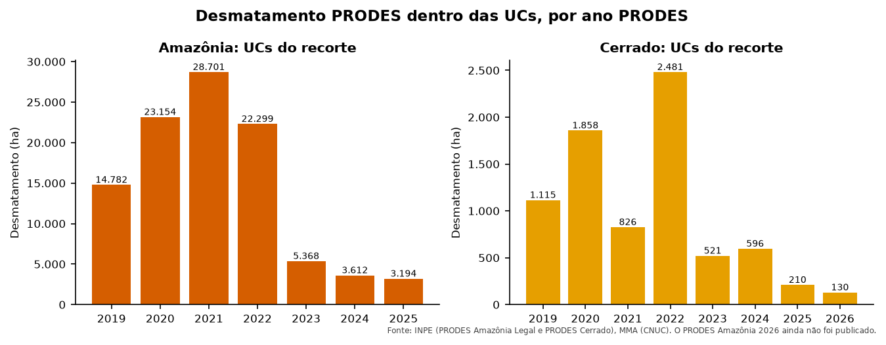

::: {.ficha}
[Nível]{.rotulo} Iniciante
[Leitura]{.rotulo} 9 min
[Dados]{.rotulo} outubro de 2026
[Programas]{.rotulo} [ArcGIS]{.selo-texto} {fig-alt="QGIS"} {fig-alt="PostGIS"} {fig-alt="Python"}
:::

O **PRODES** é a taxa oficial de desmatamento do Brasil. Sai uma vez por ano para cada bioma, e o
"ano PRODES" vai de agosto a julho. Quando o INPE publica um ano novo, a pergunta é sempre a mesma:
**quanto foi desmatado dentro de cada UC?**

Eu tinha um script para a Amazônia e outro, quase idêntico, para o Cerrado. Aqui é **um código só**:
a camada do PRODES e o recorte de UCs viram parâmetros.

## O que você vai fazer

1. **Filtrar** os polígonos de desmatamento e corrigir as geometrias.
2. **Cruzar** com as UCs de cada bioma (interseção).
3. **Medir** a área em hectares.
4. **Resumir:** tabela do último ano por UC e série histórica.
5. **Atualizar** quando sair um ano novo, sem duplicar.

::: {.callout-note}
## Dados
Camadas `prodes_amz`, `prodes_cerrado` e `ucs` do GeoPackage dos artigos
([como baixar](sobre.qmd#dados)). As duas camadas do PRODES têm os mesmos campos (`year`, `main_class`,
`area_km`), por isso o mesmo código serve para as duas. Os serviços WFS são:

- Amazônia: `https://terrabrasilis.dpi.inpe.br/geoserver/prodes-legal-amz/ows`, camada `prodes-legal-amz:yearly_deforestation`
- Cerrado: `https://terrabrasilis.dpi.inpe.br/geoserver/prodes-cerrado-nb/ows`, camada `prodes-cerrado-nb:yearly_deforestation`
:::

## O código

::: {.panel-tabset group="programa"}

## ArcGIS Pro

```python
import arcpy

arcpy.env.overwriteOutput = True
gpkg = r"C:\dados\artigos.gpkg"
gdb = r"C:\dados\resultados.gdb"

biomas = [("Amazônia", "main.prodes_amz", "Amazonia"),
          ("Cerrado", "main.prodes_cerrado", "Cerrado")]
partes = []

for bioma, camada, regiao in biomas:
    # 1. Desmatamento (o campo vem em maiúsculas e minúsculas) e geometrias corrigidas
    prodes = arcpy.analysis.Select(gpkg + "\\" + camada, rf"memory\prodes_{regiao}",
                                   "UPPER(main_class) = 'DESMATAMENTO'")
    arcpy.management.RepairGeometry(prodes)
    ucs = arcpy.analysis.Select(gpkg + r"\main.ucs", rf"memory\ucs_{regiao}",
                                f"regiao = '{regiao}'")

    # 2 e 3. Interseção e área geodésica
    cruzado = arcpy.analysis.PairwiseIntersect([prodes, ucs], rf"memory\cruzado_{regiao}")
    arcpy.management.CalculateGeometryAttributes(
        cruzado, [["area_ha", "AREA_GEODESIC"]], area_unit="HECTARES")
    arcpy.management.CalculateField(cruzado, "bioma", f"'{bioma}'", "PYTHON3",
                                    field_type="TEXT")
    partes.append(cruzado)

prodes_ucs = arcpy.management.Merge(partes, gdb + r"\prodes_ucs")

# 4. Série histórica por bioma e ano, e tabela por UC
arcpy.analysis.Statistics(prodes_ucs, gdb + r"\prodes_serie",
                          [["area_ha", "SUM"]], ["bioma", "year"])
arcpy.analysis.Statistics(prodes_ucs, gdb + r"\prodes_por_uc",
                          [["area_ha", "SUM"]], ["bioma", "year", "nome_uc", "grupo"])

# Último ano de cada bioma
for bioma, _, _ in biomas:
    anos = [r[0] for r in arcpy.da.SearchCursor(prodes_ucs, ["year"], f"bioma = '{bioma}'")]
    arcpy.AddMessage(f"{bioma}: último ano = {max(anos)}")
```

## QGIS

```python
import processing
G = "C:/dados/artigos.gpkg"

def rodar(alg, **p):
    p.setdefault("OUTPUT", "memory:")
    return processing.run(alg, p)["OUTPUT"]

partes = []
for bioma, camada, regiao in [("Amazônia", "prodes_amz", "Amazonia"),
                              ("Cerrado", "prodes_cerrado", "Cerrado")]:
    # 1. Desmatamento e geometrias corrigidas
    prodes = rodar("native:extractbyexpression", INPUT=f"{G}|layername={camada}",
                   EXPRESSION="upper(main_class) = 'DESMATAMENTO'")
    prodes = rodar("native:fixgeometries", INPUT=prodes)
    ucs = rodar("native:extractbyexpression", INPUT=f"{G}|layername=ucs",
                EXPRESSION=f"regiao = '{regiao}'")

    # 2 e 3. Interseção, área em hectares e bioma
    cruzado = rodar("native:intersection", INPUT=prodes, OVERLAY=ucs,
                    INPUT_FIELDS=["year"], OVERLAY_FIELDS=["cnuc", "nome_uc", "grupo"])
    cruzado = rodar("native:fieldcalculator", INPUT=cruzado, FIELD_NAME="area_ha",
                    FIELD_TYPE=0, FIELD_PRECISION=4,
                    FORMULA="area(transform($geometry, 'EPSG:4674', 'ESRI:102033')) / 10000")
    cruzado = rodar("native:fieldcalculator", INPUT=cruzado, FIELD_NAME="bioma",
                    FIELD_TYPE=2, FIELD_LENGTH=10, FORMULA=f"'{bioma}'")
    partes.append(cruzado)

prodes_ucs = rodar("native:mergevectorlayers", LAYERS=partes, CRS="EPSG:4674")

# 4. Soma por bioma, ano e UC; depois, só o último ano de cada bioma
por_uc = rodar("qgis:statisticsbycategories", INPUT=prodes_ucs, VALUES_FIELD_NAME="area_ha",
               CATEGORIES_FIELD_NAME=["bioma", "year", "nome_uc"])
ultimo = rodar("native:extractbyexpression", INPUT=por_uc,
               EXPRESSION='"year" = maximum("year", group_by:="bioma")')
for f in ultimo.getFeatures():
    print(f["bioma"], f["year"], f["nome_uc"], round(f["sum"], 1))
```

O truque está na última expressão: `maximum("year", group_by:="bioma")` calcula o maior ano **de cada
bioma**, e a mesma ideia funciona na Calculadora de campo e em filtros de camada.

## PostGIS

```sql
-- 1 a 3. Os dois biomas numa tabela só
DROP TABLE IF EXISTS artigos.prodes_ucs;
CREATE TABLE artigos.prodes_ucs AS
WITH prodes AS (
    SELECT 'Amazônia' AS bioma, 'Amazonia' AS regiao, year AS ano,
           ST_CollectionExtract(ST_MakeValid(geom), 3) AS geom
    FROM artigos.prodes_amz
    WHERE upper(main_class) = 'DESMATAMENTO'
    UNION ALL
    SELECT 'Cerrado', 'Cerrado', year,
           ST_CollectionExtract(ST_MakeValid(geom), 3)
    FROM artigos.prodes_cerrado
    WHERE upper(main_class) = 'DESMATAMENTO'
)
SELECT p.bioma, p.ano, u.cnuc, u.nome_uc, u.grupo,
       ST_Intersection(p.geom, u.geom) AS geom
FROM prodes p
JOIN artigos.ucs u ON u.regiao = p.regiao AND ST_Intersects(p.geom, u.geom)
WHERE NOT ST_IsEmpty(p.geom);

ALTER TABLE artigos.prodes_ucs ADD COLUMN area_ha numeric;
UPDATE artigos.prodes_ucs SET area_ha = ST_Area(geom::geography) / 10000;

-- 4a. Último ano de cada bioma, por UC
SELECT bioma, ano, nome_uc, grupo, count(*) AS poligonos, round(sum(area_ha), 1) AS area_ha
FROM artigos.prodes_ucs p
WHERE ano = (SELECT max(ano) FROM artigos.prodes_ucs q WHERE q.bioma = p.bioma)
GROUP BY bioma, ano, nome_uc, grupo
ORDER BY bioma, area_ha DESC;

-- 4b. Série histórica
SELECT ano,
       round(sum(area_ha) FILTER (WHERE bioma = 'Amazônia')) AS amazonia_ha,
       round(sum(area_ha) FILTER (WHERE bioma = 'Cerrado')) AS cerrado_ha
FROM artigos.prodes_ucs
GROUP BY ano
ORDER BY ano;
```

## Python

```python
import geopandas as gpd
import pandas as pd

G = "dados/artigos.gpkg"
ucs = gpd.read_file(G, layer="ucs")

def corrigir(gdf):
    gdf["geometry"] = gdf.make_valid(method="structure", keep_collapsed=False)
    return gdf[~gdf.is_empty]

def prodes_em_ucs(camada, regiao, bioma):
    """Cruza uma camada do PRODES com as UCs de uma região e mede em hectares."""
    prodes = gpd.read_file(G, layer=camada)
    prodes = corrigir(prodes[prodes["main_class"].str.upper() == "DESMATAMENTO"])
    u = ucs[ucs["regiao"] == regiao][["cnuc", "nome_uc", "grupo", "geometry"]]
    x = gpd.overlay(prodes[["year", "geometry"]], u, how="intersection", keep_geom_type=True)
    x["area_ha"] = x.to_crs("ESRI:102033").area / 10_000
    return x.assign(bioma=bioma).rename(columns={"year": "ano"})

prodes_ucs = pd.concat([prodes_em_ucs("prodes_amz", "Amazonia", "Amazônia"),
                        prodes_em_ucs("prodes_cerrado", "Cerrado", "Cerrado")])

# 4a. Último ano de cada bioma, por UC
ultimo = prodes_ucs[prodes_ucs["ano"] == prodes_ucs.groupby("bioma")["ano"].transform("max")]
print(ultimo.groupby(["bioma", "ano", "nome_uc", "grupo"])
            .agg(poligonos=("area_ha", "size"), area_ha=("area_ha", "sum"))
            .round(1).sort_values("area_ha", ascending=False))

# 4b. Série histórica
print(prodes_ucs.pivot_table(index="ano", columns="bioma", values="area_ha",
                             aggfunc="sum").round())
```

:::

## Conferindo o resultado

As três versões testadas (QGIS, PostGIS e Python) deram os mesmos totais, com diferença menor que 0,1%.

{fig-alt="Dois gráficos de barras lado a lado. À esquerda, Amazônia: o desmatamento nas UCs do recorte passa de 20 mil hectares em 2020 e 2021 e cai para menos de 5 mil em 2025. À direita, Cerrado: valores menores, entre 130 e 2.500 hectares por ano, com pico em 2022."}

| Bioma | Ano PRODES | UC | Grupo | Polígonos | Área (ha) |
|---|---|---|---|---:|---:|
| Amazônia | 2025 | Floresta Nacional do Jamanxim | Uso Sustentável | 120 | 1.569,7 |
| Amazônia | 2025 | Área de Proteção Ambiental do Tapajós | Uso Sustentável | 69 | 1.251,6 |
| Amazônia | 2025 | Floresta Nacional de Altamira | Uso Sustentável | 35 | 269,5 |
| Amazônia | 2025 | Floresta Estadual de Iriri | Uso Sustentável | 9 | 59,4 |
| Amazônia | 2025 | Parque Nacional do Jamanxim | Proteção Integral | 3 | 27,0 |
| Amazônia | 2025 | Parque Nacional do Rio Novo | Proteção Integral | 4 | 16,7 |
| Cerrado | 2026 | Área de Proteção Ambiental Pouso Alto | Uso Sustentável | 37 | 129,7 |

: Último ano PRODES disponível em cada bioma (consulta de outubro de 2026). O PRODES Cerrado 2026 já estava publicado; o da Amazônia, ainda não. {.striped}

O Parque Nacional da Chapada dos Veadeiros não teve desmatamento PRODES em 2026. Repare também que, nos
dois biomas, quase todo o desmatamento em UCs está nas de **Uso Sustentável**, onde há moradores e
atividades permitidas.

## Atualizar quando sair um ano novo

O INPE às vezes **republica** um ano (com correções). Se o seu script só acrescenta linhas, o mesmo ano
aparece duas vezes e a área dobra. A regra é: **apague o ano e insira de novo**, numa transação.

::: {.panel-tabset group="programa"}

## ArcGIS Pro

```python
ano = 2025
tabela = gdb + r"\prodes_ucs_historico"
with arcpy.da.UpdateCursor(tabela, ["year"], f"year = {ano} AND bioma = 'Amazônia'") as cur:
    for _ in cur:
        cur.deleteRow()
novos = arcpy.analysis.Select(prodes_ucs, r"memory\novos", f"year = {ano} AND bioma = 'Amazônia'")
arcpy.management.Append(novos, tabela, "NO_TEST")
```

## QGIS

No QGIS, o mais seguro é **regravar a camada inteira** a cada atualização (o cruzamento leva segundos).
Para editar uma tabela que já existe, selecione o ano com **Selecionar por expressão**
(`"year" = 2025`), apague as feições selecionadas e use **Editar → Colar feições** com os dados novos.

## PostGIS

```sql
BEGIN;
DELETE FROM artigos.prodes_ucs WHERE bioma = 'Amazônia' AND ano = 2025;
INSERT INTO artigos.prodes_ucs (bioma, ano, cnuc, nome_uc, grupo, geom, area_ha)
SELECT bioma, ano, cnuc, nome_uc, grupo, geom, area_ha
FROM artigos.prodes_ucs_novo            -- o mesmo cruzamento, só com o ano novo
WHERE bioma = 'Amazônia' AND ano = 2025;
COMMIT;
```

Se algo der errado entre o `DELETE` e o `INSERT`, o `ROLLBACK` desfaz tudo e a tabela não fica pela metade.

## Python

```python
historico = gpd.read_file("dados/prodes_ucs_historico.gpkg")
ano, bioma = 2025, "Amazônia"
novos = prodes_ucs[(prodes_ucs["ano"] == ano) & (prodes_ucs["bioma"] == bioma)]
historico = pd.concat([historico[~((historico["ano"] == ano) & (historico["bioma"] == bioma))],
                       novos])
historico.to_file("dados/prodes_ucs_historico.gpkg")
```

:::

O artigo [Atualizar camadas sem duplicar](13-atualizar-camadas.qmd) detalha esse padrão.

## Armadilhas

::: {.callout-warning}
## Maiúsculas e minúsculas
No recorte da Amazônia, 3 polígonos de 2024 vêm com `main_class = 'desmatamento'` (minúsculo) e 1.635
com `'DESMATAMENTO'`. Um filtro `main_class = 'DESMATAMENTO'` perde os três. Compare sempre com
`UPPER(...)`.
:::

::: {.callout-warning}
## Geometrias inválidas no PRODES
2.263 dos 11.126 polígonos do PRODES Amazônia do recorte (20%) são inválidos. O script antigo tinha a
linha `RepairGeometry` comentada, e funcionava por sorte. Corrija sempre antes do cruzamento.
:::

::: {.callout-tip}
## `area_km` já vem na tabela, por que recalcular?
O `area_km` do INPE é a área do polígono **inteiro**. Depois da interseção, um polígono que cruza o
limite da UC fica só com a parte de dentro, e o `area_km` original fica errado. Recalcule sempre depois
de cortar.
:::

## Veja também

- [Interior e entorno das UCs](02-interior-entorno.qmd)
- [Tabela mensal acumulada](06-tabela-mensal-acumulada.qmd), para o DETER, que sai todo dia

::: {.navegacao-livro}
[[← Anterior]{.direcao} Interior e entorno das UCs: o cruzamento que todo relatório usa](02-interior-entorno.qmd){.anterior}
[[Próximo →]{.direcao} Focos de calor das últimas 24 e 48 horas nas UCs](04-focos-calor.qmd){.proximo}
:::

## Atualizações {.unnumbered}

- **29/10/2026:** publicação, com dados do INPE, do MMA, do IBAMA e do SICAR de outubro de 2026.

[English version](https://hendesson.github.io/en/articles/03-prodes-protected-areas.html)
