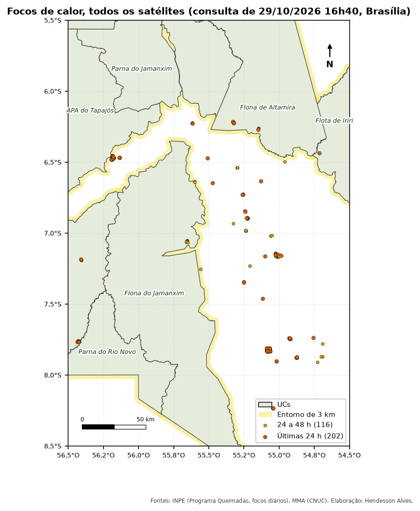

::: {.ficha}
[Nível]{.rotulo} Iniciante
[Leitura]{.rotulo} 9 min
[Dados]{.rotulo} outubro de 2026
[Programas]{.rotulo} [ArcGIS]{.selo-texto} {fig-alt="QGIS"} {fig-alt="PostGIS"} {fig-alt="Python"}
:::

Na época seca, as equipes de brigada começam o dia com uma pergunta: **onde apareceu fogo nas UCs
desde ontem?** O INPE publica os focos de calor detectados por vários satélites várias vezes por hora,
em arquivos abertos.

O script que eu usava lia os focos do *Living Atlas* do ArcGIS Online e só funcionava com uma conta da
instituição. Aqui os focos vêm direto do **servidor do INPE**, sem login.

{fig-alt="Mapa da região de Novo Progresso com as UCs em verde claro, a faixa de entorno em amarelo e focos de calor como pontos: vermelhos nas últimas 24 horas e laranja entre 24 e 48 horas. A maior concentração está na Área de Proteção Ambiental do Tapajós."}

## De onde vêm os focos

| Fonte | Endereço | Atualização |
|---|---|---|
| **INPE, arquivo diário** | `https://dataserver-coids.inpe.br/queimadas/queimadas/focos/csv/diario/Brasil/focos_diario_br_AAAAMMDD.csv` | o do dia vai crescendo ao longo do dia |
| INPE, a cada 10 minutos | `https://dataserver-coids.inpe.br/queimadas/queimadas/focos/csv/10min/` | 10 minutos |
| NASA FIRMS (VIIRS e MODIS) | `https://firms.modaps.eosdis.nasa.gov/data/active_fire/suomi-npp-viirs-c2/csv/SUOMI_VIIRS_C2_South_America_48h.csv` | algumas horas; também há `_24h` e `_7d` |

O arquivo do INPE tem uma linha por foco, com `lat`, `lon`, `data_hora_gmt`, `satelite`, `municipio`,
`estado`, `bioma` e outros campos.

::: {.callout-important}
## Foco de calor não é área queimada
Um foco é um **pixel quente** visto por um satélite num instante. O mesmo incêndio aparece como dezenas
de focos, e um mesmo foco pode ser visto por vários satélites. Use os focos para **alertar** e para
comparar períodos com o **satélite de referência** (`AQUA_M-T`). Para área queimada, veja as cicatrizes
de queimada do DETER ou o MapBiomas Fogo.
:::

## O que você vai fazer

1. Baixar os arquivos de **hoje, ontem e anteontem** (para cobrir 48 horas completas).
2. Transformar `lon` e `lat` em **pontos** (SIRGAS 2000).
3. Filtrar pela **hora** (em UTC, como vem no arquivo).
4. Descobrir **em qual UC** (ou entorno) cada foco caiu.
5. Contar por UC, janela de tempo e satélite.

## O código

::: {.panel-tabset group="programa"}

## ArcGIS Pro

```python
import arcpy
import urllib.request
from datetime import datetime, timedelta, timezone

arcpy.env.overwriteOutput = True
gpkg = r"C:\dados\artigos.gpkg"
pasta = r"C:\dados\focos"
url = ("https://dataserver-coids.inpe.br/queimadas/queimadas/focos/csv/diario/"
       "Brasil/focos_diario_br_{}.csv")

# 1 e 2. Baixar os três dias e criar os pontos
agora = datetime.now(timezone.utc)
pontos = []
for i in range(3):
    dia = (agora - timedelta(days=i)).strftime("%Y%m%d")
    csv = rf"{pasta}\focos_{dia}.csv"
    urllib.request.urlretrieve(url.format(dia), csv)
    pontos.append(arcpy.management.XYTableToPoint(
        csv, rf"memory\focos_{dia}", "lon", "lat",
        coordinate_system=arcpy.SpatialReference(4674)))
focos = arcpy.management.Merge(pontos, r"memory\focos")

# 3 e 4. UC de cada foco e filtro das últimas 48 horas
focos_ucs = arcpy.analysis.PairwiseIntersect([focos, gpkg + r"\main.ucs"], r"memory\focos_ucs")
corte_48h = (agora - timedelta(hours=48)).strftime("%Y-%m-%d %H:%M:%S")
ultimos = arcpy.analysis.Select(focos_ucs, r"C:\dados\resultados.gdb\focos_ucs_48h",
                                f"data_hora_gmt >= timestamp '{corte_48h}'")

# 5. Contagem por UC e satélite
arcpy.analysis.Statistics(ultimos, r"C:\dados\resultados.gdb\focos_por_uc",
                          [["id", "COUNT"]], ["nome_uc", "satelite"])
```

::: {.callout-note}
O `XYTableToPoint` lê o `data_hora_gmt` como texto ou como data, conforme a versão do ArcGIS Pro. Se o
`Select` não encontrar nada, confira o tipo do campo e troque o filtro por
`data_hora_gmt >= '{corte_48h}'`, que compara o texto.
:::

## QGIS

```python
import os, tempfile, urllib.request
from datetime import datetime, timedelta, timezone
import processing

G = "C:/dados/artigos.gpkg"
url = ("https://dataserver-coids.inpe.br/queimadas/queimadas/focos/csv/diario/"
       "Brasil/focos_diario_br_{}.csv")

def rodar(alg, **p):
    p.setdefault("OUTPUT", "memory:")
    return processing.run(alg, p)["OUTPUT"]

# 1 e 2. Baixar os três dias e abrir como camada de pontos (texto delimitado)
agora = datetime.now(timezone.utc)
camadas = []
for i in range(3):
    dia = (agora - timedelta(days=i)).strftime("%Y%m%d")
    csv = os.path.join(tempfile.gettempdir(), f"focos_{dia}.csv")
    urllib.request.urlretrieve(url.format(dia), csv)
    uri = (f"file:///{csv}?delimiter=,&xField=lon&yField=lat&crs=EPSG:4674"
           "&field=data_hora_gmt:text")
    camadas.append(QgsVectorLayer(uri, f"focos_{dia}", "delimitedtext"))
focos = rodar("native:mergevectorlayers", LAYERS=camadas, CRS="EPSG:4674")

# 3. Últimas 48 horas (texto no formato AAAA-MM-DD HH:MM:SS se compara como data)
corte = (agora - timedelta(hours=48)).strftime("%Y-%m-%d %H:%M:%S")
focos = rodar("native:extractbyexpression", INPUT=focos,
              EXPRESSION=f"\"data_hora_gmt\" >= '{corte}'")

# 4. UC de cada foco (predicado 5 = "está dentro")
focos_ucs = rodar("native:joinattributesbylocation", INPUT=focos,
                  JOIN=f"{G}|layername=ucs", PREDICATE=[5], JOIN_FIELDS=["nome_uc"],
                  METHOD=0, DISCARD_NONMATCHING=True)

# 5. Contagem por UC e satélite
resumo = rodar("qgis:statisticsbycategories", INPUT=focos_ucs,
               CATEGORIES_FIELD_NAME=["nome_uc", "satelite"])
for f in resumo.getFeatures():
    print(f["nome_uc"], f["satelite"], f["count"])
QgsProject.instance().addMapLayer(focos_ucs)
```

O `&field=data_hora_gmt:text` no endereço da camada obriga o QGIS a ler a data como texto, e assim o
filtro funciona igual em qualquer idioma do sistema.

## PostGIS

```sql
-- 1. Tabela para os focos e carga dos três arquivos (o \copy roda no seu computador)
DROP TABLE IF EXISTS artigos.focos;
CREATE TABLE artigos.focos (
    id text, lat numeric, lon numeric, data_hora_gmt timestamp,
    satelite text, municipio text, estado text, pais text,
    municipio_id bigint, estado_id int, pais_id int,
    numero_dias_sem_chuva numeric, precipitacao numeric, risco_fogo numeric,
    bioma text, frp numeric
);
\copy artigos.focos FROM PROGRAM 'curl -s https://dataserver-coids.inpe.br/queimadas/queimadas/focos/csv/diario/Brasil/focos_diario_br_$(date -u +%Y%m%d).csv' CSV HEADER
\copy artigos.focos FROM PROGRAM 'curl -s https://dataserver-coids.inpe.br/queimadas/queimadas/focos/csv/diario/Brasil/focos_diario_br_$(date -u -d yesterday +%Y%m%d).csv' CSV HEADER
\copy artigos.focos FROM PROGRAM 'curl -s https://dataserver-coids.inpe.br/queimadas/queimadas/focos/csv/diario/Brasil/focos_diario_br_$(date -u -d "2 days ago" +%Y%m%d).csv' CSV HEADER

-- 2. Pontos
ALTER TABLE artigos.focos ADD COLUMN geom geometry(Point, 4674);
UPDATE artigos.focos SET geom = ST_SetSRID(ST_MakePoint(lon, lat), 4674);
CREATE INDEX ON artigos.focos USING gist (geom);

-- 3 a 5. Focos em UCs nas últimas 24 e 48 horas (hora em UTC)
SELECT u.nome_uc,
       count(*) FILTER (WHERE f.data_hora_gmt >= (now() AT TIME ZONE 'UTC') - interval '24 hours') AS focos_24h,
       count(*) AS focos_48h,
       count(*) FILTER (WHERE f.satelite = 'AQUA_M-T') AS focos_48h_referencia
FROM artigos.focos f
JOIN artigos.ucs u ON ST_Within(f.geom, u.geom)
WHERE f.data_hora_gmt >= (now() AT TIME ZONE 'UTC') - interval '48 hours'
GROUP BY u.nome_uc
ORDER BY focos_48h DESC;
```

::: {.callout-note}
O `\copy … FROM PROGRAM` precisa do `curl` e, no Windows, troque o `$(date …)` pela data escrita à
mão. Outra opção é baixar os arquivos antes e usar `\copy artigos.focos FROM 'focos.csv' CSV HEADER`.
:::

## Python

```python
from datetime import datetime, timedelta, timezone
import pandas as pd
import geopandas as gpd

url = ("https://dataserver-coids.inpe.br/queimadas/queimadas/focos/csv/diario/"
       "Brasil/focos_diario_br_{}.csv")

# 1. Baixar hoje, ontem e anteontem
agora = datetime.now(timezone.utc)
dias = [(agora - timedelta(days=i)).strftime("%Y%m%d") for i in range(3)]
focos = pd.concat([pd.read_csv(url.format(d)) for d in dias], ignore_index=True)
focos["data_hora_gmt"] = pd.to_datetime(focos["data_hora_gmt"], utc=True)

# 2. Pontos e 3. últimas 48 horas
focos = gpd.GeoDataFrame(focos, geometry=gpd.points_from_xy(focos.lon, focos.lat), crs=4674)
focos = focos[focos["data_hora_gmt"] >= agora - timedelta(hours=48)]
focos["janela"] = (focos["data_hora_gmt"] >= agora - timedelta(hours=24)).map(
    {True: "últimas 24 h", False: "24 a 48 h"})

# 4. Em qual UC (ou entorno) caiu cada foco
G = "dados/artigos.gpkg"
zonas = pd.concat([
    gpd.read_file(G, layer="ucs")[["nome_uc", "geometry"]].assign(local="interior"),
    gpd.read_file(G, layer="ucs_entorno")[["nome_uc", "geometry"]].assign(local="entorno"),
])
focos_ucs = gpd.sjoin(focos, zonas, predicate="within")

# 5. Contagem
print(pd.crosstab([focos_ucs["nome_uc"], focos_ucs["local"]], focos_ucs["janela"],
                  margins=True, margins_name="total"))
print(focos_ucs[focos_ucs["satelite"] == "AQUA_M-T"].groupby("nome_uc").size())
focos_ucs.to_file("dados/focos_ucs_48h.gpkg")
```

:::

## Conferindo o resultado

Os números mudam a cada execução. Na tarde de 29/10/2026, as três versões testadas encontraram os mesmos
focos dentro das UCs do recorte:

| UC | Últimas 24 h | Últimas 48 h | 48 h, só `AQUA_M-T` | Entorno, 48 h |
|---|---:|---:|---:|---:|
| Área de Proteção Ambiental do Tapajós | 17 | 34 | 5 | 41 |
| Floresta Nacional de Altamira | 5 | 8 | 4 | 0 |
| Floresta Nacional do Jamanxim | 0 | 8 | 0 | 3 |
| Floresta Estadual de Iriri | 1 | 1 | 0 | 0 |
| Área de Proteção Ambiental Pouso Alto (Cerrado) | 1 | 1 | 0 | 0 |

: Focos de calor no interior e no entorno das UCs, consulta de 29/10/2026 às 16h40 (Brasília). {.striped}

Os mesmos 52 focos no interior das UCs, nas três versões. A diferença entre a coluna de todos os
satélites (34) e a do satélite de referência (5) na APA do Tapajós mostra por que não se deve somar
satélites para comparar períodos.

## Rodar sozinho todo dia

Este é o tipo de script que vale **agendar**:

- **Windows:** Agendador de Tarefas, chamando `propy.bat script.py` (ArcGIS Pro) ou `python script.py`.
- **ArcGIS Pro 3.x:** botão direito na ferramenta de script → **Agendar**.
- **Linux/Mac:** `crontab -e` e uma linha como `0 7 * * * cd /dados && python focos.py`.

Para não acumular linhas repetidas a cada execução, veja
[Atualizar camadas sem duplicar](13-atualizar-camadas.qmd).

## Armadilhas

::: {.callout-warning}
## Hora em UTC
O campo `data_hora_gmt` está em **UTC** (Brasília = UTC−3). Se você filtrar "últimas 24 horas" com a
hora do relógio do computador, perde ou ganha 3 horas de focos. Calcule o corte em UTC, como nos
códigos acima.
:::

::: {.callout-warning}
## Contar focos de todos os satélites
No mesmo dia, o recorte teve focos de 7 satélites. Somar todos dá um número maior, que muda conforme os
satélites em operação. Para comparar anos ou meses, use só o `AQUA_M-T` (satélite de referência). Para
alertar a brigada, use todos.
:::

::: {.callout-warning}
## O arquivo de hoje está incompleto
O arquivo do dia corrente vai crescendo ao longo do dia. Por isso o código baixa **três** arquivos: só
assim as últimas 48 horas ficam completas a qualquer hora.
:::

## Veja também

- [Interior e entorno das UCs](02-interior-entorno.qmd), para montar a camada de entorno
- [Fontes de dados](../guia-espacial/guia/03-fontes-de-dados.qmd), com o BDQueimadas e o MapBiomas Fogo

::: {.navegacao-livro}
[[← Anterior]{.direcao} Desmatamento anual do PRODES nas UCs da Amazônia e do Cerrado](03-prodes-ucs.qmd){.anterior}
[[Próximo →]{.direcao} Ano, mês e ano PRODES: campos de data em cada programa](05-campos-de-data.qmd){.proximo}
:::

## Atualizações {.unnumbered}

- **29/10/2026:** publicação, com dados do INPE, do MMA, do IBAMA e do SICAR de outubro de 2026.

[English version](https://hendesson.github.io/en/articles/04-fire-hotspots.html)
