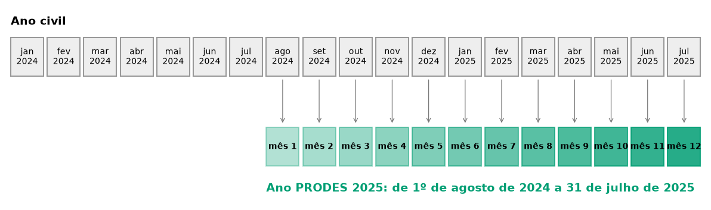

::: {.ficha}
[Nível]{.rotulo} Iniciante
[Leitura]{.rotulo} 6 min
[Dados]{.rotulo} outubro de 2026
[Programas]{.rotulo} [ArcGIS]{.selo-texto} {fig-alt="QGIS"} {fig-alt="PostGIS"} {fig-alt="Python"} {fig-alt="Power BI"}
:::

Todo painel de monitoramento precisa quebrar as datas em pedaços: **ano**, **mês**, **nome do mês** e,
no caso do desmatamento, o **ano PRODES**, que vai de **1º de agosto a 31 de julho**. O "PRODES 2025"
começa em agosto de 2024.

Nos scripts antigos, cada pedaço era uma função com um `UpdateCursor`, repetida em vários arquivos. Aqui
cada um vira **uma linha** em cada programa.

{fig-alt="Duas réguas de meses. Na de cima, o ano civil de janeiro a dezembro. Na de baixo, o ano PRODES 2025, de agosto de 2024 (mês 1) a julho de 2025 (mês 12), com setas ligando os meses correspondentes."}

## As regras

| Campo | Regra | 15/03/2025 | 20/09/2025 |
|---|---|---|---|
| `ano` | ano da data | 2025 | 2025 |
| `mes` | mês da data | 3 | 9 |
| `mes_nome` | nome do mês, por uma lista fixa | Março | Setembro |
| `ano_prodes` | ano + 1 se o mês for agosto ou depois | 2025 | **2026** |
| `mes_prodes` | agosto = 1 … julho = 12, ou `(mes + 4) % 12 + 1` | 8 | 2 |

O `%` é o **resto da divisão**: `(9 + 4) % 12 + 1` = `13 % 12 + 1` = `1 + 1` = 2.

::: {.callout-warning}
## Nome do mês pelo idioma do computador
O script antigo usava `strftime("%B")`, que devolve o nome do mês **no idioma do sistema**: "março" num
computador em português, "March" num servidor em inglês. Num painel, isso mistura idiomas. Use uma
**lista fixa** de nomes, como nos códigos abaixo.
:::

## O código

Os exemplos usam a camada `deter` (campo `view_date`) do GeoPackage dos artigos
([como baixar](sobre.qmd#dados)).

::: {.panel-tabset group="programa"}

## ArcGIS Pro

```python
import arcpy

fc = r"C:\dados\resultados.gdb\deter"
arcpy.management.CopyFeatures(r"C:\dados\artigos.gpkg\main.deter", fc)

meses = ("['Janeiro','Fevereiro','Março','Abril','Maio','Junho','Julho',"
         "'Agosto','Setembro','Outubro','Novembro','Dezembro']")

arcpy.management.CalculateFields(fc, "PYTHON3", [
    ["ano",        "!view_date!.year"],
    ["mes",        "!view_date!.month"],
    ["mes_nome",   f"{meses}[!view_date!.month - 1]"],
    ["ano_prodes", "!view_date!.year + (1 if !view_date!.month >= 8 else 0)"],
    ["mes_prodes", "(!view_date!.month + 4) % 12 + 1"],
])
```

`CalculateFields` (no plural) calcula vários campos de uma vez e cria os que não existem. No ArcMap, use
um `CalculateField_management` para cada campo, com `"PYTHON_9.3"`.

## QGIS

Na **Calculadora de campo**, crie cada campo com a expressão:

| Campo | Tipo | Expressão |
|---|---|---|
| `ano` | inteiro | `year("view_date")` |
| `mes` | inteiro | `month("view_date")` |
| `mes_nome` | texto | `array_get(array('Janeiro','Fevereiro','Março','Abril','Maio','Junho','Julho','Agosto','Setembro','Outubro','Novembro','Dezembro'), month("view_date") - 1)` |
| `ano_prodes` | inteiro | `year("view_date") + if(month("view_date") >= 8, 1, 0)` |
| `mes_prodes` | inteiro | `(month("view_date") + 4) % 12 + 1` |

No console Python, os mesmos cinco campos numa sequência:

```python
import processing
G = "C:/dados/artigos.gpkg"

campos = [
    ("ano", 1, 'year("view_date")'),
    ("mes", 1, 'month("view_date")'),
    ("mes_nome", 2, "array_get(array('Janeiro','Fevereiro','Março','Abril','Maio','Junho',"
                    "'Julho','Agosto','Setembro','Outubro','Novembro','Dezembro'), "
                    'month("view_date") - 1)'),
    ("ano_prodes", 1, 'year("view_date") + if(month("view_date") >= 8, 1, 0)'),
    ("mes_prodes", 1, '(month("view_date") + 4) % 12 + 1'),
]
camada = f"{G}|layername=deter"
for nome, tipo, formula in campos:          # tipo: 1 = inteiro, 2 = texto
    camada = processing.run("native:fieldcalculator", {
        "INPUT": camada, "FIELD_NAME": nome, "FIELD_TYPE": tipo, "FIELD_LENGTH": 12,
        "FORMULA": formula, "OUTPUT": "memory:"})["OUTPUT"]

resumo = processing.run("qgis:statisticsbycategories", {
    "INPUT": camada, "CATEGORIES_FIELD_NAME": ["ano_prodes"], "OUTPUT": "memory:"})["OUTPUT"]
for f in resumo.getFeatures():
    print(f["ano_prodes"], f["count"])
```

## PostGIS

```sql
SELECT view_date,
       extract(year FROM view_date)::int                                   AS ano,
       extract(month FROM view_date)::int                                  AS mes,
       (ARRAY['Janeiro','Fevereiro','Março','Abril','Maio','Junho','Julho',
              'Agosto','Setembro','Outubro','Novembro','Dezembro'])
           [extract(month FROM view_date)::int]                            AS mes_nome,
       extract(year FROM view_date + interval '5 months')::int             AS ano_prodes,
       (extract(month FROM view_date)::int + 4) % 12 + 1                   AS mes_prodes
FROM artigos.deter
LIMIT 5;

-- Conferência: alertas por ano PRODES
SELECT extract(year FROM view_date + interval '5 months')::int AS ano_prodes, count(*)
FROM artigos.deter
GROUP BY 1
ORDER BY 1;
```

O truque do `+ interval '5 months'`: somar 5 meses a qualquer data de agosto a dezembro empurra a data
para o ano seguinte, e as de janeiro a julho continuam no mesmo ano. É exatamente a regra do ano PRODES.

## Python

```python
import geopandas as gpd

deter = gpd.read_file("dados/artigos.gpkg", layer="deter")
data = deter["view_date"].astype("datetime64[ns]")

MESES = ["Janeiro", "Fevereiro", "Março", "Abril", "Maio", "Junho", "Julho",
         "Agosto", "Setembro", "Outubro", "Novembro", "Dezembro"]

deter["ano"] = data.dt.year
deter["mes"] = data.dt.month
deter["mes_nome"] = deter["mes"].map(lambda m: MESES[m - 1])
deter["ano_prodes"] = deter["ano"] + (deter["mes"] >= 8).astype(int)
deter["mes_prodes"] = (deter["mes"] + 4) % 12 + 1

print(deter[["view_date", "ano", "mes", "mes_nome", "ano_prodes", "mes_prodes"]].head())
print(deter.groupby("ano_prodes").size())
```

## Power BI

No **Power Query** (Página Inicial → Transformar dados), em **Adicionar Coluna → Coluna Personalizada**:

```
// ano_prodes
Date.Year([view_date]) + (if Date.Month([view_date]) >= 8 then 1 else 0)

// mes_prodes
Number.Mod(Date.Month([view_date]) + 4, 12) + 1

// mes_nome (lista fixa, não depende do idioma)
{"Janeiro","Fevereiro","Março","Abril","Maio","Junho","Julho",
 "Agosto","Setembro","Outubro","Novembro","Dezembro"}{Date.Month([view_date]) - 1}
```

Ou em **DAX**, como coluna calculada da tabela de calendário:

```
Ano PRODES = YEAR ( dim_calendario[data] ) + IF ( MONTH ( dim_calendario[data] ) >= 8, 1, 0 )
Mês PRODES = MOD ( MONTH ( dim_calendario[data] ) + 4, 12 ) + 1
```

Para ordenar os meses na ordem do ano PRODES nos gráficos, selecione a coluna `mes_nome` e use
**Classificar por coluna → mes_prodes**.

:::

## Conferindo o resultado

As versões do QGIS, do PostGIS e do Python deram a mesma contagem de alertas por ano PRODES:

| Ano PRODES | Período | Alertas DETER no recorte |
|---|---|---:|
| 2024 | jan. a jul. 2024 (o download começa em 2024) | 639 |
| 2025 | ago. 2024 a jul. 2025 | 5.787 |
| 2026 | ago. 2025 a jul. 2026 | 595 |
| 2027 | ago. a out. 2026 (em andamento) | 802 |

: Alertas do DETER por ano PRODES, todas as classes. {.striped}

O pico de 2025 são **5.127 cicatrizes de queimada** da seca de 2024. Separando por classe, os alertas
de desmatamento por corte raso (`DESMATAMENTO_CR`) foram 431 em 2025 e 300 em 2026. Por isso os painéis
quase sempre separam **desmatamento** de **queimada**.

## Primeiro e último dia do período

Duas perguntas que também aparecem muito: "qual o primeiro e o último alerta da camada?" (para o título
do relatório) e "qual o último dia do mês?" (para saber se o mês já fechou).

| | Primeira e última data | Último dia do mês |
|---|---|---|
| ArcGIS Pro | `min()`/`max()` sobre `arcpy.da.SearchCursor(fc, ["view_date"])` | `calendar.monthrange(ano, mes)[1]` |
| QGIS | `minimum("view_date")`, `maximum("view_date")` | `make_date(year(d), month(d), 1) + '1 month' - '1 day'` |
| PostGIS | `min(view_date)`, `max(view_date)` | `(date_trunc('month', d) + interval '1 month - 1 day')::date` |
| Python | `deter["view_date"].min()` | `data + pd.offsets.MonthEnd(0)` |
| Power BI (DAX) | `MIN()`, `MAX()` | `EOMONTH ( data, 0 )` |

## Veja também

- [Tabela mensal acumulada](06-tabela-mensal-acumulada.qmd), que usa esses campos
- [Módulo 7 do curso: Power BI](../guia-espacial/curso/07-power-bi.qmd), com a tabela de calendário

::: {.navegacao-livro}
[[← Anterior]{.direcao} Focos de calor das últimas 24 e 48 horas nas UCs](04-focos-calor.qmd){.anterior}
[[Próximo →]{.direcao} Tabela mensal acumulada do DETER, com os meses zerados](06-tabela-mensal-acumulada.qmd){.proximo}
:::

## Atualizações {.unnumbered}

- **29/10/2026:** publicação, com dados do INPE, do MMA, do IBAMA e do SICAR de outubro de 2026.

[English version](https://hendesson.github.io/en/articles/05-date-fields.html)
