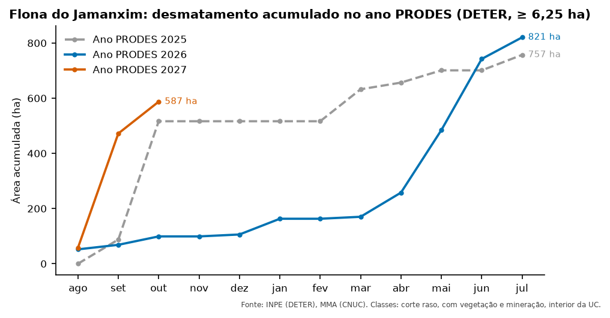

::: {.ficha}
[Nível]{.rotulo} Intermediário
[Leitura]{.rotulo} 9 min
[Dados]{.rotulo} outubro de 2026
[Programas]{.rotulo} [ArcGIS]{.selo-texto} {fig-alt="QGIS"} {fig-alt="PostGIS"} {fig-alt="Python"} {fig-alt="Power BI"}
:::

O gráfico mais pedido num painel de desmatamento é a **curva acumulada**: quanto já foi desmatado
desde o começo do ano PRODES, mês a mês, comparando com os anos anteriores.

Para desenhar essa curva, a tabela precisa de **uma linha para cada UC, ano e mês**, inclusive os meses
**sem nenhum alerta** (com zero). Sem eles, a linha do gráfico pula meses e o acumulado fica errado. O
script que eu usava fazia isso com `itertools.product`, `merge` e `cumsum` do pandas, depois de várias
etapas no `arcpy`.

{fig-alt="Gráfico de linhas com três anos PRODES. O eixo horizontal vai de agosto a julho. A linha de 2025 termina em 757 hectares e a de 2026, em 821. A de 2027 só vai até outubro, com 587 hectares, porque os meses seguintes ainda não aconteceram."}

## O que você vai fazer

1. **Filtrar** os alertas de desmatamento (corte raso, com vegetação e mineração), no interior, com
   pelo menos 6,25 ha.
2. Calcular **ano PRODES** e **mês PRODES** (veja [Campos de data](05-campos-de-data.qmd)).
3. Montar a **grade completa**: todas as UCs × todos os anos × 12 meses.
4. **Somar** a área de cada mês e preencher os vazios com **zero**.
5. **Acumular** dentro de cada UC e ano.
6. Marcar como **não válidos** os meses depois do último dado (para o gráfico não desenhar uma linha
   reta até julho).

```{mermaid}
%%| eval: true
%%| fig-cap: "Da soma por mês à tabela completa"
flowchart LR
    A["Alertas<br/>filtrados"] --> B["Soma por<br/>UC, ano, mês"]
    G["Grade:<br/>UC × ano × 12 meses"] --> C["Junção<br/>(vazios = 0)"]
    B --> C
    C --> D["Acumulado<br/>no ano"]
    D --> E["valido = falso<br/>depois do último mês"]
```

## Dados

Use a camada **`deter_interior_entorno`** criada no artigo [Interior e entorno das UCs](02-interior-entorno.qmd)
(ela já tem `nome_uc`, `local` e `area_ha`).

## O código

::: {.panel-tabset group="programa"}

## ArcGIS Pro

O `arcpy` não tem uma ferramenta para "completar a grade". A saída é a mesma do script original: somar
com o `arcpy` e completar com o pandas, que já vem no Python do ArcGIS Pro.

```python
import arcpy
import numpy as np
import pandas as pd

gdb = r"C:\dados\resultados.gdb"
fc = gdb + r"\deter_interior_entorno"
filtro = ("classname IN ('DESMATAMENTO_CR', 'DESMATAMENTO_VEG', 'MINERACAO') "
          "AND local = 'interior' AND area_ha >= 6.25")

# 1 e 2. Ler a tabela filtrada para o pandas
linhas = arcpy.da.SearchCursor(fc, ["nome_uc", "view_date", "area_ha"], filtro)
d = pd.DataFrame(list(linhas), columns=["nome_uc", "view_date", "area_ha"])
data = pd.to_datetime(d["view_date"])
d["ano_prodes"] = data.dt.year + (data.dt.month >= 8)
d["mes_prodes"] = (data.dt.month + 4) % 12 + 1

# 3 e 4. Grade completa e soma por mês (vazios = 0)
soma = d.groupby(["nome_uc", "ano_prodes", "mes_prodes"])["area_ha"].sum()
grade = pd.MultiIndex.from_product(
    [sorted(d["nome_uc"].unique()), sorted(d["ano_prodes"].unique()), range(1, 13)],
    names=soma.index.names)
tabela = soma.reindex(grade, fill_value=0).reset_index()

# 5. Acumulado
tabela["acumulado_ha"] = tabela.groupby(["nome_uc", "ano_prodes"])["area_ha"].cumsum()

# 6. Meses depois do último dado
ultimo = max(r[0] for r in arcpy.da.SearchCursor(fc, ["view_date"]))
ano_u, mes_u = ultimo.year + (ultimo.month >= 8), (ultimo.month + 4) % 12 + 1
tabela["valido"] = ~((tabela["ano_prodes"] == ano_u) & (tabela["mes_prodes"] > mes_u))

# Gravar como tabela do geodatabase
arr = np.rec.fromrecords(tabela.astype({"nome_uc": "U120", "valido": "int16"}).values,
                         names=list(tabela.columns))
arcpy.da.NumPyArrayToTable(arr, gdb + r"\deter_mensal_acumulado")
```

## QGIS

No QGIS, o caminho mais direto é uma **camada virtual**: uma consulta SQL (SQLite) sobre as camadas
abertas, sem banco de dados. Abra **Camada → Adicionar camada → Adicionar/Editar camada virtual**,
importe a camada `deter_interior_entorno` e cole a consulta. Ou, no console:

```python
consulta = """
WITH alertas AS (
    SELECT nome_uc,
           CAST(strftime('%Y', view_date) AS INTEGER)
             + (CAST(strftime('%m', view_date) AS INTEGER) >= 8)          AS ano_prodes,
           (CAST(strftime('%m', view_date) AS INTEGER) + 4) % 12 + 1      AS mes_prodes,
           area_ha
    FROM deter
    WHERE classname IN ('DESMATAMENTO_CR', 'DESMATAMENTO_VEG', 'MINERACAO')
      AND local = 'interior' AND area_ha >= 6.25
),
meses(mes_prodes) AS (SELECT 1 UNION ALL SELECT mes_prodes + 1 FROM meses WHERE mes_prodes < 12),
grade AS (
    SELECT u.nome_uc, a.ano_prodes, m.mes_prodes
    FROM (SELECT DISTINCT nome_uc FROM alertas) u,
         (SELECT DISTINCT ano_prodes FROM alertas) a, meses m
),
mensal AS (
    SELECT g.nome_uc, g.ano_prodes, g.mes_prodes, coalesce(sum(a.area_ha), 0) AS area_ha
    FROM grade g
    LEFT JOIN alertas a USING (nome_uc, ano_prodes, mes_prodes)
    GROUP BY g.nome_uc, g.ano_prodes, g.mes_prodes
),
ultimo AS (
    SELECT CAST(strftime('%Y', max(view_date)) AS INTEGER)
             + (CAST(strftime('%m', max(view_date)) AS INTEGER) >= 8)      AS ano,
           (CAST(strftime('%m', max(view_date)) AS INTEGER) + 4) % 12 + 1 AS mes
    FROM deter
)
SELECT m.*,
       sum(m.area_ha) OVER (PARTITION BY m.nome_uc, m.ano_prodes
                            ORDER BY m.mes_prodes) AS acumulado_ha,
       NOT (m.ano_prodes = u.ano AND m.mes_prodes > u.mes) AS valido
FROM mensal m, ultimo u
ORDER BY m.nome_uc, m.ano_prodes, m.mes_prodes
"""
deter = QgsVectorLayer("C:/dados/deter_interior_entorno.gpkg", "deter", "ogr")
QgsProject.instance().addMapLayer(deter)
tabela = QgsVectorLayer(f"?query={consulta}", "deter_mensal_acumulado", "virtual")
QgsProject.instance().addMapLayer(tabela)
print(tabela.featureCount(), "linhas")
```

A camada virtual é recalculada sempre que a camada de origem muda, e pode ser exportada como CSV ou
GeoPackage (**botão direito → Exportar**).

## PostGIS

```sql
CREATE OR REPLACE VIEW artigos.deter_mensal_acumulado AS
WITH alertas AS (
    SELECT nome_uc,
           extract(year FROM view_date + interval '5 months')::int AS ano_prodes,
           (extract(month FROM view_date)::int + 4) % 12 + 1      AS mes_prodes,
           area_ha
    FROM artigos.deter_interior_entorno
    WHERE classname IN ('DESMATAMENTO_CR', 'DESMATAMENTO_VEG', 'MINERACAO')
      AND local = 'interior' AND area_ha >= 6.25
),
grade AS (
    SELECT u.nome_uc, a.ano_prodes, m.mes_prodes
    FROM (SELECT DISTINCT nome_uc FROM alertas) u
    CROSS JOIN (SELECT DISTINCT ano_prodes FROM alertas) a
    CROSS JOIN generate_series(1, 12) AS m(mes_prodes)
),
mensal AS (
    SELECT g.nome_uc, g.ano_prodes, g.mes_prodes, coalesce(sum(a.area_ha), 0) AS area_ha
    FROM grade g
    LEFT JOIN alertas a USING (nome_uc, ano_prodes, mes_prodes)
    GROUP BY g.nome_uc, g.ano_prodes, g.mes_prodes
),
ultimo AS (
    SELECT extract(year FROM max(view_date) + interval '5 months')::int AS ano,
           (extract(month FROM max(view_date))::int + 4) % 12 + 1      AS mes
    FROM artigos.deter_interior_entorno
)
SELECT m.nome_uc, m.ano_prodes, m.mes_prodes, round(m.area_ha, 2) AS area_ha,
       round(sum(m.area_ha) OVER (PARTITION BY m.nome_uc, m.ano_prodes
                                  ORDER BY m.mes_prodes), 2) AS acumulado_ha,
       NOT (m.ano_prodes = u.ano AND m.mes_prodes > u.mes) AS valido
FROM mensal m, ultimo u;

SELECT * FROM artigos.deter_mensal_acumulado
WHERE nome_uc = 'FLORESTA NACIONAL DO JAMANXIM' AND ano_prodes = 2027
ORDER BY mes_prodes;
```

## Python

```python
import geopandas as gpd
import pandas as pd

todos = gpd.read_file("dados/deter_interior_entorno.gpkg")
d = todos[todos["classname"].isin(["DESMATAMENTO_CR", "DESMATAMENTO_VEG", "MINERACAO"])
          & (todos["local"] == "interior") & (todos["area_ha"] >= 6.25)].copy()

# 2. Ano e mês PRODES
data = pd.to_datetime(d["view_date"])
d["ano_prodes"] = data.dt.year + (data.dt.month >= 8)
d["mes_prodes"] = (data.dt.month + 4) % 12 + 1

# 3 e 4. Grade completa e soma por mês (vazios = 0)
soma = d.groupby(["nome_uc", "ano_prodes", "mes_prodes"])["area_ha"].sum()
grade = pd.MultiIndex.from_product(
    [sorted(d["nome_uc"].unique()), sorted(d["ano_prodes"].unique()), range(1, 13)],
    names=soma.index.names)
tabela = soma.reindex(grade, fill_value=0).reset_index()

# 5. Acumulado no ano PRODES
tabela["acumulado_ha"] = tabela.groupby(["nome_uc", "ano_prodes"])["area_ha"].cumsum()

# 6. Meses depois do último dado
ultimo = pd.to_datetime(todos["view_date"]).max()
ano_u, mes_u = ultimo.year + (ultimo.month >= 8), (ultimo.month + 4) % 12 + 1
tabela["valido"] = ~((tabela["ano_prodes"] == ano_u) & (tabela["mes_prodes"] > mes_u))

tabela.round(2).to_csv("dados/deter_mensal_acumulado.csv", index=False)
print(tabela.query("nome_uc == 'FLORESTA NACIONAL DO JAMANXIM' and ano_prodes == 2027").round(2))
```

## Power BI

No Power BI, a grade completa e o acumulado saem do **modelo**, sem tabela pronta: basta uma tabela de
calendário (`dim_calendario`) ligada aos alertas pela data.

```
Área (ha) = SUM ( fato_deter[area_ha] ) + 0

Área acumulada no ano PRODES (ha) =
CALCULATE ( [Área (ha)], DATESYTD ( dim_calendario[data], "07-31" ) )

Área acumulada (só meses com dado) =
IF ( MAX ( dim_calendario[data] ) <= MAX ( fato_deter[view_date] ),
     [Área acumulada no ano PRODES (ha)] )
```

- O `+ 0` faz os meses sem alerta aparecerem como zero.
- O `"07-31"` diz ao `DATESYTD` que o ano termina em **31 de julho**: é o ano PRODES.
- A terceira medida devolve vazio depois do último alerta, o equivalente à coluna `valido`.

:::

## Conferindo o resultado

As versões do QGIS (camada virtual), do PostGIS e do Python deram a mesma tabela: 288 linhas,
e os mesmos valores. O ano PRODES 2027 na Floresta Nacional do Jamanxim ficou assim:

| Mês PRODES | Mês | Área no mês (ha) | Acumulado (ha) | `valido` |
|---:|---|---:|---:|---|
| 1 | agosto | 57,7 | 57,7 | sim |
| 2 | setembro | 414,4 | 472,1 | sim |
| 3 | outubro | 115,3 | 587,4 | sim |
| 4 | novembro | 0 | 587,4 | não |
| … | … | 0 | 587,4 | não |
| 12 | julho | 0 | 587,4 | não |

: Floresta Nacional do Jamanxim, ano PRODES 2027 (agosto de 2026 a julho de 2027). {.striped}

Em três meses, o acumulado já chegou a 587 ha, contra 757 ha no ano PRODES 2025 inteiro e 821 ha no
2026. O ano PRODES 2024 aparece incompleto na tabela, porque os dados baixados começam em janeiro de 2024.

## De onde veio o "6,25 ha"

O filtro de área mínima vem do script original e acompanha a área mínima mapeada pelo PRODES. O DETER
tem alertas menores, de até 3 ha. Ao mudar esse corte, a curva muda, então deixe-o escrito no painel.

## Classes em colunas

Outro script da pasta transformava as classes do DETER em colunas (`DCR_AREA`, `MIN_AREA`, …) e trocava
os vazios por zero. É a mesma ideia com outra cara: uma **tabela dinâmica**.

| Programa | Como |
|---|---|
| ArcGIS Pro | `arcpy.management.PivotTable(tabela, ["nome_uc"], "classname", "area_ha", saida)` |
| QGIS | camada virtual com `sum(CASE WHEN classname = 'MINERACAO' THEN area_ha ELSE 0 END) AS min_area` |
| PostGIS | `sum(area_ha) FILTER (WHERE classname = 'MINERACAO') AS min_area` |
| Python | `d.pivot_table(index="nome_uc", columns="classname", values="area_ha", aggfunc="sum", fill_value=0)` |
| Power BI | matriz com `classname` nas colunas; não precisa pivotar |

## Veja também

- [Campos de data](05-campos-de-data.qmd)
- [Módulo 7 do curso: Power BI](../guia-espacial/curso/07-power-bi.qmd)

::: {.navegacao-livro}
[[← Anterior]{.direcao} Ano, mês e ano PRODES: campos de data em cada programa](05-campos-de-data.qmd){.anterior}
[[Próximo →]{.direcao} Trazer informações de outra tabela: junções e listas de valores](07-juntar-atributos.qmd){.proximo}
:::

## Atualizações {.unnumbered}

- **29/10/2026:** publicação, com dados do INPE, do MMA, do IBAMA e do SICAR de outubro de 2026.
