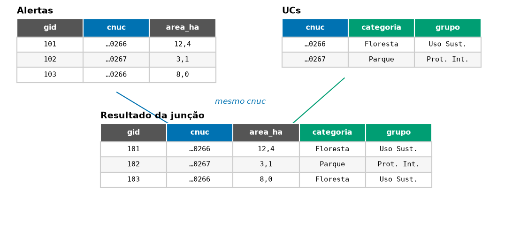

::: {.ficha}
[Nível]{.rotulo} Iniciante
[Leitura]{.rotulo} 6 min
[Dados]{.rotulo} outubro de 2026
[Programas]{.rotulo} [ArcGIS]{.selo-texto} {fig-alt="QGIS"} {fig-alt="PostGIS"} {fig-alt="Python"}
:::

Duas tarefas aparecem em quase todo script de monitoramento:

1. **Junção por campo:** a camada de alertas tem o código da UC (`cnuc`), e você quer trazer a
   categoria, o grupo e a esfera, que estão na camada de UCs.
2. **Lista de valores:** uma linha por UC com **todos** os municípios onde houve alerta, separados por
   vírgula. No meu script, era a lista de e-mails dos responsáveis por cada alerta.

Nos scripts antigos, a junção era feita com um dicionário e dois cursores, **repetidos para cada campo**,
e a lista de valores com uma função de 80 linhas. Em cada programa, as duas tarefas cabem em poucas linhas.

{fig-alt="Duas tabelas. À esquerda, alertas com as colunas gid, cnuc e area_ha. À direita, UCs com cnuc, categoria e grupo. Setas ligam os cnuc iguais, e o resultado embaixo tem as colunas das duas tabelas."}

## Dados

Camada `deter_interior_entorno` (do artigo [Interior e entorno](02-interior-entorno.qmd)) e camada `ucs`
do GeoPackage dos artigos. Os municípios vêm do campo `municipality` do DETER.

## O código

::: {.panel-tabset group="programa"}

## ArcGIS Pro

```python
import arcpy

gpkg = r"C:\dados\artigos.gpkg"
gdb = r"C:\dados\resultados.gdb"
alertas = gdb + r"\deter_interior_entorno"

# 1. Junção por campo: uma linha resolve
arcpy.management.JoinField(alertas, "cnuc", gpkg + r"\main.ucs", "cnuc",
                           ["categoria", "grupo", "esfera"])

# 2. Lista de municípios por UC: estatística CONCATENATE (ArcGIS Pro 3.2 ou mais novo)
arcpy.analysis.Statistics(alertas, gdb + r"\municipios_por_uc",
                          [["municipality", "UNIQUE"], ["municipality", "CONCATENATE"]],
                          ["nome_uc"], concatenation_separator=", ")
```

Se o `JoinField` ficar lento em tabelas grandes, o padrão dos scripts antigos (dicionário + cursor) é
mais rápido, mas escreva **um dicionário para todos os campos**, não um por campo:

```python
campos = ["categoria", "grupo", "esfera"]
ucs = {linha[0]: linha[1:] for linha in
       arcpy.da.SearchCursor(gpkg + r"\main.ucs", ["cnuc"] + campos)}

for c in campos:
    arcpy.management.AddField(alertas, c, "TEXT")
with arcpy.da.UpdateCursor(alertas, ["cnuc"] + campos) as cursor:
    for linha in cursor:
        if linha[0] in ucs:
            cursor.updateRow([linha[0], *ucs[linha[0]]])
```

Nas versões antigas do Pro (sem `CONCATENATE`), monte a lista com um dicionário de conjuntos:

```python
from collections import defaultdict
lista = defaultdict(set)
for uc, mun in arcpy.da.SearchCursor(alertas, ["nome_uc", "municipality"]):
    if mun:
        lista[uc].add(mun)
municipios = {uc: ", ".join(sorted(m)) for uc, m in lista.items()}
```

## QGIS

**Pelos menus:** propriedades da camada de alertas → **Uniões** → `+`, camada `ucs`, campo `cnuc` nos
dois lados. Para gravar a união de vez, use **Unir atributos pelo valor do campo** na Caixa de
Ferramentas. Para a lista, **Agregar** com a função `concatenate_unique`.

```python
import processing
G = "C:/dados/artigos.gpkg"

# 1. Junção por campo
alertas = processing.run("native:joinattributestable", {
    "INPUT": "C:/dados/deter_interior_entorno.gpkg",
    "FIELD": "cnuc", "INPUT_2": f"{G}|layername=ucs", "FIELD_2": "cnuc",
    "FIELDS_TO_COPY": ["categoria", "grupo", "esfera"], "METHOD": 1,   # 1 = só a primeira
    "OUTPUT": "memory:"})["OUTPUT"]

# 2. Uma linha por UC, com a lista de municípios e o total de área
municipios = processing.run("native:aggregate", {
    "INPUT": alertas, "GROUP_BY": "nome_uc",
    "AGGREGATES": [
        {"aggregate": "first_value", "input": '"nome_uc"', "name": "nome_uc",
         "type": 10, "length": 120, "precision": 0, "delimiter": ""},
        {"aggregate": "first_value", "input": '"categoria"', "name": "categoria",
         "type": 10, "length": 80, "precision": 0, "delimiter": ""},
        {"aggregate": "concatenate_unique", "input": '"municipality"', "name": "municipios",
         "type": 10, "length": 500, "precision": 0, "delimiter": ", "},
        {"aggregate": "sum", "input": '"area_ha"', "name": "area_ha",
         "type": 6, "length": 0, "precision": 2, "delimiter": ""},
    ],
    "OUTPUT": "memory:"})["OUTPUT"]

for f in municipios.getFeatures():
    print(f["nome_uc"], "|", f["categoria"], "|", f["municipios"], "|", round(f["area_ha"]))
```

Na Calculadora de campo **da camada de UCs**, a mesma lista sai com uma expressão (as UCs sem alerta ficam vazias):
`aggregate('deter_interior_entorno', 'concatenate_unique', "municipality", filter:="nome_uc" = attribute(@parent, 'nome_uc'), concatenator:=', ')`.

## PostGIS

```sql
-- 1. Junção por campo
SELECT a.gid, a.nome_uc, a.local, a.area_ha, u.categoria, u.grupo, u.esfera
FROM artigos.deter_interior_entorno a
JOIN artigos.ucs u USING (cnuc)
LIMIT 5;

-- 2. Uma linha por UC, com a lista de municípios
SELECT a.nome_uc, u.categoria,
       string_agg(DISTINCT a.municipality, ', ' ORDER BY a.municipality) AS municipios,
       round(sum(a.area_ha)) AS area_ha
FROM artigos.deter_interior_entorno a
JOIN artigos.ucs u USING (cnuc)
GROUP BY a.nome_uc, u.categoria
ORDER BY area_ha DESC;
```

## Python

```python
import geopandas as gpd

alertas = gpd.read_file("dados/deter_interior_entorno.gpkg")
ucs = gpd.read_file("dados/artigos.gpkg", layer="ucs")

# 1. Junção por campo (validate confere que cada cnuc aparece uma vez só nas UCs)
alertas = alertas.merge(ucs[["cnuc", "categoria", "grupo", "esfera"]],
                        on="cnuc", how="left", validate="many_to_one")

# 2. Uma linha por UC, com a lista de municípios
lista = lambda s: ", ".join(sorted(s.dropna().unique()))
municipios = (alertas.groupby("nome_uc")
              .agg(categoria=("categoria", "first"), municipios=("municipality", lista),
                   area_ha=("area_ha", "sum"))
              .round(0).sort_values("area_ha", ascending=False))
print(municipios.to_string())
```

:::

## Conferindo o resultado

As três versões testadas deram as mesmas listas e a mesma área (o PostGIS difere em menos de 0,1%,
pela forma de medir, como no artigo 2):

| UC | Categoria | Municípios com alertas | Área de alertas (ha) |
|---|---|---|---:|
| Floresta Nacional do Jamanxim | Floresta | Itaituba, Novo Progresso | 167.584 |
| Floresta Nacional de Altamira | Floresta | Altamira, Itaituba | 66.310 |
| Parque Nacional do Jamanxim | Parque | Itaituba, Trairao | 33.286 |
| Área de Proteção Ambiental do Tapajós | Área de Proteção Ambiental | Itaituba, Novo Progresso | 22.855 |
| Parque Nacional do Rio Novo | Parque | Itaituba, Novo Progresso | 10.924 |
| Floresta Estadual de Iriri | Floresta | Altamira | 467 |

: Interior e entorno somados, todas as classes do DETER. {.striped}

Repare em "Trairao", sem til: é assim que o nome vem no DETER. Mais um motivo para juntar tabelas por
**código**, e não por nome. O `concatenate_unique` do QGIS lista os nomes na ordem em que aparecem; para
ordem alfabética, use na Calculadora de campo
`array_to_string(array_sort(array_distinct(array_agg("municipality", group_by:="nome_uc"))), ', ')`.

## Armadilhas

::: {.callout-warning}
## Chave repetida multiplica linhas
Se o `cnuc` aparecer duas vezes na camada de UCs (por exemplo, uma UC partida em dois polígonos), cada
alerta é copiado duas vezes e a área dobra. O `validate="many_to_one"` do pandas acusa o erro; no
PostGIS, confira com `SELECT cnuc, count(*) FROM artigos.ucs GROUP BY cnuc HAVING count(*) > 1`; no
QGIS, use `METHOD = 1` (só a primeira correspondência).
:::

::: {.callout-warning}
## Juntar pelo nome em vez do código
Os scripts antigos às vezes ligavam as tabelas pelo **nome da UC**. Um acento ou uma letra maiúscula
diferente (`Floresta Nacional` × `FLORESTA NACIONAL`) e a junção falha sem avisar. Use sempre um código
(`cnuc`, código do IBGE, número do embargo).
:::

::: {.callout-tip}
## Excluir linhas repetidas
Para manter **uma linha por alerta** depois de concatenar (o `DeleteIdentical` do ArcGIS), use
`native:removeduplicatesbyattribute` no QGIS, `DISTINCT ON (gid)` no PostGIS e
`drop_duplicates("gid")` no pandas.
:::

## Veja também

- [Do ArcMap ao QGIS: a tabela de equivalências](01-equivalencias.qmd)
- [Módulo 2 do curso: JOINs e agregações](../guia-espacial/curso/02-joins-e-agregacoes.qmd)

::: {.navegacao-livro}
[[← Anterior]{.direcao} Tabela mensal acumulada do DETER, com os meses zerados](06-tabela-mensal-acumulada.qmd){.anterior}
[[Próximo →]{.direcao} Imóveis do CAR dentro das UCs: selecionar e medir a sobreposição](08-car-ucs.qmd){.proximo}
:::

## Atualizações {.unnumbered}

- **29/10/2026:** publicação, com dados do INPE, do MMA, do IBAMA e do SICAR de outubro de 2026.
