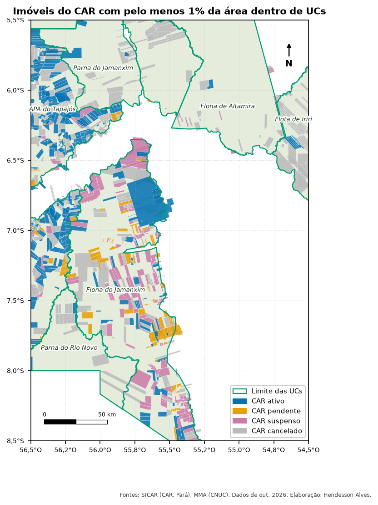

::: {.ficha}
[Nível]{.rotulo} Intermediário
[Leitura]{.rotulo} 8 min
[Dados]{.rotulo} outubro de 2026
[Programas]{.rotulo} [ArcGIS]{.selo-texto} {fig-alt="QGIS"} {fig-alt="PostGIS"} {fig-alt="Python"}
:::

O **Cadastro Ambiental Rural (CAR)** é autodeclarado: o próprio dono desenha o imóvel. Por isso aparecem
imóveis **dentro** de Unidades de Conservação, inclusive de Proteção Integral, onde não poderia haver
propriedade privada. Saber onde isso acontece ajuda a priorizar a regularização fundiária e a
fiscalização.

O script que eu usava só **selecionava** os imóveis que tocavam as UCs. Aqui você também vai medir
**quanto** de cada imóvel e de cada UC está sobreposto, o que separa o imóvel que só encosta no limite
do que está inteiro lá dentro.

{fig-alt="Mapa da região de Novo Progresso. As UCs aparecem com contorno verde e os imóveis do CAR como polígonos coloridos: ativos em azul, pendentes em laranja, suspensos em roxo e cancelados em cinza. Há muitos imóveis dentro da Floresta Nacional do Jamanxim e da APA do Tapajós."}

## De onde vem o CAR

O SICAR publica os imóveis de cada estado num serviço **WFS** aberto:

- Endereço: `https://geoserver.car.gov.br/geoserver/sicar/wfs`
- Camadas: `sicar:sicar_imoveis_pa`, `sicar:sicar_imoveis_mt` etc. (uma por UF)

Os campos mais úteis são `cod_imovel`, `status_imovel` (`AT` ativo, `PE` pendente, `SU` suspenso,
`CA` cancelado), `tipo_imovel` (`IRU` imóvel rural, `AST` assentamento, `PCT` povos e comunidades
tradicionais), `condicao` e `area` (área declarada, em hectares). O script dos artigos baixa os imóveis
do recorte para a camada `car` ([como baixar](sobre.qmd#dados)).

::: {.callout-note}
O **SIGEF** (imóveis certificados pelo INCRA) tem a mesma estrutura de uso: troque a camada `car` pela
do SIGEF e o código abaixo funciona igual. Os arquivos ficam no Acervo Fundiário do INCRA
(`https://acervofundiario.incra.gov.br`).
:::

## O que você vai fazer

1. **Selecionar** os imóveis que tocam as UCs (o que o script antigo fazia).
2. **Cortar** cada imóvel pelas UCs e medir a área sobreposta.
3. Calcular a **porcentagem** do imóvel que está dentro da UC e descartar quem só encosta.
4. Resumir por UC: número de imóveis por situação e **área da UC coberta por CAR**, sem contar duas
   vezes os imóveis que se sobrepõem entre si.

## O código

::: {.panel-tabset group="programa"}

## ArcGIS Pro

```python
import arcpy

arcpy.env.overwriteOutput = True
gpkg = r"C:\dados\artigos.gpkg"
gdb = r"C:\dados\resultados.gdb"
ucs = arcpy.analysis.Select(gpkg + r"\main.ucs", r"memory\ucs", "regiao = 'Amazonia'")

# 1. Seleção por localização (o que o script antigo fazia)
car = arcpy.management.MakeFeatureLayer(gpkg + r"\main.car", "car")
arcpy.management.SelectLayerByLocation(car, "INTERSECT", ucs)
arcpy.management.CopyFeatures(car, gdb + r"\car_toca_ucs")

# 2 e 3. Interseção, área sobreposta e porcentagem do imóvel
arcpy.management.CalculateGeometryAttributes(
    gdb + r"\car_toca_ucs", [["area_imovel_ha", "AREA_GEODESIC"]], area_unit="HECTARES")
car_ucs = arcpy.analysis.PairwiseIntersect([gdb + r"\car_toca_ucs", ucs], gdb + r"\car_ucs")
arcpy.management.CalculateGeometryAttributes(
    car_ucs, [["sobreposicao_ha", "AREA_GEODESIC"]], area_unit="HECTARES")
arcpy.management.CalculateField(car_ucs, "pct_imovel",
                                "100 * !sobreposicao_ha! / !area_imovel_ha!", "PYTHON3",
                                field_type="DOUBLE")

# 4. Resumo por UC e situação (só quem tem pelo menos 1% dentro)
dentro = arcpy.analysis.Select(car_ucs, r"memory\dentro", "pct_imovel >= 1")
arcpy.analysis.Statistics(dentro, gdb + r"\car_por_uc",
                          [["cod_imovel", "COUNT"], ["sobreposicao_ha", "SUM"]],
                          ["nome_uc", "status_imovel"])

# Área da UC coberta por CAR, sem contar sobreposições entre imóveis
coberta = arcpy.analysis.PairwiseDissolve(dentro, r"memory\coberta", ["nome_uc"])
arcpy.management.CalculateGeometryAttributes(
    coberta, [["coberta_ha", "AREA_GEODESIC"]], area_unit="HECTARES")
```

## QGIS

```python
import processing
G = "C:/dados/artigos.gpkg"
AREA = "area(transform($geometry, 'EPSG:4674', 'ESRI:102033')) / 10000"

def rodar(alg, **p):
    p.setdefault("OUTPUT", "memory:")
    return processing.run(alg, p)["OUTPUT"]

ucs = rodar("native:extractbyexpression", INPUT=f"{G}|layername=ucs",
            EXPRESSION="regiao = 'Amazonia'")

# 1. Seleção por localização (predicado 0 = intersecta)
car = rodar("native:extractbylocation", INPUT=f"{G}|layername=car", INTERSECT=ucs,
            PREDICATE=[0])
print("imóveis que tocam as UCs:", car.featureCount())

# 2 e 3. Área do imóvel, interseção, área sobreposta e porcentagem
car = rodar("native:fieldcalculator", INPUT=car, FIELD_NAME="area_imovel_ha",
            FIELD_TYPE=0, FIELD_PRECISION=4, FORMULA=AREA)
car_ucs = rodar("native:intersection", INPUT=car, OVERLAY=ucs,
                OVERLAY_FIELDS=["cnuc", "nome_uc", "grupo"])
car_ucs = rodar("native:fieldcalculator", INPUT=car_ucs, FIELD_NAME="sobreposicao_ha",
                FIELD_TYPE=0, FIELD_PRECISION=4, FORMULA=AREA)
car_ucs = rodar("native:fieldcalculator", INPUT=car_ucs, FIELD_NAME="pct_imovel",
                FIELD_TYPE=0, FIELD_PRECISION=2,
                FORMULA='100 * "sobreposicao_ha" / "area_imovel_ha"')

# 4. Resumo por UC e situação (pelo menos 1% dentro)
dentro = rodar("native:extractbyexpression", INPUT=car_ucs, EXPRESSION='"pct_imovel" >= 1')
resumo = rodar("qgis:statisticsbycategories", INPUT=dentro, VALUES_FIELD_NAME="sobreposicao_ha",
               CATEGORIES_FIELD_NAME=["nome_uc", "status_imovel"])
for f in resumo.getFeatures():
    print(f["nome_uc"], f["status_imovel"], f["count"], round(f["sum"]))

# Área da UC coberta por CAR, sem contar sobreposições entre imóveis
coberta = rodar("native:dissolve", INPUT=dentro, FIELD=["nome_uc"])
coberta = rodar("native:fieldcalculator", INPUT=coberta, FIELD_NAME="coberta_ha",
                FIELD_TYPE=0, FIELD_PRECISION=1, FORMULA=AREA)
for f in coberta.getFeatures():
    print(f["nome_uc"], "coberta por CAR:", round(f["coberta_ha"]), "ha")
```

## PostGIS

```sql
-- 1 a 3. Imóveis que tocam as UCs, área sobreposta e porcentagem do imóvel
DROP TABLE IF EXISTS artigos.car_ucs;
CREATE TABLE artigos.car_ucs AS
SELECT c.cod_imovel, c.status_imovel, c.tipo_imovel, u.cnuc, u.nome_uc, u.grupo,
       ST_Area(c.geom::geography) / 10000                         AS area_imovel_ha,
       ST_Area(ST_Intersection(c.geom, u.geom)::geography) / 10000 AS sobreposicao_ha,
       ST_Intersection(c.geom, u.geom)                            AS geom
FROM artigos.car c
JOIN artigos.ucs u ON u.regiao = 'Amazonia' AND ST_Intersects(c.geom, u.geom);

ALTER TABLE artigos.car_ucs ADD COLUMN pct_imovel numeric;
UPDATE artigos.car_ucs SET pct_imovel = 100 * sobreposicao_ha / area_imovel_ha;

-- 4. Resumo por UC (só quem tem pelo menos 1% dentro)
SELECT nome_uc, grupo,
       count(*)                                         AS imoveis,
       count(*) FILTER (WHERE status_imovel = 'AT')     AS ativos,
       count(*) FILTER (WHERE status_imovel = 'PE')     AS pendentes,
       count(*) FILTER (WHERE status_imovel = 'SU')     AS suspensos,
       count(*) FILTER (WHERE status_imovel = 'CA')     AS cancelados,
       round(sum(sobreposicao_ha))                      AS soma_sobreposicao_ha,
       round((ST_Area(ST_Union(geom)::geography) / 10000)::numeric) AS coberta_ha
FROM artigos.car_ucs
WHERE pct_imovel >= 1
GROUP BY nome_uc, grupo
ORDER BY coberta_ha DESC;
```

## Python

```python
import geopandas as gpd

G = "dados/artigos.gpkg"
ucs = gpd.read_file(G, layer="ucs").query("regiao == 'Amazonia'")
car = gpd.read_file(G, layer="car")
ALBERS = "ESRI:102033"                       # projeção de área igual

# 1. Seleção por localização
toca = car[car.intersects(ucs.union_all())].copy()
print("imóveis que tocam as UCs:", len(toca))

# 2 e 3. Interseção, área sobreposta e porcentagem do imóvel
toca["area_imovel_ha"] = toca.to_crs(ALBERS).area / 10_000
car_ucs = gpd.overlay(toca, ucs[["cnuc", "nome_uc", "grupo", "geometry"]],
                      how="intersection", keep_geom_type=True)
car_ucs["sobreposicao_ha"] = car_ucs.to_crs(ALBERS).area / 10_000
car_ucs["pct_imovel"] = 100 * car_ucs["sobreposicao_ha"] / car_ucs["area_imovel_ha"]

# 4. Resumo por UC (pelo menos 1% dentro)
dentro = car_ucs[car_ucs["pct_imovel"] >= 1]
resumo = dentro.pivot_table(index="nome_uc", columns="status_imovel", values="cod_imovel",
                            aggfunc="count", fill_value=0)
resumo["soma_sobreposicao_ha"] = dentro.groupby("nome_uc")["sobreposicao_ha"].sum().round()
resumo["coberta_ha"] = (dentro.dissolve("nome_uc").to_crs(ALBERS).area / 10_000).round()
print(resumo.sort_values("coberta_ha", ascending=False))
```

:::

## Conferindo o resultado

As versões do QGIS, do PostGIS e do Python deram os mesmos números de imóveis e as mesmas áreas (o
PostGIS difere em menos de 0,01%). Como o CAR só foi baixado dentro do recorte, as porcentagens são
sobre a parte de cada UC que fica no recorte:

| UC | Grupo | Imóveis (≥ 1% dentro) | Cancelados | Área coberta por CAR (ha) | % da UC no recorte | % sem os cancelados |
|---|---|---:|---:|---:|---:|---:|
| Floresta Nacional do Jamanxim | Uso Sustentável | 415 | 119 | 631.419 | 49% | 37% |
| Área de Proteção Ambiental do Tapajós | Uso Sustentável | 517 | 171 | 511.783 | 72% | 48% |
| Floresta Estadual de Iriri | Uso Sustentável | 70 | 63 | 146.701 | 80% | 4% |
| Parque Nacional do Jamanxim | Proteção Integral | 89 | 80 | 124.953 | 19% | 2% |
| Parque Nacional do Rio Novo | Proteção Integral | 20 | 17 | 51.462 | 17% | 2% |
| Floresta Nacional de Altamira | Uso Sustentável | 40 | 29 | 29.644 | 5% | 1% |

: Imóveis do CAR sobrepostos às UCs do recorte (SICAR, consulta de outubro de 2026). {.striped}

A coluna "sem os cancelados" muda a história: na Floresta Estadual de Iriri, 63 dos 70 cadastros já
foram cancelados, e a cobertura cai de 80% para 4%. Nos dois Parques Nacionais (Proteção Integral),
ainda restam **12 cadastros ativos, pendentes ou suspensos**.

## Armadilhas

::: {.callout-warning}
## "Intersecta" inclui quem só encosta
A seleção por localização com **intersecta** pega também o imóvel desenhado em cima do limite da UC,
com 0,01% de área dentro. No recorte, 1.196 imóveis tocam as UCs, mas só 1.135 têm pelo menos 1%
da área lá dentro. Meça a sobreposição antes de concluir que "há N imóveis na UC".
:::

::: {.callout-warning}
## Imóveis sobrepostos entre si
Como o CAR é autodeclarado, vários imóveis cobrem o mesmo pedaço de terra. Somar a sobreposição de
cada um dá mais área do que existe: compare a coluna de soma com a de área coberta (dissolvida) na
tabela acima.
:::

::: {.callout-warning}
## Cadastros cancelados
Os imóveis com `status_imovel = 'CA'` (cancelados) continuam no serviço. Decida se entram na análise e
escreva isso no relatório. Neste artigo, eles aparecem numa coluna separada.
:::

::: {.callout-note}
## Dados pessoais
O serviço público do SICAR não traz nome nem CPF do proprietário, só o código do imóvel. Mesmo assim,
evite publicar listas de códigos de imóveis com acusações: o CAR sobreposto a uma UC é um indício
para análise, não uma infração comprovada.
:::

## Veja também

- [Interior e entorno das UCs](02-interior-entorno.qmd)
- [Fontes de dados](../guia-espacial/guia/03-fontes-de-dados.qmd), com o CAR, o SIGEF e as Terras Indígenas

::: {.navegacao-livro}
[[← Anterior]{.direcao} Trazer informações de outra tabela: junções e listas de valores](07-juntar-atributos.qmd){.anterior}
[[Próximo →]{.direcao} Densidade Kernel do desmatamento: onde a pressão está concentrada](09-densidade-kernel.qmd){.proximo}
:::

## Atualizações {.unnumbered}

- **29/10/2026:** publicação, com dados do INPE, do MMA, do IBAMA e do SICAR de outubro de 2026.

[English version](https://hendesson.github.io/en/articles/08-car-protected-areas.html)
