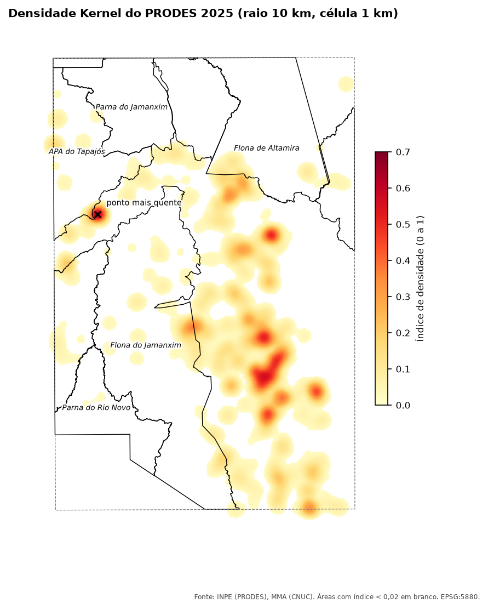

::: {.ficha}
[Nível]{.rotulo} Intermediário
[Leitura]{.rotulo} 11 min
[Dados]{.rotulo} outubro de 2026
[Programas]{.rotulo} [ArcGIS]{.selo-texto} {fig-alt="QGIS"} {fig-alt="PostGIS"} {fig-alt="Python"}
:::

Um mapa com 1.600 polígonos pequenos de desmatamento é difícil de ler. A **densidade Kernel** espalha
cada polígono numa vizinhança e soma tudo numa superfície contínua: o resultado é um **mapa de calor**
que mostra onde o desmatamento está concentrado.

O script que eu usava fazia duas densidades, uma pesada pela **área** dos polígonos e outra só pela
**quantidade**, normalizava cada uma entre 0 e 1 e tirava a média. Assim, tanto uma grande derrubada
quanto muitas pequenas aparecem como "quentes". Depois, calculava a média do índice dentro de cada UC.

{fig-alt="Mapa de calor sobre a região de Novo Progresso, de amarelo-claro a vermelho. A maior parte do calor fica fora das UCs, numa faixa a leste da Floresta Nacional do Jamanxim. O ponto mais quente, marcado com um X, fica na divisa entre a APA do Tapajós e a Floresta Nacional do Jamanxim, a oeste. Os limites das UCs aparecem em preto."}

## Como funciona

```{mermaid}
%%| eval: true
%%| fig-cap: "Do polígono ao índice por UC"
flowchart LR
    A["Polígonos<br/>PRODES 2025"] --> B["Ponto dentro<br/>de cada polígono"]
    B --> C["Kernel pesado<br/>pela área"]
    B --> D["Kernel sem peso<br/>(quantidade)"]
    C --> E["Normalizar<br/>0 a 1"]
    D --> F["Normalizar<br/>0 a 1"]
    E --> G["Média"]
    F --> G
    G --> H["Média por UC"]
```

- **Raio de busca:** até onde cada ponto "espalha" sua influência. Aqui, **10 km**.
- **Tamanho da célula:** a resolução do mapa. Aqui, **1 km**.
- **Núcleo quártico:** o peso cai suavemente do centro (peso máximo) até a borda do raio (zero). É o
  padrão do ArcGIS e do QGIS.
- **Recorte:** só baixamos desmatamento dentro de um retângulo. Fora dele, a densidade daria zero sem
  ser zero, então o mapa e as médias por UC ficam **dentro do recorte**.
- **Normalizar:** `(valor − mínimo) / (máximo − mínimo)`. Cada programa calcula a densidade numa
  escala diferente, mas, depois de normalizar, os resultados ficam comparáveis.

::: {.callout-warning}
## Trabalhe em metros
O script antigo usava raio de `0,777` e célula de `0,0015`, em **graus**. Um grau de longitude mede
cerca de 111 km no Equador e menos ao sul, então o "círculo" de busca vira uma elipse. Reprojete para
uma projeção em metros (aqui, EPSG:5880) e escreva raio e célula em metros.
:::

## O código

Dados: camada `prodes_amz` (ano 2025) e `ucs` do GeoPackage dos artigos ([como baixar](sobre.qmd#dados)).

::: {.panel-tabset group="programa"}

## ArcGIS Pro

Precisa da extensão **Spatial Analyst**.

```python
import arcpy
from arcpy.sa import KernelDensity

arcpy.CheckOutExtension("Spatial")
arcpy.env.overwriteOutput = True
arcpy.env.outputCoordinateSystem = arcpy.SpatialReference(5880)   # metros
gpkg = r"C:\dados\artigos.gpkg"
gdb = r"C:\dados\resultados.gdb"

# Área baixada (o recorte): o mapa e as médias por UC ficam só dentro dela
recorte = arcpy.Extent(-56.5, -8.5, -54.5, -5.5, spatial_reference=arcpy.SpatialReference(4674))
arcpy.env.extent = recorte.projectAs(arcpy.SpatialReference(5880))

# 1. Polígonos de 2025, área em hectares e um ponto dentro de cada um
prodes = arcpy.analysis.Select(gpkg + r"\main.prodes_amz", r"memory\prodes",
                               "year = 2025 AND UPPER(main_class) = 'DESMATAMENTO'")
arcpy.management.RepairGeometry(prodes)
arcpy.management.CalculateGeometryAttributes(
    prodes, [["area_ha", "AREA_GEODESIC"]], area_unit="HECTARES")
pontos = arcpy.management.FeatureToPoint(prodes, r"memory\pontos", "INSIDE")

# 2. Duas densidades: pesada pela área e sem peso (célula 1 km, raio 10 km)
kd_area = KernelDensity(pontos, "area_ha", 1000, 10000, "SQUARE_KILOMETERS")
kd_qtde = KernelDensity(pontos, "NONE", 1000, 10000, "SQUARE_KILOMETERS")

# 3. Normalizar cada uma entre 0 e 1 e tirar a média
def normalizar(r):
    arcpy.management.CalculateStatistics(r)
    return (r - r.minimum) / (r.maximum - r.minimum)

indice = (normalizar(kd_area) + normalizar(kd_qtde)) / 2
indice.save(gdb + r"\kernel_indice")

# 4. Média e máximo do índice em cada UC, só na parte dentro do recorte
ucs = arcpy.analysis.Select(gpkg + r"\main.ucs", r"memory\ucs", "regiao = 'Amazonia'")
ucs = arcpy.analysis.Clip(ucs, recorte.polygon, r"memory\ucs_recorte")
arcpy.sa.ZonalStatisticsAsTable(ucs, "nome_uc", indice, gdb + r"\kernel_por_uc",
                                "DATA", "MEAN_STD")
```

::: {.callout-note}
O script original normalizava com `ZonalStatistics` (mínimo e máximo por zona). Com uma zona só, o
`r.minimum` e o `r.maximum` do raster dão o mesmo resultado em uma linha.
:::

## QGIS

```python
import processing
G = "C:/dados/artigos.gpkg"
SAIDA = "C:/dados/"

def rodar(alg, **p):
    p.setdefault("OUTPUT", "memory:")
    return processing.run(alg, p)["OUTPUT"]

# 1. Polígonos de 2025, área em hectares e ponto dentro de cada um (em metros)
prodes = rodar("native:extractbyexpression", INPUT=f"{G}|layername=prodes_amz",
               EXPRESSION="year = 2025 AND upper(main_class) = 'DESMATAMENTO'")
prodes = rodar("native:fixgeometries", INPUT=prodes)
prodes = rodar("native:removenullgeometries", INPUT=prodes, REMOVE_EMPTY=True)  # lascas
prodes = rodar("native:fieldcalculator", INPUT=prodes, FIELD_NAME="area_ha", FIELD_TYPE=0,
               FIELD_PRECISION=4,
               FORMULA="area(transform($geometry, 'EPSG:4674', 'ESRI:102033')) / 10000")
pontos = rodar("native:pointonsurface", INPUT=prodes)
pontos = rodar("native:reprojectlayer", INPUT=pontos, TARGET_CRS="EPSG:5880")

# 2. Mapa de calor (núcleo quártico), com e sem peso
kernel = dict(INPUT=pontos, RADIUS=10000, PIXEL_SIZE=1000, KERNEL=0, OUTPUT_VALUE=0)
kd_area = rodar("native:heatmapkerneldensityestimation", **kernel, WEIGHT_FIELD="area_ha",
                OUTPUT=SAIDA + "kd_area.tif")
kd_qtde = rodar("native:heatmapkerneldensityestimation", **kernel,
                OUTPUT=SAIDA + "kd_qtde.tif")

# 3. Normalizar (0 a 1) e tirar a média
norm_area = rodar("native:rescaleraster", INPUT=kd_area, BAND=1, MINIMUM=0, MAXIMUM=1,
                  OUTPUT=SAIDA + "kd_area_norm.tif")
norm_qtde = rodar("native:rescaleraster", INPUT=kd_qtde, BAND=1, MINIMUM=0, MAXIMUM=1,
                  OUTPUT=SAIDA + "kd_qtde_norm.tif")
indice = rodar("gdal:rastercalculator", INPUT_A=norm_area, BAND_A=1, INPUT_B=norm_qtde,
               BAND_B=1, FORMULA="(A + B) / 2", RTYPE=5, OUTPUT=SAIDA + "kernel_media.tif")

# O mapa de calor só cobre a área dos pontos mais o raio, e grava "sem dado" onde a
# densidade é zero: estender até o recorte e trocar "sem dado" por zero
indice = rodar("gdal:warpreproject", INPUT=indice, TARGET_CRS="EPSG:5880",
               TARGET_RESOLUTION=1000, TARGET_EXTENT="-56.5,-54.5,-8.5,-5.5",
               TARGET_EXTENT_CRS="EPSG:4674", OUTPUT=SAIDA + "kernel_recorte.tif")
indice = rodar("native:fillnodata", INPUT=indice, BAND=1, FILL_VALUE=0,
               OUTPUT=SAIDA + "kernel_indice.tif")

# 4. Média e máximo do índice em cada UC, só na parte dentro do recorte
ucs = rodar("native:extractbyexpression", INPUT=f"{G}|layername=ucs",
            EXPRESSION="regiao = 'Amazonia'")
ucs = rodar("native:extractbyextent", INPUT=ucs, CLIP=True,
            EXTENT="-56.5,-54.5,-8.5,-5.5 [EPSG:4674]")
ucs = rodar("native:fixgeometries", INPUT=ucs)
ucs = rodar("native:reprojectlayer", INPUT=ucs, TARGET_CRS="EPSG:5880")
por_uc = rodar("native:zonalstatisticsfb", INPUT=ucs, INPUT_RASTER=indice, RASTER_BAND=1,
               STATISTICS=[2, 6], COLUMN_PREFIX="idx_")          # 2 = média, 6 = máximo
for f in por_uc.getFeatures():
    print(f["nome_uc"], round(f["idx_mean"], 3), round(f["idx_max"], 3))
QgsProject.instance().addMapLayer(QgsRasterLayer(indice, "Índice Kernel"))
```

O **Mapa de calor** fica em Processamento → Interpolação (no QGIS 3, o identificador é `qgis:heatmapkerneldensityestimation`). Nos menus, o passo 3 é
**Reescalar raster** duas vezes e uma **Calculadora raster** com `("norm_area@1" + "norm_qtde@1") / 2`.

## PostGIS

O PostGIS faz Kernel sem raster: uma **grade de pontos** a cada 1 km e, para cada ponto da grade, a
soma do peso quártico dos desmatamentos a até 10 km.

```sql
-- 1. Um ponto dentro de cada polígono de 2025 (em metros) e a área em hectares
DROP TABLE IF EXISTS artigos.kernel_pontos;
CREATE TABLE artigos.kernel_pontos AS
SELECT ST_Transform(ST_PointOnSurface(g), 5880) AS geom,
       ST_Area(g::geography) / 10000 AS area_ha
FROM (SELECT ST_CollectionExtract(ST_MakeValid(geom), 3) AS g
      FROM artigos.prodes_amz
      WHERE year = 2025 AND upper(main_class) = 'DESMATAMENTO') p
WHERE NOT ST_IsEmpty(g);
CREATE INDEX ON artigos.kernel_pontos USING gist (geom);

-- 2. Grade de 1 km sobre a área dos pontos (mais 10 km de margem) e as duas densidades
DROP TABLE IF EXISTS artigos.kernel_grade;
CREATE TABLE artigos.kernel_grade AS
WITH grade AS (
    SELECT ST_Centroid(c.geom) AS geom
    FROM ST_SquareGrid(1000, (SELECT ST_SetSRID(ST_Expand(ST_Extent(geom), 10000)::geometry, 5880)
                              FROM artigos.kernel_pontos)) AS c
),
quartico AS (                       -- peso: (1 - (d/r)²)², de 1 no centro a 0 em 10 km
    SELECT g.geom, p.area_ha,
           power(1 - power(ST_Distance(g.geom, p.geom) / 10000, 2), 2) AS w
    FROM grade g
    JOIN artigos.kernel_pontos p ON ST_DWithin(g.geom, p.geom, 10000)
)
SELECT geom, sum(w * area_ha) AS kd_area, sum(w) AS kd_qtde
FROM quartico
GROUP BY geom;

-- 3. Normalizar e tirar a média (células sem desmatamento por perto ficam com 0)
ALTER TABLE artigos.kernel_grade ADD COLUMN indice numeric;
WITH lim AS (SELECT max(kd_area) AS ma, max(kd_qtde) AS mq FROM artigos.kernel_grade)
UPDATE artigos.kernel_grade SET indice = ((kd_area / ma) + (kd_qtde / mq)) / 2 FROM lim;
CREATE INDEX ON artigos.kernel_grade USING gist (geom);

-- 4. Média e máximo do índice em cada UC, só dentro do recorte (células com zero contam)
WITH ucs AS (
    SELECT nome_uc,
           ST_Transform(ST_Intersection(geom, ST_MakeEnvelope(-56.5, -8.5, -54.5, -5.5, 4674)),
                        5880) AS geom
    FROM artigos.ucs
    WHERE regiao = 'Amazonia'
)
SELECT u.nome_uc,
       round(avg(coalesce(k.indice, 0)), 3) AS idx_media,
       round(max(coalesce(k.indice, 0)), 3) AS idx_max
FROM ucs u
CROSS JOIN LATERAL ST_SquareGrid(1000, u.geom) AS c
LEFT JOIN artigos.kernel_grade k ON k.geom = ST_Centroid(c.geom)
WHERE ST_Intersects(ST_Centroid(c.geom), u.geom)
GROUP BY u.nome_uc
ORDER BY idx_media DESC;
```

O mínimo de cada densidade é zero (longe de qualquer desmatamento), por isso a normalização vira só
`valor / máximo`.

## Python

```python
import numpy as np
import geopandas as gpd
from shapely.geometry import box
from rasterio.transform import from_origin
from rasterstats import zonal_stats

G = "dados/artigos.gpkg"
RAIO, CEL = 10_000, 1_000                         # metros
recorte = gpd.GeoSeries([box(-56.5, -8.5, -54.5, -5.5)], crs=4674)

# 1. Polígonos de 2025, área em hectares e ponto dentro de cada um (em metros)
prodes = gpd.read_file(G, layer="prodes_amz")
prodes = prodes[(prodes["year"] == 2025) & (prodes["main_class"].str.upper() == "DESMATAMENTO")]
prodes["geometry"] = prodes.make_valid(method="structure", keep_collapsed=False)
prodes = prodes[~prodes.is_empty]
peso = prodes.to_crs("ESRI:102033").area.values / 10_000
pontos = prodes.representative_point().to_crs(5880)
x, y = pontos.x.values, pontos.y.values

# 2. Grade de 1 km sobre o recorte e núcleo quártico, ponto a ponto
xmin, ymin, xmax, ymax = recorte.to_crs(5880).total_bounds
x0, y1 = xmin, ymax
ncol = int((xmax - x0) // CEL) + 1
nlin = int((y1 - ymin) // CEL) + 1
cx = x0 + (np.arange(ncol) + 0.5) * CEL           # centro das colunas
cy = y1 - (np.arange(nlin) + 0.5) * CEL           # centro das linhas
kd_area = np.zeros((nlin, ncol))
kd_qtde = np.zeros((nlin, ncol))
for xi, yi, wi in zip(x, y, peso):
    c = slice(max(0, int((xi - RAIO - x0) // CEL)), int((xi + RAIO - x0) // CEL) + 1)
    l = slice(max(0, int((y1 - yi - RAIO) // CEL)), int((y1 - yi + RAIO) // CEL) + 1)
    d2 = (cx[c][None, :] - xi) ** 2 + (cy[l][:, None] - yi) ** 2
    k = np.where(d2 < RAIO ** 2, (1 - d2 / RAIO ** 2) ** 2, 0)
    kd_area[l, c] += wi * k
    kd_qtde[l, c] += k

# 3. Normalizar (o mínimo é zero) e tirar a média
indice = (kd_area / kd_area.max() + kd_qtde / kd_qtde.max()) / 2

# 4. Média e máximo do índice em cada UC, só dentro do recorte
ucs = gpd.read_file(G, layer="ucs").query("regiao == 'Amazonia'")
ucs = gpd.clip(ucs, recorte).to_crs(5880)
stats = zonal_stats(ucs, indice, affine=from_origin(x0, y1, CEL, CEL),
                    stats=["mean", "max"], nodata=-1)
ucs["idx_media"] = [round(s["mean"], 3) for s in stats]
ucs["idx_max"] = [round(s["max"], 3) for s in stats]
print(ucs[["nome_uc", "idx_media", "idx_max"]].sort_values("idx_media", ascending=False))
np.save("dados/kernel_indice.npy", indice)
```

:::

## Conferindo o resultado

As três versões testadas deram as mesmas médias por UC (diferença de até 0,001). O máximo varia um pouco
mais (até 0,02), porque cada programa alinha a grade de células de um jeito:

| UC (parte dentro do recorte) | Média do índice | Máximo (QGIS / PostGIS / Python) |
|---|---:|---|
| Floresta Nacional do Jamanxim | 0,014 | 0,36 / 0,37 / 0,37 |
| Área de Proteção Ambiental do Tapajós | 0,013–0,014 | 0,49 / 0,47 / 0,47 |
| Floresta Nacional de Altamira | 0,008 | 0,19 / 0,18 / 0,19 |
| Floresta Estadual de Iriri | 0,005–0,006 | 0,06 / 0,06 / 0,06 |
| Parque Nacional do Rio Novo | 0,002 | 0,03 / 0,03 / 0,03 |
| Parque Nacional do Jamanxim | 0,001 | 0,09 / 0,08 / 0,08 |
| Floresta Nacional de Itaituba I | 0 | 0 / 0 / 0 |

: Índice de densidade Kernel do PRODES 2025 (0 = nenhum desmatamento num raio de 10 km; 1 = o ponto mais quente do recorte). {.striped}

As médias são baixas porque as UCs são enormes e a maior parte delas está longe de qualquer
desmatamento. O **máximo** diz mais: a APA do Tapajós e a Floresta Nacional do Jamanxim têm pontos com
quase metade da intensidade do ponto mais quente do recorte. Esse ponto (o X no mapa) fica **fora**
das UCs, na divisa entre a APA do Tapajós e a Floresta Nacional do Jamanxim, e a maior parte do calor
está numa faixa a leste da Flona do Jamanxim, também fora das UCs.

## Escolhendo o raio

O raio muda tudo. Com 2 km, cada desmatamento vira uma mancha isolada; com 50 km, o mapa inteiro fica
morno. Não existe raio "certo": escolha pela escala da decisão (o raio de atuação de uma equipe de
campo, por exemplo) e **escreva o valor na legenda**. O artigo
[Priorização em ArcGIS Pro e QGIS](12-priorizacao-arcgis-qgis.qmd) mostra outra forma de olhar a
concentração, agrupando os polígonos próximos.

## Veja também

- [Desmatamento anual do PRODES nas UCs](03-prodes-ucs.qmd)
- [Conceitos de dados espaciais](../guia-espacial/guia/01-conceitos.qmd): raster, resolução e projeções

::: {.navegacao-livro}
[[← Anterior]{.direcao} Imóveis do CAR dentro das UCs: selecionar e medir a sobreposição](08-car-ucs.qmd){.anterior}
[[Próximo →]{.direcao} Um mapa por UC, automático: do ArcMap ao QGIS e ao Python](10-mapas-automaticos.qmd){.proximo}
:::

## Atualizações {.unnumbered}

- **29/10/2026:** publicação, com dados do INPE, do MMA, do IBAMA e do SICAR de outubro de 2026.

[English version](https://hendesson.github.io/en/articles/09-kernel-density.html)
