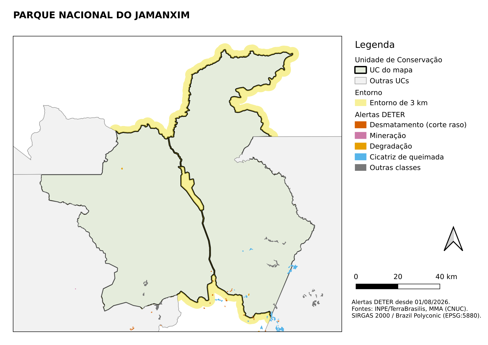

::: {.ficha}
[Nível]{.rotulo} Intermediário
[Leitura]{.rotulo} 10 min
[Dados]{.rotulo} outubro de 2026
[Programas]{.rotulo} [ArcGIS]{.selo-texto} {fig-alt="QGIS"} {fig-alt="Python"}
:::

Toda semana, um mapa para cada UC com os alertas novos: é o tipo de tarefa que **não se faz à mão**.
Com 7 UCs já são 7 mapas; com 130, ninguém dá conta.

Os scripts que eu usava faziam isso no **ArcMap**, com `arcpy.mapping`: abriam um `.mxd`, trocavam o
filtro da camada, davam zoom na UC e exportavam um JPEG. Esse módulo **não existe no ArcGIS Pro**. Aqui
está a mesma ideia em cada programa, do script antigo à versão sem licença.

{fig-alt="Mapa em folha A4 deitada com o título Parque Nacional do Jamanxim. A UC aparece em verde com contorno preto grosso, o entorno de 3 km em amarelo, as UCs vizinhas em cinza claro e os alertas do DETER coloridos por classe. À direita, legenda, barra de escala de 0 a 40 km, seta de norte e fonte dos dados."}

## O que todo mapa automático precisa

1. Um **modelo** (layout) com mapa, título, legenda, escala, norte e fonte.
2. Uma **camada que comanda a série** (as UCs): cada feição vira uma página.
3. **Título e filtros que mudam** com a página (o nome da UC, só o entorno dela).
4. **Zoom automático** na feição da página, com uma margem.
5. **Exportação** com um nome de arquivo por UC (o código CNUC é melhor que o nome, que tem acentos e espaços).

| | Modelo | Série | Texto que muda |
|---|---|---|---|
| ArcMap | `.mxd` | laço em Python com `arcpy.mapping` | `ListLayoutElements("TEXT_ELEMENT")` |
| ArcGIS Pro | layout no `.aprx` | **Série de mapas** (Map Series) | texto dinâmico `<dyn type="page" property="name"/>` |
| QGIS | layout de impressão | **Atlas** | expressão `[% "nome_uc" %]` |
| Python | figura do matplotlib | laço `for` | f-string |

## O código

::: {.panel-tabset group="programa"}

## ArcMap

O script antigo, simplificado. Só roda no **ArcMap 10.x** (Python 2.7).

```python
# -*- coding: utf-8 -*-
import arcpy

mxd = arcpy.mapping.MapDocument(r"C:\dados\mapa_uc.mxd")
df = arcpy.mapping.ListDataFrames(mxd, "Layers")[0]
ucs = arcpy.mapping.ListLayers(mxd, "UCs", df)[0]
titulo = arcpy.mapping.ListLayoutElements(mxd, "TEXT_ELEMENT", "titulo")[0]

for cnuc, nome in arcpy.da.SearchCursor(ucs, ["cnuc", "nome_uc"]):
    ucs.definitionQuery = "cnuc = '%s'" % cnuc
    df.extent = ucs.getExtent()
    df.scale = df.scale * 1.1                      # 10% de margem
    titulo.text = nome
    arcpy.mapping.ExportToPNG(mxd, r"C:\dados\mapas\mapa_%s.png" % cnuc, resolution=150)
    print "Mapa de %s exportado" % nome
ucs.definitionQuery = ""
del mxd
```

Para levar esse layout ao ArcGIS Pro, abra um projeto e use **Inserir → Importar mapa** com o `.mxd`.

## ArcGIS Pro

**Sem código:** no layout, **Layout → Série de mapas → Espacial**, camada de índice = UCs, campo de nome
= `nome_uc`. No título, insira **Texto dinâmico → Série de mapas → Nome da página**. Depois,
**Compartilhar → Exportar layout** e escolha "Todas as páginas" e "Um arquivo por página".

**Com código** (`arcpy.mp`), para quem quer controlar cada passo:

```python
import arcpy

projeto = arcpy.mp.ArcGISProject(r"C:\dados\mapas.aprx")
layout = projeto.listLayouts("Mapa por UC")[0]
quadro = layout.listElements("MAPFRAME_ELEMENT")[0]
titulo = layout.listElements("TEXT_ELEMENT", "titulo")[0]
ucs = quadro.map.listLayers("UCs")[0]

for cnuc, nome in arcpy.da.SearchCursor(ucs, ["cnuc", "nome_uc"]):
    ucs.definitionQuery = f"cnuc = '{cnuc}'"
    quadro.camera.setExtent(quadro.getLayerExtent(ucs, False, True))
    quadro.camera.scale *= 1.1                     # 10% de margem
    titulo.text = nome
    layout.exportToPNG(rf"C:\dados\mapas\mapa_{cnuc}.png", resolution=150)
    print(f"Mapa de {nome} exportado")
ucs.definitionQuery = ""
```

Se o layout já tem uma série de mapas configurada, a exportação é uma linha:

```python
layout.mapSeries.exportToPDF(r"C:\dados\mapas\mapas.pdf", "ALL", multiple_files="PDF_SINGLE_FILE")
```

## QGIS

**Sem código:** no layout de impressão, aba **Atlas → Gerar um atlas**, camada de cobertura = UCs,
nome do arquivo = `'mapa_' || "cnuc"`. No item de mapa, marque **Controlado pelo atlas** com margem de
10%. No título, use **Inserir expressão** com `[% "nome_uc" %]`. Exporte com **Atlas → Exportar atlas
como imagens**.

**Com código** (console Python), o layout inteiro montado do zero, para rodar em qualquer computador:

```python
import os
from qgis.core import (QgsProject, QgsVectorLayer, QgsPrintLayout, QgsLayoutItemMap,
                       QgsLayoutItemLabel, QgsLayoutItemLegend, QgsLayoutItemScaleBar,
                       QgsLayoutItemPicture, QgsLayoutPoint, QgsLayoutSize, QgsUnitTypes,
                       QgsLayoutExporter, QgsCategorizedSymbolRenderer, QgsRendererCategory,
                       QgsFillSymbol, QgsSingleSymbolRenderer, QgsCoordinateReferenceSystem,
                       QgsCoordinateTransform, QgsRuleBasedRenderer)
from qgis.PyQt.QtGui import QFont

G = "C:/dados/artigos.gpkg"
PASTA = "C:/dados/mapas/"
os.makedirs(PASTA, exist_ok=True)
projeto = QgsProject.instance()
MM = QgsUnitTypes.LayoutMillimeters

def poligono(**estilo):
    return QgsFillSymbol.createSimple(estilo)

# 1. Camadas e estilos: UCs (comandam o atlas), entorno e alertas desde agosto de 2026
ucs = QgsVectorLayer(f"{G}|layername=ucs", "Unidade de Conservação", "ogr")
ucs.setSubsetString("regiao = 'Amazonia'")
extensao_ucs = ucs.extent()
def regras(*lista):
    """Estilo por regras: (rótulo, expressão, símbolo). @atlas_feature é a UC da página."""
    raiz = QgsRuleBasedRenderer.Rule(None)
    for rotulo, expressao, simbolo in lista:
        raiz.appendChild(QgsRuleBasedRenderer.Rule(simbolo, filterExp=expressao, label=rotulo))
    return QgsRuleBasedRenderer(raiz)

ucs.setRenderer(regras(
    ("UC do mapa", "@atlas_featureid = $id",
     poligono(color="229,236,220", outline_color="0,0,0", outline_width="0.8")),
    ("Outras UCs", "@atlas_featureid <> $id",
     poligono(color="242,242,242", outline_color="150,150,150", outline_width="0.3"))))
entorno = QgsVectorLayer(f"{G}|layername=ucs_entorno", "Entorno", "ogr")
entorno.setRenderer(regras(
    ("Entorno de 3 km", "\"cnuc\" = attribute(@atlas_feature, 'cnuc')",
     poligono(color="240,228,66,140", outline_style="no"))))
alertas = QgsVectorLayer(f"{G}|layername=deter", "Alertas DETER", "ogr")
alertas.setSubsetString("view_date >= '2026-08-01'")
classes = [("DESMATAMENTO_CR", "213,94,0", "Desmatamento (corte raso)"),
           ("MINERACAO", "204,121,167", "Mineração"),
           ("DEGRADACAO", "230,159,0", "Degradação"),
           ("CICATRIZ_DE_QUEIMADA", "86,180,233", "Cicatriz de queimada")]
categorias = [QgsRendererCategory(valor, poligono(color=cor, outline_color=cor,
                                                  outline_width="0.15"), rotulo)
              for valor, cor, rotulo in classes]
categorias.append(QgsRendererCategory(None, poligono(color="120,120,120", outline_style="no"),
                                      "Outras classes"))
alertas.setRenderer(QgsCategorizedSymbolRenderer("classname", categorias))
projeto.addMapLayers([ucs, entorno, alertas])

# 2. Layout A4 deitado (cada item é adicionado e depois posicionado, em milímetros)
layout = QgsPrintLayout(projeto)
layout.initializeDefaults()

def colocar(item, x, y, largura=None, altura=None):
    layout.addLayoutItem(item)
    item.attemptMove(QgsLayoutPoint(x, y, MM))
    if largura:
        item.attemptResize(QgsLayoutSize(largura, altura, MM))
    return item

mapa = QgsLayoutItemMap(layout)
crs_mapa = QgsCoordinateReferenceSystem("EPSG:5880")       # em metros: escala correta
mapa.setCrs(crs_mapa)
mapa.setLayers([alertas, entorno, ucs])
mapa.setFrameEnabled(True)
colocar(mapa, 8, 22, 200, 180)
# Extensão inicial: sem ela, o atlas estica o quadro do mapa na primeira página
para_metros = QgsCoordinateTransform(ucs.crs(), crs_mapa, projeto)
mapa.zoomToExtent(para_metros.transformBoundingBox(extensao_ucs))

titulo = QgsLayoutItemLabel(layout)
titulo.setText('[% "nome_uc" %]')                            # muda a cada página
titulo.setFont(QFont("DejaVu Sans", 16, QFont.Weight.Bold))
colocar(titulo, 8, 6, 280, 12)

legenda = QgsLayoutItemLegend(layout)
legenda.setLinkedMap(mapa)
legenda.setTitle("Legenda")
colocar(legenda, 214, 22)

norte = QgsLayoutItemPicture(layout)
norte.setPicturePath(":/images/north_arrows/layout_default_north_arrow.svg")
colocar(norte, 270, 138, 15, 15)
norte.setLinkedMap(mapa)

escala = QgsLayoutItemScaleBar(layout)
escala.setLinkedMap(mapa)
escala.setStyle("Single Box")
escala.setUnits(QgsUnitTypes.DistanceKilometers)
escala.setUnitLabel("km")
escala.setNumberOfSegments(2)
escala.setNumberOfSegmentsLeft(0)
escala.setUnitsPerSegment(20)
colocar(escala, 214, 165)

fonte = QgsLayoutItemLabel(layout)
fonte.setText("Alertas DETER desde 01/08/2026.\nFontes: INPE/TerraBrasilis, MMA (CNUC).\n"
              "SIRGAS 2000 / Brazil Polyconic (EPSG:5880).")
colocar(fonte, 214, 182, 80, 20)

# 3. Atlas: uma página por UC, mapa centrado na UC com 10% de margem
atlas = layout.atlas()
atlas.setCoverageLayer(ucs)
atlas.setEnabled(True)
atlas.setFilenameExpression("'mapa_' || \"cnuc\"")
mapa.setAtlasDriven(True)
mapa.setAtlasScalingMode(QgsLayoutItemMap.Auto)
mapa.setAtlasMargin(0.10)

# 4. Uma imagem PNG por UC
config = QgsLayoutExporter.ImageExportSettings()
config.dpi = 150
config.generateWorldFile = False
config.exportMetadata = False
resultado, erro = QgsLayoutExporter.exportToImage(atlas, PASTA + "mapa.png", "png", config)
print("exportação:", "ok" if resultado == QgsLayoutExporter.Success else erro)
print(sorted(os.listdir(PASTA)))
```

Os dois truques que fazem o atlas parecer feito à mão estão no estilo por regras:

- `@atlas_featureid = $id` destaca **a UC da página** e deixa as vizinhas em cinza;
- `"cnuc" = attribute(@atlas_feature, 'cnuc')` mostra **só o entorno** da UC da página.

## PostGIS

O PostGIS **não desenha mapas**, mas pode entregar as camadas prontas para o QGIS ou o ArcGIS Pro. Uma
view com os alertas recentes de cada UC deixa o projeto de mapas leve e sempre atualizado:

```sql
CREATE OR REPLACE VIEW artigos.mapa_alertas_recentes AS
SELECT d.gid, d.classname, d.view_date, z.cnuc, z.nome_uc, z.local, z.geom
FROM artigos.deter_interior_entorno z
JOIN artigos.deter d USING (gid)
WHERE d.view_date >= current_date - 90;
```

No QGIS, conecte-se ao banco (**Navegador → PostgreSQL → Nova conexão**), arraste a view para o mapa e
use o atlas da aba QGIS. A cada atualização do banco, o atlas já sai com os dados novos.

## Python

Sem programa de SIG nenhum: um laço que desenha e salva um PNG por UC.

```python
import os
import geopandas as gpd
import matplotlib
matplotlib.use("Agg")
import matplotlib.pyplot as plt
from matplotlib.patches import Patch

G = "dados/artigos.gpkg"
os.makedirs("dados/mapas_py", exist_ok=True)
ucs = gpd.read_file(G, layer="ucs").query("regiao == 'Amazonia'").to_crs(5880)
entorno = gpd.read_file(G, layer="ucs_entorno").to_crs(5880)
alertas = gpd.read_file(G, layer="deter").to_crs(5880)
alertas = alertas[alertas["view_date"].astype(str) >= "2026-08-01"]

CORES = {"DESMATAMENTO_CR": ("#D55E00", "Desmatamento (corte raso)"),
         "MINERACAO": ("#CC79A7", "Mineração"), "DEGRADACAO": ("#E69F00", "Degradação"),
         "CICATRIZ_DE_QUEIMADA": ("#56B4E9", "Cicatriz de queimada")}
alertas["cor"] = alertas["classname"].map(lambda c: CORES.get(c, ("#787878", ""))[0])

for _, uc in ucs.iterrows():
    fig, ax = plt.subplots(figsize=(11.7, 8.3))                    # A4 deitado
    xmin, ymin, xmax, ymax = uc.geometry.bounds
    m = 0.10 * max(xmax - xmin, ymax - ymin)                       # 10% de margem
    ax.set_xlim(xmin - m, xmax + m)
    ax.set_ylim(ymin - m, ymax + m)

    ucs.plot(ax=ax, color="#f2f2f2", edgecolor="#969696", linewidth=0.4)
    entorno[entorno["cnuc"] == uc["cnuc"]].plot(ax=ax, color="#F0E442", alpha=0.55)
    ucs[ucs["cnuc"] == uc["cnuc"]].plot(ax=ax, color="#e5ecdc", edgecolor="black", linewidth=1.2)
    alertas.plot(ax=ax, color=alertas["cor"], linewidth=0)

    # Escala de 20 km, norte, legenda, título e fonte
    x0, y0 = ax.get_xlim()[0] + m * 0.4, ax.get_ylim()[0] + m * 0.4
    ax.plot([x0, x0 + 20_000], [y0, y0], color="black", linewidth=3)
    ax.text(x0 + 10_000, y0 + m * 0.12, "20 km", ha="center", fontsize=9)
    ax.annotate("N", xy=(0.95, 0.95), xytext=(0.95, 0.86), xycoords="axes fraction",
                ha="center", fontsize=12, fontweight="bold",
                arrowprops=dict(facecolor="black", width=4, headwidth=12))
    itens = [Patch(facecolor="#e5ecdc", edgecolor="black", label="UC do mapa"),
             Patch(facecolor="#F0E442", alpha=0.55, label="Entorno de 3 km")]
    itens += [Patch(color=cor, label=rotulo) for cor, rotulo in CORES.values()]
    ax.legend(handles=itens, loc="upper left", fontsize=9, framealpha=0.9)
    ax.set_title(uc["nome_uc"], fontsize=15, fontweight="bold", loc="left")
    ax.set_axis_off()
    fig.text(0.01, 0.01, "Alertas DETER desde 01/08/2026. Fontes: INPE/TerraBrasilis, "
             "MMA (CNUC). SIRGAS 2000 / Brazil Polyconic (EPSG:5880).", fontsize=8)
    fig.savefig(f"dados/mapas_py/mapa_{uc['cnuc']}.png", dpi=150, bbox_inches="tight")
    plt.close(fig)
    print("Mapa de", uc["nome_uc"], "exportado")
```

:::

## Conferindo o resultado

O Atlas do QGIS e o laço do Python geraram os **7 mapas** do recorte, um por UC, em poucos segundos.
As versões do ArcMap e do ArcGIS Pro seguem a mesma lógica, mas não foram testadas aqui (precisam de
licença).

## Armadilhas

::: {.callout-warning}
## Mapa em graus, escala errada
Um mapa em SIRGAS 2000 geográfico (graus) tem a barra de escala distorcida, e as UCs ficam "achatadas"
na vertical. Ponha o **quadro do mapa** numa projeção em metros (aqui, EPSG:5880), mesmo que os dados
continuem em graus.
:::

::: {.callout-warning}
## Atlas que estica o quadro do mapa (QGIS, pelo código)
Montando o layout pelo Python, se o mapa começar sem extensão, a primeira página do atlas **muda o
tamanho do quadro** e ele passa da folha. Dê uma extensão inicial ao mapa (`zoomToExtent`) antes de
ligar o atlas, como no código acima.
:::

::: {.callout-tip}
## Nome do arquivo
Use o código da UC (`mapa_0000.00.0267.png`), não o nome. Acentos, espaços e barras no nome do arquivo
quebram scripts e links, principalmente entre Windows e Linux.
:::

## Veja também

- [Relatório automático em PDF](11-relatorio-pdf.qmd), que junta mapa, tabela e texto
- [Mapas acadêmicos em preto e branco no R](../tutoriais/mapas-preto-e-branco.qmd), sobre os elementos de um bom mapa

::: {.navegacao-livro}
[[← Anterior]{.direcao} Densidade Kernel do desmatamento: onde a pressão está concentrada](09-densidade-kernel.qmd){.anterior}
[[Próximo →]{.direcao} Relatório automático em PDF: o boletim que se escreve sozinho](11-relatorio-pdf.qmd){.proximo}
:::

## Atualizações {.unnumbered}

- **29/10/2026:** publicação, com dados do INPE, do MMA, do IBAMA e do SICAR de outubro de 2026.

[English version](https://hendesson.github.io/en/articles/10-automated-maps.html)
