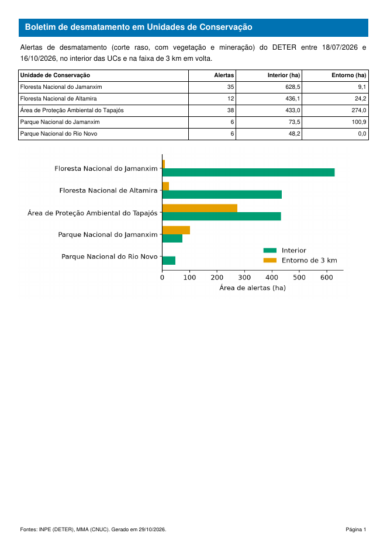
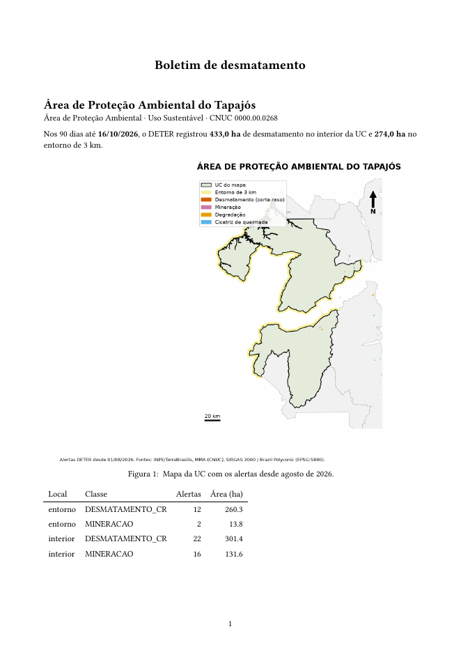

::: {.ficha}
[Nível]{.rotulo} Intermediário
[Leitura]{.rotulo} 10 min
[Dados]{.rotulo} outubro de 2026
[Programas]{.rotulo} [ArcGIS]{.selo-texto} {fig-alt="QGIS"} {fig-alt="Python"}
:::

Os scripts mais longos da minha pasta não faziam análise espacial: montavam uma **nota informativa**
em PDF, com logotipos, legenda, uma tabela por UC e o texto de cada ocorrência. Eram 1.500 linhas de
`fpdf`, e qualquer mudança de layout dava trabalho.

Aqui está o mesmo tipo de produto, um **boletim de desmatamento por UC** com dados públicos, em quatro
caminhos. O mais curto para manter costuma ser o **Quarto**: o layout fica num arquivo de texto e o
script só troca a UC.

::: {.grid}

::: {.g-col-12 .g-col-md-6}
{fig-alt="Página A4 com faixa azul no topo com o título Boletim de desmatamento em Unidades de Conservação, um parágrafo com o período, uma tabela com cinco UCs e um gráfico de barras com a área no interior e no entorno."}
:::

::: {.g-col-12 .g-col-md-6}
{fig-alt="Página A4 com o nome da Área de Proteção Ambiental do Tapajós, uma frase com a área desmatada no interior e no entorno, o mapa da UC e uma tabela com alertas por local e classe."}
:::

:::

## O que vai no boletim

1. **Período** e fonte, calculados a partir dos próprios dados (nunca digitados).
2. **Tabela resumo**: área de alertas no interior e no entorno de cada UC.
3. **Gráfico** da tabela.
4. **Uma página por UC**, com o mapa do [artigo anterior](10-mapas-automaticos.qmd).

Os dados vêm da camada `deter_interior_entorno` (artigo [Interior e entorno](02-interior-entorno.qmd)):
alertas de desmatamento (corte raso, com vegetação e mineração) dos últimos 90 dias.

## O código

::: {.panel-tabset group="programa"}

## ArcGIS Pro

O ArcGIS Pro tem **Relatórios** (Inserir → Relatório), que fazem a tabela por UC com cabeçalho e
rodapé, e **Séries de mapas** no layout. O script junta os dois num PDF:

```python
import arcpy

projeto = arcpy.mp.ArcGISProject(r"C:\dados\boletim.aprx")

# Tabela por UC (relatório criado em Inserir → Relatório, agrupado por nome_uc)
relatorio = projeto.listReports("Alertas por UC")[0]
relatorio.exportToPDF(r"C:\dados\saida\tabela.pdf")

# Um mapa por UC (layout com série de mapas configurada)
layout = projeto.listLayouts("Mapa por UC")[0]
layout.mapSeries.exportToPDF(r"C:\dados\saida\mapas.pdf")

# Juntar tudo num arquivo só
boletim = arcpy.mp.PDFDocumentCreate(r"C:\dados\saida\boletim.pdf")
boletim.appendPages(r"C:\dados\saida\tabela.pdf")
boletim.appendPages(r"C:\dados\saida\mapas.pdf")
boletim.saveAndClose()
```

O `fpdf2` da aba Python também roda no ArcGIS Pro: no **Gerenciador de pacotes**, clone o ambiente
padrão, ative o clone e instale `fpdf2`. Foi assim que os scripts originais funcionavam.

## QGIS

O Atlas do QGIS exporta **um PDF com uma página por UC**. Basta acrescentar ao layout do
[artigo anterior](10-mapas-automaticos.qmd) uma **tabela de atributos** filtrada pela UC da página.
Rode este trecho **depois** do código daquele artigo:

```python
# Continua o código do artigo anterior (layout, atlas e camadas já criados)
from qgis.core import QgsLayoutItemAttributeTable, QgsLayoutFrame, QgsLayoutItemPage

# Diminui o mapa para abrir espaço para a tabela embaixo, em retrato
layout.pageCollection().page(0).setPageSize("A4", QgsLayoutItemPage.Portrait)
mapa.attemptResize(QgsLayoutSize(194, 150, MM))
mapa.zoomToExtent(para_metros.transformBoundingBox(extensao_ucs))
legenda.setColumnCount(2)
for item, (x, y) in [(legenda, (8, 176)), (norte, (188, 25)), (escala, (145, 178)),
                     (fonte, (145, 192))]:
    item.attemptMove(QgsLayoutPoint(x, y, MM))
norte.attemptResize(QgsLayoutSize(11, 11, MM))
fonte.attemptResize(QgsLayoutSize(57, 20, MM))

# Tabela com os alertas da UC da página (filtro pela feição do atlas)
tabela = QgsLayoutItemAttributeTable.create(layout)
layout.addMultiFrame(tabela)                 # o layout passa a ser o dono da tabela
tabela.setVectorLayer(alertas)
tabela.setFilterFeatures(True)
tabela.setFeatureFilter('intersects($geometry, @atlas_geometry)')
tabela.setMaximumNumberOfFeatures(10)
tabela.setDisplayedFields(["view_date", "classname", "municipality"])
quadro_tabela = QgsLayoutFrame(layout, tabela)
tabela.addFrame(quadro_tabela)
quadro_tabela.attemptMove(QgsLayoutPoint(8, 230, MM))
quadro_tabela.attemptResize(QgsLayoutSize(194, 58, MM))

# Um PDF só, com uma página por UC
config_pdf = QgsLayoutExporter.PdfExportSettings()
resultado, erro = QgsLayoutExporter.exportToPdf(atlas, PASTA + "boletim_qgis.pdf", config_pdf)
print("PDF:", "ok" if resultado == QgsLayoutExporter.Success else erro)
```

O filtro `intersects($geometry, @atlas_geometry)` faz a tabela mostrar só os alertas da UC da página.
Sem código, o mesmo filtro fica em **Propriedades do item → Filtrar com**.

## PostGIS

O banco entrega a tabela pronta para qualquer gerador de relatório (Quarto, Power BI, ArcGIS Pro):

```sql
CREATE OR REPLACE VIEW artigos.boletim_90_dias AS
WITH periodo AS (SELECT max(view_date) AS fim FROM artigos.deter_interior_entorno)
SELECT nome_uc,
       count(*) FILTER (WHERE local = 'interior')                 AS alertas_interior,
       round(sum(area_ha) FILTER (WHERE local = 'interior'), 1)   AS interior_ha,
       round(sum(area_ha) FILTER (WHERE local = 'entorno'), 1)    AS entorno_ha,
       min(p.fim) - 90 AS inicio, min(p.fim) AS fim
FROM artigos.deter_interior_entorno, periodo p
WHERE classname IN ('DESMATAMENTO_CR', 'DESMATAMENTO_VEG', 'MINERACAO')
  AND view_date > p.fim - 90
GROUP BY nome_uc
ORDER BY interior_ha DESC NULLS LAST;

SELECT * FROM artigos.boletim_90_dias;
```

## Python

Com o **fpdf2** (`pip install fpdf2`), o mesmo pacote dos scripts originais:

```python
from datetime import date
import geopandas as gpd
import pandas as pd
import matplotlib
matplotlib.use("Agg")
import matplotlib.pyplot as plt
from fpdf import FPDF

CLASSES = ["DESMATAMENTO_CR", "DESMATAMENTO_VEG", "MINERACAO"]

def nome(texto):
    """FLORESTA NACIONAL DO JAMANXIM -> Floresta Nacional do Jamanxim"""
    return " ".join(p if p in ("de", "do", "da", "dos", "das", "e") else p.capitalize()
                    for p in texto.lower().split())

# 1. Dados: alertas de desmatamento dos últimos 90 dias, por UC e local
d = gpd.read_file("dados/deter_interior_entorno.gpkg")
d["view_date"] = pd.to_datetime(d["view_date"])
fim = d["view_date"].max()
inicio = fim - pd.Timedelta(days=90)
d = d[d["classname"].isin(CLASSES) & (d["view_date"] > inicio)]
tabela = (d.pivot_table(index="nome_uc", columns="local", values="area_ha",
                        aggfunc="sum", fill_value=0)
          .reindex(columns=["interior", "entorno"], fill_value=0)
          .sort_values("interior", ascending=False))
alertas = d[d["local"] == "interior"].groupby("nome_uc").size()

# 2. Gráfico para o relatório
fig, ax = plt.subplots(figsize=(7, 3.2))
tabela[::-1].rename(index=nome).plot.barh(ax=ax, color=["#009E73", "#E69F00"], width=0.75)
ax.set_xlabel("Área de alertas (ha)")
ax.set_ylabel("")
ax.legend(["Interior", "Entorno de 3 km"], frameon=False)
ax.spines[["top", "right"]].set_visible(False)
fig.tight_layout()
fig.savefig("dados/boletim_grafico.png", dpi=200)

# 3. O PDF: cabeçalho e rodapé em todas as páginas
class Boletim(FPDF):
    def header(self):
        self.set_fill_color(0, 114, 178)
        self.set_text_color(255)
        self.set_font("Helvetica", "B", 13)
        self.cell(0, 10, "  Boletim de desmatamento em Unidades de Conservação",
                  fill=True, new_x="LMARGIN", new_y="NEXT")
        self.set_text_color(0)
        self.ln(3)

    def footer(self):
        self.set_y(-12)
        self.set_font("Helvetica", "", 8)
        self.cell(0, 6, f"Fontes: INPE (DETER), MMA (CNUC). Gerado em "
                        f"{date.today():%d/%m/%Y}.", align="L")
        self.cell(0, 6, f"Página {self.page_no()}", align="R")

pdf = Boletim(orientation="P", unit="mm", format="A4")
pdf.set_auto_page_break(auto=True, margin=15)
pdf.add_page()

# 4. Resumo, tabela e gráfico
pdf.set_font("Helvetica", "", 11)
pdf.multi_cell(0, 6, f"Alertas de desmatamento (corte raso, com vegetação e mineração) do DETER "
                     f"entre {inicio:%d/%m/%Y} e {fim:%d/%m/%Y}, no interior das UCs e na faixa "
                     f"de 3 km em volta.")
pdf.ln(3)
pdf.set_font("Helvetica", "", 9)
with pdf.table(col_widths=(90, 25, 35, 35), text_align=("LEFT", "RIGHT", "RIGHT", "RIGHT")) as t:
    t.row(["Unidade de Conservação", "Alertas", "Interior (ha)", "Entorno (ha)"])
    for uc, linha in tabela.iterrows():
        t.row([nome(uc), str(alertas.get(uc, 0)),
               f"{linha['interior']:,.1f}".replace(",", "X").replace(".", ",").replace("X", "."),
               f"{linha['entorno']:,.1f}".replace(",", "X").replace(".", ",").replace("X", ".")])
pdf.ln(4)
pdf.image("dados/boletim_grafico.png", w=180)

# 5. Uma página por UC, com o mapa do artigo anterior
ucs = gpd.read_file("dados/artigos.gpkg", layer="ucs").set_index("nome_uc")
for uc in tabela.index:
    pdf.add_page()
    pdf.set_font("Helvetica", "B", 12)
    pdf.cell(0, 8, nome(uc), new_x="LMARGIN", new_y="NEXT")
    pdf.set_font("Helvetica", "", 10)
    pdf.cell(0, 6, f"{ucs.loc[uc, 'categoria']} · {ucs.loc[uc, 'grupo']} · "
                   f"CNUC {ucs.loc[uc, 'cnuc']}", new_x="LMARGIN", new_y="NEXT")
    pdf.cell(0, 6, f"Interior: {tabela.loc[uc, 'interior']:.1f} ha · "
                   f"Entorno: {tabela.loc[uc, 'entorno']:.1f} ha", new_x="LMARGIN", new_y="NEXT")
    pdf.ln(2)
    pdf.image(f"dados/mapas_py/mapa_{ucs.loc[uc, 'cnuc']}.png", w=185)

pdf.output("dados/boletim.pdf")
print("boletim.pdf com", pdf.page_no(), "páginas")
print(tabela.round(1))
```

## Quarto

Um arquivo `boletim.qmd` é o **modelo**; o parâmetro `cnuc` escolhe a UC. O PDF sai pelo **Typst**,
que já vem com o Quarto (não precisa instalar LaTeX).

````markdown
---
title: "Boletim de desmatamento"
format:
  typst:
    papersize: a4
    margin: {x: 2cm, y: 2cm}
lang: pt-BR
execute:
  echo: false
  warning: false
jupyter: python3
---

```{python}
#| tags: [parameters]
cnuc = "0000.00.0266"      # trocado na hora de gerar: -P cnuc:...
```

```{python}
import geopandas as gpd
import pandas as pd
from IPython.display import Markdown

def nome(texto):
    return " ".join(p if p in ("de", "do", "da", "dos", "das", "e") else p.capitalize()
                    for p in texto.lower().split())

G = "../dados/artigos.gpkg"
uc = gpd.read_file(G, layer="ucs").query("cnuc == @cnuc").iloc[0]
d = gpd.read_file("../dados/deter_interior_entorno.gpkg").query("cnuc == @cnuc")
d["view_date"] = pd.to_datetime(d["view_date"])
fim = d["view_date"].max()
d = d[d["classname"].isin(["DESMATAMENTO_CR", "DESMATAMENTO_VEG", "MINERACAO"])
      & (d["view_date"] > fim - pd.Timedelta(days=90))]
area = d.groupby("local")["area_ha"].sum().reindex(["interior", "entorno"], fill_value=0)
```

```{python}
#| output: asis
print(f"## {nome(uc['nome_uc'])}\n")
print(f"{uc['categoria']} · {uc['grupo']} · CNUC {cnuc}\n")
ha = lambda x: f"{x:,.1f}".replace(",", " ").replace(".", ",").replace(" ", ".")
print(f"Nos 90 dias até **{fim:%d/%m/%Y}**, o DETER registrou **{ha(area['interior'])} ha** de "
      f"desmatamento no interior da UC e **{ha(area['entorno'])} ha** no entorno de 3 km.\n")
```

```{python}
#| fig-cap: "Mapa da UC com os alertas desde agosto de 2026."
from IPython.display import Image
Image(f"../dados/mapas_py/mapa_{cnuc}.png", width=600)
```

```{python}
tabela = (d.groupby(["local", "classname"])["area_ha"].agg(["count", "sum"]).round(1)
          .reset_index()
          .rename(columns={"local": "Local", "classname": "Classe",
                           "count": "Alertas", "sum": "Área (ha)"}))
Markdown(tabela.to_markdown(index=False))
```
````

Para gerar um PDF por UC, chame o Quarto num laço (no Windows, use um `for` do PowerShell):

```bash
for cnuc in 0000.00.0266 0000.00.0267 0000.00.0268; do
  quarto render boletim.qmd -P cnuc:$cnuc --output boletim_$cnuc.pdf
done
```

O Quarto precisa de `jupyter`, `papermill` e `tabulate` instalados no mesmo Python dos dados
(`pip install jupyter papermill tabulate`).

:::

## Conferindo o resultado

As versões Python (fpdf2), Quarto e QGIS geraram os PDFs com os mesmos números. Nos 90 dias até
16/10/2026:

| UC | Alertas no interior | Interior (ha) | Entorno (ha) |
|---|---:|---:|---:|
| Floresta Nacional do Jamanxim | 35 | 628,5 | 9,1 |
| Floresta Nacional de Altamira | 12 | 436,1 | 24,2 |
| Área de Proteção Ambiental do Tapajós | 38 | 433,0 | 274,0 |
| Parque Nacional do Jamanxim | 6 | 73,5 | 100,9 |
| Parque Nacional do Rio Novo | 6 | 48,2 | 0 |

: Alertas de desmatamento do DETER (corte raso, com vegetação e mineração) nos 90 dias até 16/10/2026. {.striped}

No Parque Nacional do Jamanxim, que é de Proteção Integral, o entorno teve **mais** desmatamento que o
interior no período. É o tipo de achado que um boletim semanal mostra cedo.

## Armadilhas

::: {.callout-warning}
## Datas digitadas no texto
"Boletim de 1º a 30 de setembro" escrito à mão fica errado na primeira vez que o script roda em outro
mês. Calcule o período a partir dos dados (`max(view_date)`), como nos códigos acima.
:::

::: {.callout-warning}
## Acentos no PDF
As fontes padrão do fpdf2 (Helvetica, Times) só têm os caracteres do Latin-1: acentos do português
funcionam, mas travessão (—), aspas curvas e emojis não. Para qualquer caractere, carregue uma fonte
TTF com `pdf.add_font("DejaVu", "", "DejaVuSans.ttf")`.
:::

::: {.callout-warning}
## Tabela de atributos no layout do QGIS, pelo código
Crie a tabela com `QgsLayoutItemAttributeTable.create(layout)` e registre-a com
`layout.addMultiFrame(tabela)` **antes** de configurar. Sem isso, o Python apaga a tabela da memória e
o QGIS fecha sem aviso na hora de exportar.
:::

::: {.callout-tip}
## Logotipos e identidade visual
Os boletins oficiais levam logotipo e cabeçalho do órgão. Num boletim pessoal ou de estudo, **não use
logotipos de instituições**: deixe claro que é um produto seu, feito com dados públicos.
:::

## Veja também

- [Um mapa por UC, automático](10-mapas-automaticos.qmd)
- [Módulo 7 do curso: Power BI](../guia-espacial/curso/07-power-bi.qmd), para um painel em vez de PDF

::: {.navegacao-livro}
[[← Anterior]{.direcao} Um mapa por UC, automático: do ArcMap ao QGIS e ao Python](10-mapas-automaticos.qmd){.anterior}
[[Próximo →]{.direcao} Priorizar alertas em ArcGIS Pro, QGIS e Python](12-priorizacao-arcgis-qgis.qmd){.proximo}
:::

## Atualizações {.unnumbered}

- **29/10/2026:** publicação, com dados do INPE, do MMA, do IBAMA e do SICAR de outubro de 2026.
