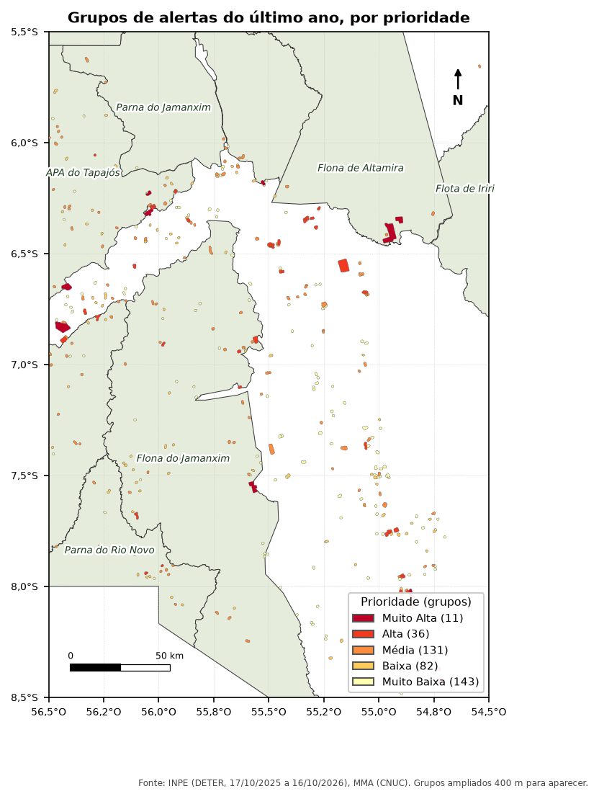

::: {.ficha}
[Nível]{.rotulo} Avançado
[Leitura]{.rotulo} 14 min
[Dados]{.rotulo} outubro de 2026
[Programas]{.rotulo} [ArcGIS]{.selo-texto} {fig-alt="QGIS"} {fig-alt="PostGIS"} {fig-alt="Python"}
:::

Com centenas de alertas por mês, a fiscalização precisa decidir **por onde começar**. O script que eu
usava fazia isso em quatro passos: juntar os alertas que estão perto uns dos outros num **grupo**,
medir cada grupo, transformar as medidas em **índices de 0 a 1** e somar com **pesos**.

O [Módulo 5 do curso](../guia-espacial/curso/05-priorizacao.qmd) faz uma versão disso em SQL, passo a passo. Aqui
está a lógica do script original, com os mesmos parâmetros, em cada programa.

{fig-alt="Mapa da região de Novo Progresso com as UCs em verde claro e grupos de alertas coloridos: muito baixa em amarelo-claro, baixa em amarelo, média em laranja, alta em vermelho e muito alta em vermelho-escuro. Os 11 grupos de prioridade muito alta aparecem espalhados pelo recorte, vários deles nas bordas das UCs."}

## A lógica

```{mermaid}
%%| eval: true
%%| fig-cap: "Do alerta ao grupo e à nota"
flowchart LR
    A["Alertas do<br/>último ano"] --> B["Agrupar vizinhos<br/>60 m / 800 m"]
    B --> C["Medidas do grupo:<br/>área, quantidade,<br/>tempo, velocidade"]
    C --> D["Índices 0 a 1<br/>(com limites)"]
    D --> E["Nota ponderada<br/>0,2 / 0,2 / 0,2 / 0,4"]
    E --> F["Classe:<br/>Muito Baixa a<br/>Muito Alta"]
```

| Medida do grupo | Como se calcula | Limites: corte raso | Limites: mineração | Peso |
|---|---|---|---|---:|
| Área | soma da área dos alertas (ha) | 3 a 30 ha | 0,1 a 5 ha | 0,2 |
| Quantidade | número de alertas no grupo | 1 a 4 | 1 a 10 | 0,2 |
| Tempo | dias entre o alerta mais novo do grupo e a data de referência | −365 a −14 dias | −365 a −14 dias | 0,2 |
| Velocidade | área ÷ dias desde o primeiro alerta do grupo (ha/dia) | 0,1 a 0,5 | 0,00057 a 0,1 | 0,4 |

- **Agrupar:** alertas a até **60 m** um do outro (corte raso) ou **800 m** (mineração, que se espalha
  ao longo dos rios) viram um grupo só.
- **Índice com limites:** abaixo do mínimo vale 0, acima do máximo vale 1, e no meio cresce em linha
  reta. Um grupo de 30 ha ou mais já tem índice de área 1.
- **Classes:** ≥ 0,95 Muito Alta; ≥ 0,8 Alta; ≥ 0,6 Média; ≥ 0,4 Baixa; abaixo disso, Muito Baixa.

::: {.callout-note}
## Data de referência
O script original media o tempo até **hoje**. Aqui, a referência é a **data do alerta mais novo**
(16/10/2026), para que o resultado não mude só porque o script rodou outro dia. Para uso diário,
troque pela data de hoje.
:::

## O código

Dados: camada `deter` do GeoPackage dos artigos ([como baixar](sobre.qmd#dados)). O script original
usava alertas do Programa Brasil MAIS, que são restritos a órgãos públicos; o DETER funciona igual.

::: {.panel-tabset group="programa"}

## ArcGIS Pro

```python
import arcpy
from datetime import timedelta

arcpy.env.overwriteOutput = True
arcpy.env.outputCoordinateSystem = arcpy.SpatialReference(5880)     # metros
gpkg = r"C:\dados\artigos.gpkg"
gdb = r"C:\dados\resultados.gdb"

PARAM = {
    "corte_raso": dict(dist=60, area=(3, 30), qtde=(1, 4), velo=(0.1, 0.5)),
    "mineracao":  dict(dist=800, area=(0.1, 5), qtde=(1, 10), velo=(0.00057, 0.1)),
}

def norm(valor, limites):
    a, b = limites
    return min(1, max(0, (valor - a) / (b - a)))

def classe(x):
    for limite, nome in [(0.95, "Muito Alta"), (0.8, "Alta"), (0.6, "Média"), (0.4, "Baixa")]:
        if x >= limite:
            return nome
    return "Muito Baixa"

# 1 e 2. Alertas do último ano, corrigidos, com área e tipo
deter = arcpy.management.CopyFeatures(gpkg + r"\main.deter", r"memory\deter")
ref = max(r[0] for r in arcpy.da.SearchCursor(deter, ["view_date"]))
corte = (ref - timedelta(days=365)).strftime("%Y-%m-%d")
alertas = arcpy.analysis.Select(
    deter, r"memory\alertas",
    "classname IN ('DESMATAMENTO_CR', 'DESMATAMENTO_VEG', 'MINERACAO') "
    f"AND view_date > timestamp '{corte} 00:00:00'")
arcpy.management.RepairGeometry(alertas)
arcpy.management.CalculateGeometryAttributes(
    alertas, [["area_ha", "AREA_GEODESIC"]], area_unit="HECTARES")
arcpy.management.CalculateField(
    alertas, "tipo", "'mineracao' if !classname! == 'MINERACAO' else 'corte_raso'",
    "PYTHON3", field_type="TEXT")

tabelas = []
for tipo, p in PARAM.items():
    a = arcpy.analysis.Select(alertas, rf"memory\a_{tipo}", f"tipo = '{tipo}'")

    # 3. Agrupar: buffer de metade da distância, dissolver tudo e separar as partes
    grupos = arcpy.analysis.PairwiseBuffer(a, rf"memory\buf_{tipo}",
                                           f"{p['dist'] / 2} Meters", dissolve_option="ALL")
    grupos = arcpy.management.MultipartToSinglepart(grupos, rf"memory\grupos_{tipo}")
    arcpy.management.CalculateField(grupos, "cluster", f"'{tipo}_' + str(!OBJECTID!)",
                                    "PYTHON3", field_type="TEXT")
    a = arcpy.analysis.SpatialJoin(a, grupos, rf"memory\aj_{tipo}", "JOIN_ONE_TO_ONE",
                                   "KEEP_COMMON", match_option="INTERSECT")

    # 4. Medidas de cada grupo
    t = arcpy.analysis.Statistics(a, rf"memory\t_{tipo}",
                                  [["area_ha", "SUM"], ["gid", "COUNT"],
                                   ["view_date", "MIN"], ["view_date", "MAX"]], "cluster")

    # 5. Índices, nota e classe
    for campo, tipo_campo in [("tempo", "LONG"), ("velo", "DOUBLE"),
                              ("indice", "DOUBLE"), ("prioridade", "TEXT"), ("tipo", "TEXT")]:
        arcpy.management.AddField(t, campo, tipo_campo)
    campos = ["SUM_area_ha", "COUNT_gid", "MIN_view_date", "MAX_view_date",
              "tempo", "velo", "indice", "prioridade", "tipo"]
    with arcpy.da.UpdateCursor(t, campos) as cursor:
        for area, qtde, primeiro, ultimo, *_ in cursor:
            tempo = (ultimo - ref).days
            velo = area / max(1, (ref - primeiro).days)
            indice = (0.2 * norm(area, p["area"]) + 0.2 * norm(qtde, p["qtde"])
                      + 0.2 * norm(tempo, (-365, -14)) + 0.4 * norm(velo, p["velo"]))
            cursor.updateRow([area, qtde, primeiro, ultimo, tempo, velo, indice,
                              classe(indice), tipo])
    arcpy.management.JoinField(grupos, "cluster", t, "cluster")
    tabelas.append(grupos)

arcpy.management.Merge(tabelas, gdb + r"\priorizacao_grupos")
```

::: {.callout-note}
O script original agrupava com **Agregar polígonos** (`cartography.AggregatePolygons`), que só existe na
licença **Advanced**. O buffer de metade da distância, dissolvido, dá os mesmos grupos e funciona na
licença Basic.
:::

## QGIS

```python
import processing
G = "C:/dados/artigos.gpkg"

PARAM = {
    "corte_raso": dict(dist=60, area=(3, 30), qtde=(1, 4), velo=(0.1, 0.5)),
    "mineracao":  dict(dist=800, area=(0.1, 5), qtde=(1, 10), velo=(0.00057, 0.1)),
}

def rodar(alg, **p):
    p.setdefault("OUTPUT", "memory:")
    return processing.run(alg, p)["OUTPUT"]

def norm(campo, limites):
    """Expressão do QGIS: normaliza entre os limites e corta em 0 e 1."""
    a, b = limites
    return f'clamp(0, ("{campo}" - {a}) / ({b} - {a}), 1)'

# 1. Data de referência (o alerta mais novo) e alertas do último ano
fonte = QgsVectorLayer(f"{G}|layername=deter", "deter", "ogr")
ref = fonte.maximumValue(fonte.fields().indexOf("view_date"))
corte = ref.addDays(-365).toString("yyyy-MM-dd")
ref = ref.toString("yyyy-MM-dd")
alertas = rodar("native:extractbyexpression", INPUT=fonte, EXPRESSION=
                "classname IN ('DESMATAMENTO_CR', 'DESMATAMENTO_VEG', 'MINERACAO') "
                f"AND view_date > '{corte}'")

# 2. Corrigir, passar para metros, área em hectares e tipo
alertas = rodar("native:fixgeometries", INPUT=alertas)
alertas = rodar("native:removenullgeometries", INPUT=alertas, REMOVE_EMPTY=True)
alertas = rodar("native:reprojectlayer", INPUT=alertas, TARGET_CRS="EPSG:5880")
alertas = rodar("native:fieldcalculator", INPUT=alertas, FIELD_NAME="area_ha", FIELD_TYPE=0,
                FIELD_PRECISION=4,
                FORMULA="area(transform($geometry, 'EPSG:5880', 'ESRI:102033')) / 10000")
alertas = rodar("native:fieldcalculator", INPUT=alertas, FIELD_NAME="tipo", FIELD_TYPE=2,
                FORMULA="if(classname = 'MINERACAO', 'mineracao', 'corte_raso')")

partes = []
for tipo, p in PARAM.items():
    a = rodar("native:extractbyattribute", INPUT=alertas, FIELD="tipo", OPERATOR=0, VALUE=tipo)

    # 3. Agrupar: buffer de metade da distância, dissolver e separar as partes
    grupos = rodar("native:buffer", INPUT=a, DISTANCE=p["dist"] / 2, DISSOLVE=True)
    grupos = rodar("native:multiparttosingleparts", INPUT=grupos)
    grupos = rodar("native:fieldcalculator", INPUT=grupos, FIELD_NAME="cluster", FIELD_TYPE=2,
                   FORMULA=f"'{tipo}_' || to_string(@row_number)")
    a = rodar("native:joinattributesbylocation", INPUT=a, JOIN=grupos, PREDICATE=[0],
              JOIN_FIELDS=["cluster"], METHOD=1)

    # 4. Medidas de cada grupo
    c = rodar("native:aggregate", INPUT=a, GROUP_BY='"cluster"', AGGREGATES=[
        {"aggregate": "first_value", "input": '"cluster"', "name": "cluster", "type": 10,
         "length": 30, "precision": 0},
        {"aggregate": "first_value", "input": '"tipo"', "name": "tipo", "type": 10,
         "length": 12, "precision": 0},
        {"aggregate": "sum", "input": '"area_ha"', "name": "area_ha", "type": 6,
         "length": 0, "precision": 4},
        {"aggregate": "count", "input": '"gid"', "name": "qtde", "type": 2,
         "length": 0, "precision": 0},
        {"aggregate": "minimum", "input": '"view_date"', "name": "primeiro", "type": 14,
         "length": 0, "precision": 0},
        {"aggregate": "maximum", "input": '"view_date"', "name": "ultimo", "type": 14,
         "length": 0, "precision": 0}])
    c = rodar("native:fieldcalculator", INPUT=c, FIELD_NAME="tempo", FIELD_TYPE=1,
              FORMULA=f"-day(to_date('{ref}') - \"ultimo\")")
    c = rodar("native:fieldcalculator", INPUT=c, FIELD_NAME="velo", FIELD_TYPE=0,
              FIELD_PRECISION=5,
              FORMULA=f"\"area_ha\" / max(1, day(to_date('{ref}') - \"primeiro\"))")

    # 5. Nota ponderada e classe
    c = rodar("native:fieldcalculator", INPUT=c, FIELD_NAME="indice", FIELD_TYPE=0,
              FIELD_PRECISION=4, FORMULA=(
                  f"0.2 * {norm('area_ha', p['area'])} + 0.2 * {norm('qtde', p['qtde'])} + "
                  f"0.2 * {norm('tempo', (-365, -14))} + 0.4 * {norm('velo', p['velo'])}"))
    c = rodar("native:fieldcalculator", INPUT=c, FIELD_NAME="prioridade", FIELD_TYPE=2,
              FORMULA="CASE WHEN indice >= 0.95 THEN 'Muito Alta' WHEN indice >= 0.8 THEN "
                      "'Alta' WHEN indice >= 0.6 THEN 'Média' WHEN indice >= 0.4 THEN 'Baixa' "
                      "ELSE 'Muito Baixa' END")
    partes.append(c)

clusters = rodar("native:mergevectorlayers", LAYERS=partes, CRS="EPSG:5880",
                 OUTPUT="C:/dados/priorizacao_qgis.gpkg")
resumo = rodar("qgis:statisticsbycategories", INPUT=clusters,
               CATEGORIES_FIELD_NAME=["tipo", "prioridade"])
for f in resumo.getFeatures():
    print(f["tipo"], f["prioridade"], f["count"])
```

O agrupamento usa a mesma ideia do ArcGIS: dois alertas a até 60 m um do outro têm buffers de 30 m que
se tocam, e o **Dissolver** junta os dois. As funções `clamp`, `day` e `max` da expressão fazem o resto.

## PostGIS

O `ST_ClusterDBSCAN` faz o agrupamento direto: com `minpoints = 1`, ele junta toda geometria que está a
até `eps` metros de outra do grupo, igual ao **Agregar polígonos**.

```sql
-- Parâmetros do script original
DROP TABLE IF EXISTS artigos.prior_param;
CREATE TABLE artigos.prior_param (tipo text PRIMARY KEY, dist numeric,
    area_min numeric, area_max numeric, qtde_min numeric, qtde_max numeric,
    velo_min numeric, velo_max numeric);
INSERT INTO artigos.prior_param VALUES
    ('corte_raso', 60, 3, 30, 1, 4, 0.1, 0.5),
    ('mineracao', 800, 0.1, 5, 1, 10, 0.00057, 0.1);

-- Normalização com limites: abaixo do mínimo = 0, acima do máximo = 1
CREATE OR REPLACE FUNCTION artigos.normalizar(valor numeric, minimo numeric, maximo numeric)
RETURNS numeric LANGUAGE sql IMMUTABLE AS
$$ SELECT least(1, greatest(0, (valor - minimo) / (maximo - minimo))) $$;

DROP TABLE IF EXISTS artigos.prior_clusters;
CREATE TABLE artigos.prior_clusters AS
WITH ref AS (SELECT max(view_date) AS d FROM artigos.deter),
alertas AS (                                  -- 1 e 2. último ano, corrigidos, em metros
    SELECT a.gid, a.view_date,
           CASE WHEN a.classname = 'MINERACAO' THEN 'mineracao' ELSE 'corte_raso' END AS tipo,
           ST_Transform(ST_CollectionExtract(ST_MakeValid(a.geom), 3), 5880) AS geom
    FROM artigos.deter a, ref
    WHERE a.classname IN ('DESMATAMENTO_CR', 'DESMATAMENTO_VEG', 'MINERACAO')
      AND a.view_date > ref.d - 365
),
agrupados AS (                                -- 3. alertas a até 60 m (ou 800 m) = mesmo grupo
    SELECT *, (ST_Area(ST_Transform(geom, 4674)::geography) / 10000)::numeric AS area_ha,
           CASE tipo
               WHEN 'mineracao' THEN ST_ClusterDBSCAN(geom, 800, 1) OVER (PARTITION BY tipo)
               ELSE ST_ClusterDBSCAN(geom, 60, 1) OVER (PARTITION BY tipo)
           END AS cluster
    FROM alertas
    WHERE NOT ST_IsEmpty(geom)
),
medidas AS (                                  -- 4. medidas de cada grupo
    SELECT g.tipo, g.cluster, sum(g.area_ha) AS area_ha, count(*) AS qtde,
           max(g.view_date) - ref.d AS tempo,
           sum(g.area_ha) / greatest(1, ref.d - min(g.view_date)) AS velo,
           ST_Union(g.geom) AS geom
    FROM agrupados g, ref
    GROUP BY g.tipo, g.cluster, ref.d
)
SELECT m.*,                                   -- 5. nota ponderada
       0.2 * artigos.normalizar(m.area_ha, p.area_min, p.area_max)
     + 0.2 * artigos.normalizar(m.qtde, p.qtde_min, p.qtde_max)
     + 0.2 * artigos.normalizar(m.tempo, -365, -14)
     + 0.4 * artigos.normalizar(m.velo, p.velo_min, p.velo_max) AS indice
FROM medidas m
JOIN artigos.prior_param p USING (tipo);

ALTER TABLE artigos.prior_clusters ADD COLUMN prioridade text;
UPDATE artigos.prior_clusters SET prioridade = CASE
    WHEN indice >= 0.95 THEN 'Muito Alta' WHEN indice >= 0.8 THEN 'Alta'
    WHEN indice >= 0.6 THEN 'Média' WHEN indice >= 0.4 THEN 'Baixa' ELSE 'Muito Baixa' END;

SELECT tipo, prioridade, count(*) AS grupos, round(sum(area_ha)) AS area_ha
FROM artigos.prior_clusters
GROUP BY tipo, prioridade
ORDER BY tipo, min(indice) DESC;
```

## Python

```python
import geopandas as gpd
import pandas as pd

# Parâmetros do script original: distância de agrupamento, limites de cada índice e pesos
PARAM = {
    "corte_raso": dict(dist=60, area=(3, 30), qtde=(1, 4), velo=(0.1, 0.5)),
    "mineracao":  dict(dist=800, area=(0.1, 5), qtde=(1, 10), velo=(0.00057, 0.1)),
}
TEMPO = (-365, -14)                       # dias até a data de referência (negativo = passado)
PESOS = dict(area=0.2, qtde=0.2, tempo=0.2, velo=0.4)
CLASSES = [(0.95, "Muito Alta"), (0.8, "Alta"), (0.6, "Média"), (0.4, "Baixa"), (0, "Muito Baixa")]

# 1. Alertas de corte raso e mineração dos últimos 365 dias
deter = gpd.read_file("dados/artigos.gpkg", layer="deter")
deter["view_date"] = pd.to_datetime(deter["view_date"])
ref = deter["view_date"].max()                       # data de referência: o alerta mais novo
deter = deter[(deter["view_date"] > ref - pd.Timedelta(days=365))
              & deter["classname"].isin(["DESMATAMENTO_CR", "DESMATAMENTO_VEG", "MINERACAO"])]
deter["tipo"] = deter["classname"].map(lambda c: "mineracao" if c == "MINERACAO" else "corte_raso")

# 2. Geometrias corrigidas, em metros, e área em hectares
deter["geometry"] = deter.make_valid(method="structure", keep_collapsed=False)
deter = deter[~deter.is_empty].to_crs(5880)
deter["area_ha"] = deter.to_crs("ESRI:102033").area / 10_000

def normalizar(valor, limites):
    minimo, maximo = limites
    return ((valor - minimo) / (maximo - minimo)).clip(0, 1)

partes = []
for tipo, p in PARAM.items():
    a = deter[deter["tipo"] == tipo]
    # 3. Agrupar: buffer de metade da distância, unir e separar as partes
    grupos = gpd.GeoDataFrame(geometry=[a.buffer(p["dist"] / 2).union_all()], crs=5880)
    grupos = grupos.explode(index_parts=False).reset_index(drop=True)
    grupos["cluster"] = [f"{tipo}_{i + 1}" for i in range(len(grupos))]
    a = gpd.sjoin(a, grupos, predicate="intersects").drop(columns="index_right")

    # 4. Medidas de cada grupo
    c = a.groupby("cluster").agg(area_ha=("area_ha", "sum"), qtde=("gid", "count"),
                                 primeiro=("view_date", "min"), ultimo=("view_date", "max"))
    c["tempo"] = (c["ultimo"] - ref).dt.days                         # 0 = mais recente
    c["velo"] = c["area_ha"] / (ref - c["primeiro"]).dt.days.clip(lower=1)

    # 5. Índices de 0 a 1, nota ponderada e classe
    c["indice"] = (PESOS["area"] * normalizar(c["area_ha"], p["area"])
                   + PESOS["qtde"] * normalizar(c["qtde"], p["qtde"])
                   + PESOS["tempo"] * normalizar(c["tempo"], TEMPO)
                   + PESOS["velo"] * normalizar(c["velo"], p["velo"]))
    c["prioridade"] = c["indice"].map(lambda x: next(n for lim, n in CLASSES if x >= lim))
    partes.append(c.assign(tipo=tipo))

clusters = pd.concat(partes)
print("data de referência:", ref.date())
print(pd.crosstab(clusters["tipo"], clusters["prioridade"]))
colunas = ["tipo", "area_ha", "qtde", "tempo", "velo", "indice", "prioridade"]
print(clusters.sort_values("indice", ascending=False)[colunas].head(5).round(3))
clusters.to_csv("dados/priorizacao_python.csv")
```

:::

## Conferindo o resultado

As versões do **QGIS**, do **PostGIS** e do **Python** formaram os mesmos grupos e deram exatamente a
mesma contagem em cada classe:

| Prioridade | Grupos de corte raso | Área (ha) | Grupos de mineração | Área (ha) |
|---|---:|---:|---:|---:|
| Muito Alta | 11 | 6.974 | 0 | 0 |
| Alta | 29 | 4.433 | 7 | 173 |
| Média | 68 | 2.150 | 63 | 747 |
| Baixa | 26 | 539 | 56 | 489 |
| Muito Baixa | 129 | 1.929 | 14 | 110 |

: Grupos de alertas do DETER de 17/10/2025 a 16/10/2026 no recorte de exemplo. {.striped}

Os 11 grupos de prioridade **muito alta** somam quase 7 mil hectares, mais que os 129 grupos de
prioridade muito baixa juntos. É esse o ganho de priorizar: quase 40% da área de alertas do ano
está em menos de 3% dos grupos (11 de 403).

## Armadilhas

::: {.callout-warning}
## Distância em graus
`AggregatePolygons` e `ST_ClusterDBSCAN` usam a **unidade da camada**. Com os dados em SIRGAS 2000
(graus), "60" quer dizer 60 graus. Reprojete para metros antes de agrupar, como em todos os códigos acima.
:::

::: {.callout-warning}
## Velocidade de um alerta isolado
Um grupo com um alerta só, detectado hoje, teria velocidade "área ÷ 0 dias". O original dividia pela
diferença até hoje; aqui o divisor tem mínimo de 1 dia. Escolha uma regra e escreva no relatório.
:::

::: {.callout-tip}
## Os limites e os pesos são escolhas
Os limites (30 ha, 4 alertas, 0,5 ha/dia…) e os pesos vieram da experiência de uma equipe com um tipo
de alerta. Não são critérios oficiais. Teste outros valores e veja como a lista muda: se os primeiros
lugares não mudam, a priorização é robusta.
:::

## Veja também

- [Módulo 5 do curso: Priorização](../guia-espacial/curso/05-priorizacao.qmd), a versão em SQL com `WITH RECURSIVE`
- [Densidade Kernel do desmatamento](09-densidade-kernel.qmd), outra forma de ver concentração

::: {.navegacao-livro}
[[← Anterior]{.direcao} Relatório automático em PDF: o boletim que se escreve sozinho](11-relatorio-pdf.qmd){.anterior}
[[Próximo →]{.direcao} Atualizar camadas sem duplicar: substituir, anexar e carga incremental](13-atualizar-camadas.qmd){.proximo}
:::

## Atualizações {.unnumbered}

- **29/10/2026:** publicação, com dados do INPE, do MMA, do IBAMA e do SICAR de outubro de 2026.

[English version](https://hendesson.github.io/en/articles/12-prioritization-arcgis-qgis.html)
