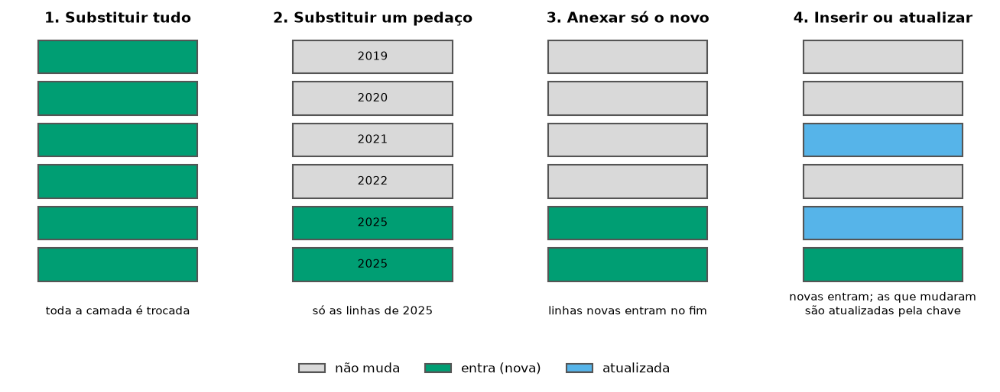

::: {.ficha}
[Nível]{.rotulo} Avançado
[Leitura]{.rotulo} 10 min
[Dados]{.rotulo} outubro de 2026
[Programas]{.rotulo} [ArcGIS]{.selo-texto} {fig-alt="QGIS"} {fig-alt="PostGIS"} {fig-alt="Python"}
:::

Quase todos os scripts da minha pasta terminavam do mesmo jeito: **apagar** as feições de uma camada e
**anexar** as novas (`DeleteFeatures` + `Append`). Funciona, mas cada script reinventava a regra, e um
erro no meio deixava a camada vazia ou duplicada.

Este artigo junta os quatro padrões que apareciam nos scripts e mostra o mais útil para o DETER, a
**carga incremental**, com três armadilhas que só apareceram testando com os dados reais.

{fig-alt="Quatro painéis. Substituir tudo: a tabela inteira é trocada. Substituir um pedaço: só as linhas de um ano são trocadas. Anexar só o novo: linhas novas entram no fim. Inserir ou atualizar: linhas novas entram e as que já existem são atualizadas pela chave."}

## Os quatro padrões

| Padrão | Quando usar | No script antigo |
|---|---|---|
| **1. Substituir tudo** | camada pequena, que a fonte publica inteira (embargos, UCs) | `DeleteFeatures` + `Append` dos embargos do IBAMA |
| **2. Substituir um pedaço** | dado por período que pode ser republicado (um ano do PRODES) | apagar o ano com `UpdateCursor` e anexar |
| **3. Anexar só o novo** | dado que só cresce (alertas diários) | pegar a data máxima e anexar o que é mais novo |
| **4. Inserir ou atualizar** ("upsert") | quando um registro pode mudar depois de publicado | não existia: duplicava |

O padrão 2 está no artigo [PRODES nas UCs](03-prodes-ucs.qmd#atualizar-quando-sair-um-ano-novo). Os
padrões 1, 3 e 4 estão abaixo.

## 1. Substituir tudo, sem deixar a camada vazia

O risco do "apagar e anexar" é o script cair **entre** as duas etapas: a camada fica vazia até alguém
perceber. Faça a troca de uma vez só:

| Programa | Como |
|---|---|
| ArcGIS Pro | `arcpy.management.TruncateTable(destino)` e `Append(novos, destino, "NO_TEST")`, dentro de um `with arcpy.da.Editor(gdb):` para desfazer se der erro |
| QGIS | `native:savefeatures` com `ACTION_ON_EXISTING_FILE = 1` (sobrescreve só a camada, numa operação) |
| PostGIS | `BEGIN; TRUNCATE destino; INSERT INTO destino SELECT … FROM novos; COMMIT;` |
| Python | `gdf.to_file("base.gpkg", layer="embargos")` grava a camada inteira de novo |

## 3 e 4. Carga incremental do DETER

O DETER publica alertas **todos os dias**. Baixar o serviço inteiro a cada vez é lento; o certo é pedir
**só o que mudou** e juntar à base. A receita que funcionou, depois dos testes:

1. Descobrir a **data mais recente** da base.
2. Pedir ao servidor os alertas desde **30 dias antes** dessa data (a "janela de segurança").
3. Comparar pela **chave** `gid` + `classname` + `view_date` e ficar só com o que falta.
4. **Anexar** (ou, no PostGIS, inserir e atualizar o que mudou).

Para testar, criei uma base "antiga", só com os alertas até 30/09/2026, e rodei cada versão **duas
vezes seguidas**.

::: {.panel-tabset group="programa"}

## ArcGIS Pro

O ArcGIS Pro não filtra WFS por data na ferramenta `WFSToFeatureClass`. O jeito é pedir o GeoJSON
filtrado ao servidor, como na aba Python, e converter com `JSONToFeatures`:

```python
import arcpy
import urllib.parse
import urllib.request
from datetime import timedelta

arcpy.env.overwriteOutput = True
base = r"C:\dados\resultados.gdb\deter_historico"

def chave(gid, classe, data):
    """O gid sozinho se repete no DETER: a chave é código + classe + data."""
    return f"{gid}|{classe}|{str(data)[:10]}"

# 1. Até quando a base já tem dados? Buscar de novo os 30 dias anteriores
campos = ["gid", "classname", "view_date"]
existentes = {chave(*linha) for linha in arcpy.da.SearchCursor(base, campos)}
ultima = max(linha[2] for linha in arcpy.da.SearchCursor(base, campos))
desde = (ultima - timedelta(days=30)).strftime("%Y-%m-%d")

# 2. Pedir ao servidor só a janela, só no recorte
filtro = f"view_date >= '{desde}' AND BBOX(geom,-56.5,-8.5,-54.5,-5.5,'EPSG:4674')"
url = ("https://terrabrasilis.dpi.inpe.br/geoserver/deter-amz/ows?service=WFS&version=2.0.0"
       "&request=GetFeature&typeNames=deter-amz:deter_amz&outputFormat=application/json"
       f"&srsName=EPSG:4674&CQL_FILTER={urllib.parse.quote(filtro)}")
urllib.request.urlretrieve(url, r"C:\dados\deter_janela.geojson")
janela = arcpy.conversion.JSONToFeatures(r"C:\dados\deter_janela.geojson",
                                         r"memory\janela", "POLYGON")

# 3. Só o que falta na base (a data vem como texto no GeoJSON)
faltam = [oid for oid, *linha in arcpy.da.SearchCursor(janela, ["OID@"] + campos)
          if chave(*linha) not in existentes]
print("alertas novos:", len(faltam))

# 4. Converter a data e anexar
if faltam:
    novos = arcpy.analysis.Select(janela, r"memory\novos",
                                  f"OBJECTID IN ({','.join(map(str, faltam))})")
    arcpy.management.CalculateField(
        novos, "data", "datetime.datetime.strptime(!view_date![:10], '%Y-%m-%d')",
        "PYTHON3", field_type="DATE")
    arcpy.management.DeleteField(novos, "view_date")
    arcpy.management.AlterField(novos, "data", "view_date", "view_date")
    arcpy.management.Append(novos, base, "NO_TEST")
```

O mesmo vale para uma camada do **ArcGIS Online**: use a URL do serviço (`.../FeatureServer/0`) como
`base`, como os scripts originais faziam.

## QGIS

```python
import processing

BASE = "C:/dados/deter_historico.gpkg"
WFS = ("WFS:https://terrabrasilis.dpi.inpe.br/geoserver/deter-amz/ows"
       "|layername=deter-amz:deter_amz")
CAMPOS = ["gid", "classname", "view_date", "sensor", "satellite", "municipality", "uf"]

def chave(f):
    """O gid sozinho se repete no DETER: a chave é código + classe + data."""
    return f"{f['gid']}|{f['classname']}|{f['view_date'].toString('yyyy-MM-dd')}"

# 1. Até quando a base já tem dados? Buscar de novo os 30 dias anteriores
historico = QgsVectorLayer(f"{BASE}|layername=deter", "historico", "ogr")
ultima = historico.maximumValue(historico.fields().indexOf("view_date"))
desde = ultima.addDays(-30).toString("yyyy-MM-dd")
existentes = {chave(f) for f in historico.getFeatures()}
print("base atual:", len(existentes), "alertas; buscando desde", desde)

# 2. Camada WFS filtrada no servidor (data) e pelo retângulo da área de interesse
servidor = QgsVectorLayer(WFS, "deter_wfs", "ogr")
servidor.setSubsetString(f"view_date >= '{desde}'")
retangulo = QgsFeatureRequest().setFilterRect(QgsRectangle(-56.5, -8.5, -54.5, -5.5))
janela = servidor.materialize(retangulo)           # copia para a memória

# 3. Ficar só com o que ainda não está na base, e só com os campos da base
ids = [f.id() for f in janela.getFeatures() if chave(f) not in existentes]
novos = janela.materialize(QgsFeatureRequest().setFilterFids(ids))
novos = processing.run("native:retainfields", {
    "INPUT": novos, "FIELDS": CAMPOS, "OUTPUT": "memory:"})["OUTPUT"]
print("alertas novos:", novos.featureCount())

# 4. Acrescentar à camada da base (ação 2 = anexar, sem criar campos)
if novos.featureCount():
    processing.run("native:savefeatures", {
        "INPUT": novos, "OUTPUT": BASE, "LAYER_NAME": "deter",
        "ACTION_ON_EXISTING_FILE": 2})
depois = QgsVectorLayer(f"{BASE}|layername=deter", "depois", "ogr")
print("base depois:", depois.featureCount(), "alertas")
```

O `materialize` copia as feições para a memória sem passar pelo Processamento, que pararia nas
geometrias inválidas do DETER (veja o artigo [Interior e entorno](02-interior-entorno.qmd)).

## PostGIS

No banco, a chave vira uma **chave primária**, e o `INSERT … ON CONFLICT` insere o que é novo e atualiza
o que já existe, numa única operação:

```sql
-- Só na primeira vez: a base, a partir da camada deter do GeoPackage
CREATE TABLE artigos.deter_hist AS
SELECT gid, classname, view_date, sensor, satellite, municipality, uf, geom
FROM artigos.deter;
ALTER TABLE artigos.deter_hist ADD PRIMARY KEY (gid, classname, view_date);
CREATE INDEX ON artigos.deter_hist USING gist (geom);
```

O script de atualização usa o `ogr2ogr` para trazer a janela do WFS:

```bash
#!/usr/bin/env bash
# Carga incremental do DETER no PostGIS: só os alertas mais novos que os da base.
set -euo pipefail
BANCO=monitoramento_ambiental

# 1. Até quando a base já tem dados? Buscar de novo os 30 dias anteriores (janela de segurança)
DESDE=$(psql -d $BANCO -Atc "SELECT max(view_date) - 30 FROM artigos.deter_hist")
echo "buscando alertas desde $DESDE"

# 2. Trazer do WFS só a janela, para uma tabela de passagem
ogr2ogr -f PostgreSQL "PG:dbname=$BANCO" \
  "WFS:https://terrabrasilis.dpi.inpe.br/geoserver/deter-amz/ows" deter-amz:deter_amz \
  -nln artigos.deter_novos -overwrite -nlt MULTIPOLYGON -lco GEOMETRY_NAME=geom \
  -spat -56.5 -8.5 -54.5 -5.5 -where "view_date >= '$DESDE'" \
  -select gid,classname,view_date,sensor,satellite,municipality,uf

# 3. Inserir os novos; se a chave já existir, atualizar
psql -d $BANCO -v ON_ERROR_STOP=1 -f upsert.sql
```

E o `upsert.sql`:

```sql
INSERT INTO artigos.deter_hist (gid, classname, view_date, sensor, satellite,
                                municipality, uf, geom)
SELECT gid, classname, view_date, sensor, satellite, municipality, uf, geom
FROM artigos.deter_novos
ON CONFLICT (gid, classname, view_date) DO UPDATE
    SET geom = EXCLUDED.geom,
        municipality = EXCLUDED.municipality;

SELECT count(*) AS alertas, max(view_date) AS ate FROM artigos.deter_hist;
```

## Python

```python
import geopandas as gpd
import pandas as pd
from urllib.parse import quote

BASE = "dados/deter_historico.gpkg"
CAMPOS = ["gid", "classname", "view_date", "sensor", "satellite", "municipality", "uf", "geometry"]

def chave(gdf):
    """O gid sozinho se repete no DETER: a chave é código + classe + data."""
    return gdf["gid"] + "|" + gdf["classname"] + "|" + gdf["view_date"].astype(str)

# 1. Até quando a base já tem dados? Buscar de novo os 30 dias anteriores (janela de segurança)
historico = gpd.read_file(BASE, layer="deter")
ultima = pd.to_datetime(historico["view_date"]).max()
desde = (ultima - pd.Timedelta(days=30)).date()
print("base atual:", len(historico), "alertas, até", ultima.date(), "- buscando desde", desde)

# 2. Pedir ao servidor só a janela, só no recorte (o filtro roda no servidor)
filtro = f"view_date >= '{desde}' AND BBOX(geom,-56.5,-8.5,-54.5,-5.5,'EPSG:4674')"
url = ("https://terrabrasilis.dpi.inpe.br/geoserver/deter-amz/ows?service=WFS&version=2.0.0"
       "&request=GetFeature&typeNames=deter-amz:deter_amz&outputFormat=application/json"
       f"&srsName=EPSG:4674&CQL_FILTER={quote(filtro)}")
novos = gpd.read_file(url)

if novos.empty:
    print("nada novo no servidor")
else:
    # 3. Ficar só com o que ainda não está na base
    novos = novos.set_crs(4674, allow_override=True)[CAMPOS]
    novos = novos[~chave(novos).isin(chave(historico))]
    # 4. Acrescentar à mesma camada do GeoPackage
    if len(novos):
        novos.to_file(BASE, layer="deter", mode="a")
    print("alertas acrescentados:", len(novos))

depois = gpd.read_file(BASE, layer="deter")
print("base depois:", len(depois), "alertas; chaves repetidas:", chave(depois).duplicated().sum())
```

:::

## Conferindo o resultado

As três versões testadas (QGIS, PostGIS e Python) partiram da mesma base de 7.483 alertas:

| | 1ª execução | 2ª execução |
|---|---:|---:|
| Base antes | 7.483 | 7.823 |
| Alertas acrescentados | 340 | 0 |
| Base depois | 7.823 | 7.823 |
| Chaves repetidas | 0 | 0 |

: Carga incremental do DETER no recorte de exemplo (dados até 16/10/2026). {.striped}

A segunda execução não acrescentou nada, que é o teste mais importante: um script de atualização
precisa poder rodar duas vezes sem estragar a base.

## As três armadilhas que os dados mostraram

::: {.callout-warning}
## 1. O código do alerta se repete
O campo `gid` parece um identificador, mas **28 códigos** do recorte aparecem em dois alertas
diferentes (classe, data e lugar diferentes). Ex.: `36608_hist` é um desmatamento de março de 2024 **e**
uma cicatriz de queimada de outubro de 2024. Com `gid` como chave, o PostGIS recusa a tabela; com ele
num `isin`, alertas novos seriam descartados. A combinação `gid` + `classname` + `view_date` é única
nos 7.823 alertas.
:::

::: {.callout-warning}
## 2. O filtro de data passa o último dia de novo
Pelo `ogr2ogr`, o filtro `view_date > '2026-10-16'` devolveu **148 alertas do próprio dia 16**. O
servidor compara a data como data e hora, com fuso horário. O `ON CONFLICT` evitou a duplicação, mas um
script que só anexa teria duplicado os 148. Moral: **nunca confie só no filtro de data**; compare pela
chave.
:::

::: {.callout-warning}
## 3. Alertas publicados depois
Um alerta pode entrar no serviço dias depois da data da imagem (`view_date`). Se o script só busca
"o que é mais novo que a data máxima", esse alerta nunca entra. A **janela de 30 dias** pega os atrasados,
e a chave descarta o que já estava na base.
:::

## Agendar e levar ao Power BI

- **Agendar:** Agendador de Tarefas do Windows ou `cron` (veja o artigo
  [Focos de calor](04-focos-calor.qmd#rodar-sozinho-todo-dia)). Rode uma vez por dia, de madrugada.
- **Power BI:** com a base atualizada no PostGIS, o painel do [Módulo 7](../guia-espacial/curso/07-power-bi.qmd) só
  precisa de **Atualizar**. No serviço do Power BI, a atualização agendada de um banco que está no seu
  computador exige o **gateway de dados local** instalado e ligado.

## Veja também

- [Desmatamento anual do PRODES nas UCs](03-prodes-ucs.qmd), com o padrão 2
- [Módulo 6 do curso: Python + PostGIS](../guia-espacial/curso/06-python.qmd), para gravar no banco sem senha no código

::: {.navegacao-livro}
[[← Anterior]{.direcao} Priorizar alertas em ArcGIS Pro, QGIS e Python](12-priorizacao-arcgis-qgis.qmd){.anterior}
:::

## Atualizações {.unnumbered}

- **29/10/2026:** publicação, com dados do INPE, do MMA, do IBAMA e do SICAR de outubro de 2026.
