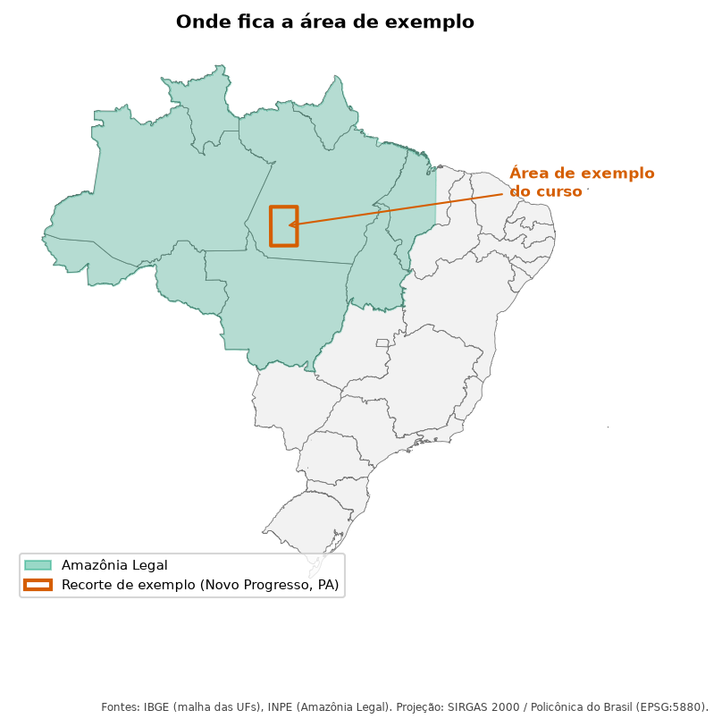
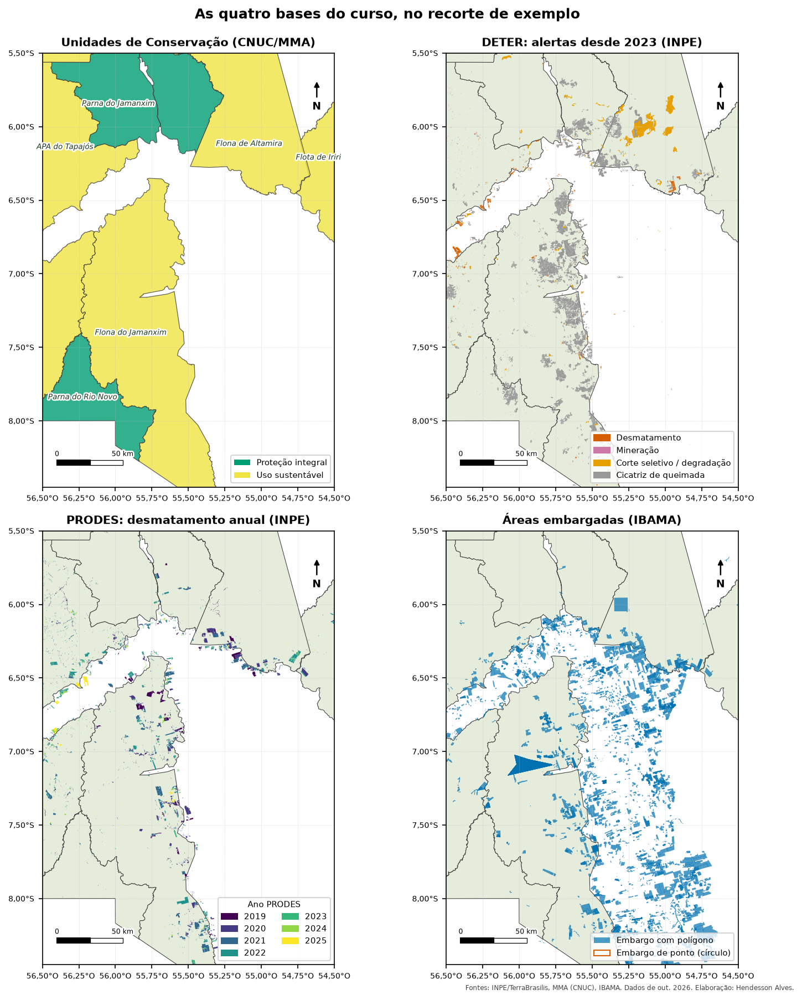

::: {.callout-tip appearance="simple"}
## Neste módulo
- Instalar as ferramentas no Windows, Linux ou Docker
- Saber de onde vem cada dado (INPE, MMA, IBAMA) e como baixar
- Carregar dados de WFS e shapefile no PostGIS com ogr2ogr

**Tempo estimado:** 60 min
:::

Neste módulo você instala as ferramentas, descobre **de onde vem cada dado** e monta o banco
`monitoramento_ambiental`, que será usado em todos os outros módulos.

---

## 1. Instalar as ferramentas

Você precisa de três coisas:

| Ferramenta | Para quê |
|---|---|
| **PostgreSQL** | o banco de dados |
| **PostGIS** | extensão que adiciona geometrias e funções espaciais ao PostgreSQL |
| **GDAL** (`ogr2ogr`) | baixar e converter dados geográficos (shapefile, WFS) para o banco |

Opcionais: **QGIS** (ver os dados no mapa), **DBeaver** ou **pgAdmin** (escrever SQL com interface),
**Power BI Desktop** (Módulo 7, só funciona no Windows).

### Windows

1. Baixe o instalador do PostgreSQL em https://www.postgresql.org/download/windows/ (EDB).
2. No fim da instalação, abra o **Stack Builder** e marque *Spatial Extensions → PostGIS*.
3. Instale o **QGIS** (https://qgis.org). Ele traz o GDAL: use o atalho **OSGeo4W Shell** para rodar `ogr2ogr`.
4. Os scripts `.sh` rodam no **Git Bash** (vem com o Git for Windows) ou no WSL. Se preferir,
   copie os comandos `ogr2ogr` e `psql` da seção 4 e rode um a um no OSGeo4W Shell.

### Linux (Debian/Ubuntu)

```bash
sudo apt install postgresql postgis gdal-bin
sudo -u postgres createuser --superuser "$USER"     # cria um usuário do banco com o seu nome
```

### Docker (qualquer sistema)

```bash
docker run -d --name postgis -p 5432:5432 -e POSTGRES_PASSWORD=troque_esta_senha postgis/postgis:17-3.5
```

### Criar o banco

```bash
createdb monitoramento_ambiental
psql -d monitoramento_ambiental -c "CREATE EXTENSION postgis;"
psql -d monitoramento_ambiental -c "SELECT postgis_full_version();"   # confere se funcionou
```

---

## 2. De onde vêm os dados

{fig-alt="Mapa do Brasil com a Amazônia Legal em verde e um retângulo vermelho no sudoeste do Pará, marcando a região de Novo Progresso usada como exemplo no curso." width="60%"}

Todos são públicos e gratuitos.

| Dado | Quem produz | O que é | Como baixar |
|---|---|---|---|
| **DETER** | INPE | Alertas quase diários de desmatamento, degradação, mineração e queimadas na Amazônia, detectados por satélite | WFS `https://terrabrasilis.dpi.inpe.br/geoserver/deter-amz/ows`, camada `deter-amz:deter_amz`; ou shapefile completo em https://terrabrasilis.dpi.inpe.br/file-delivery/download/deter-amz/shape |
| **PRODES** | INPE | Mapeamento anual oficial do desmatamento por corte raso (ano de agosto a julho) | WFS `https://terrabrasilis.dpi.inpe.br/geoserver/prodes-legal-amz/ows`, camada `prodes-legal-amz:yearly_deforestation`; ou página de downloads: https://terrabrasilis.dpi.inpe.br/downloads/ |
| **Unidades de Conservação** | MMA (CNUC) | Polígonos de todas as UCs do Brasil (federais, estaduais, municipais), com o código CNUC | https://dados.mma.gov.br/dataset/unidadesdeconservacao → "Polígono CNUC" (zip com shapefile). O script usa a versão de agosto de 2025 |
| **Áreas embargadas** | IBAMA | Polígonos das áreas embargadas por infração ambiental | WFS `https://pamgia.ibama.gov.br/server/services/01_Publicacoes_Bases/adm_embargos_ibama_a/MapServer/WFSServer`, camada `adm_embargos_ibama_a:base.adm_embargos_ibama_a`. Tabelas (sem polígono) em https://dadosabertos.ibama.gov.br/dataset/fiscalizacao-termo-de-embargo |

Outras fontes úteis para expandir o projeto:

| Dado | Onde |
|---|---|
| Alertas MapBiomas (validados, com CAR) | https://alerta.mapbiomas.org (download e API exigem cadastro gratuito) |
| Focos de calor | Programa Queimadas (INPE): https://terrabrasilis.dpi.inpe.br/queimadas/ |
| Área queimada | MapBiomas Fogo: https://mapbiomas.org |
| Limites municipais | IBGE, Malha Municipal: https://www.ibge.gov.br/geociencias/organizacao-do-territorio/malhas-territoriais.html |
| Terras Indígenas | FUNAI: https://www.gov.br/funai/pt-br/atuacao/terras-indigenas/geoprocessamento-e-mapas |
| CAR (imóveis rurais) | SICAR: https://www.car.gov.br → Consulta Pública → Downloads (por estado) |

::: {.callout-note}
**O que é WFS?** *Web Feature Service* é um padrão para servir dados vetoriais pela internet.
Em vez de baixar um arquivo enorme e recortar depois, você pede ao servidor só a área e o
período que interessam. O `ogr2ogr` e o QGIS entendem WFS diretamente.
Para ver as camadas de um WFS, abra no navegador:
`https://terrabrasilis.dpi.inpe.br/geoserver/deter-amz/ows?service=WFS&request=GetCapabilities`
:::

::: {.callout-warning}
**Dados pessoais:** a base de embargos do IBAMA traz nome e CPF/CNPJ do embargado.
Os scripts deste projeto **não copiam** esses campos. Não publique esse tipo de informação
em painéis ou sites (LGPD).
:::

---

## 3. Conhecendo cada dado antes de carregar

Use o `ogrinfo` (vem com o GDAL) para espiar um dado sem baixar tudo:

```bash
# Lista as camadas do WFS do DETER
ogrinfo "WFS:https://terrabrasilis.dpi.inpe.br/geoserver/deter-amz/ows"

# Mostra os campos e o sistema de coordenadas de uma camada
ogrinfo -so "WFS:https://terrabrasilis.dpi.inpe.br/geoserver/deter-amz/ows" deter-amz:deter_amz
```

Campos principais (conferidos em outubro de 2026):

| Dado | Campos que usamos |
|---|---|
| DETER | `gid` (id do alerta), `classname` (classe), `view_date` (data da imagem), `uf`, `municipality` |
| PRODES | `uuid`, `main_class`, `year`, `image_date`, `state` |
| CNUC | `cd_cnuc`, `nome_uc`, `categoria`, `grupo`, `esfera`, `uf` |
| Embargos IBAMA | `num_tad`, `serie_tad`, `dat_embargo`, `origem_geom` (`Polígono` ou `Ponto`), `qtd_area_embargada` |

Classes do DETER: `DESMATAMENTO_CR` (corte raso), `DESMATAMENTO_VEG` (com vegetação),
`MINERACAO`, `CS_DESORDENADO` e `CS_GEOMETRICO` (corte seletivo), `DEGRADACAO`, `CICATRIZ_DE_QUEIMADA`.

Todos vêm em **SIRGAS 2000 (EPSG:4674)**, com coordenadas em graus.

{fig-alt="Quatro mapas da mesma região. No primeiro, as Unidades de Conservação coloridas por grupo. No segundo, os alertas DETER por classe, com predomínio de cicatrizes de queimada em cinza. No terceiro, o desmatamento PRODES colorido por ano, de 2019 a 2025. No quarto, centenas de áreas embargadas pelo IBAMA, concentradas fora das UCs, ao longo da BR-163."}

---

## 4. Carregar no banco

### Jeito rápido

```bash
cd sql
./00_baixar_dados.sh
```

Por padrão o script baixa só um **recorte de exemplo** (região de Novo Progresso, PA), com DETER
desde 2023 e PRODES desde 2019. Para outra área ou período:

```bash
BBOX="-74 -18.1 -43.9 5.3" DETER_DESDE=2024-08-01 PRODES_DESDE=2022 ./00_baixar_dados.sh
```

`BBOX` é `xmin ymin xmax ymax` (longitude e latitude). Os valores acima cobrem a Amazônia Legal
inteira, o que leva bem mais tempo e espaço em disco.

### Passo a passo (o que o script faz)

Cada fonte vira uma tabela no schema `bruto`:

```bash
# Unidades de Conservação: baixa o zip e carrega direto de dentro dele (/vsizip/)
curl -L -o cnuc.zip "https://dados.mma.gov.br/dataset/44b6dc8a-dc82-4a84-8d95-1b0da7c85dac/resource/6ba9a557-87e8-4882-acb7-b3e0f0ea192d/download/shp_cnuc_2025_08.zip"
ogr2ogr -f PostgreSQL "PG:dbname=monitoramento_ambiental" /vsizip/cnuc.zip cnuc_2025_08 \
  -nln cnuc -lco SCHEMA=bruto -lco GEOMETRY_NAME=geom -nlt MULTIPOLYGON -makevalid -overwrite

# DETER pelo WFS, só a área e o período de interesse
ogr2ogr -f PostgreSQL "PG:dbname=monitoramento_ambiental" \
  "WFS:https://terrabrasilis.dpi.inpe.br/geoserver/deter-amz/ows" deter-amz:deter_amz \
  -nln deter -lco SCHEMA=bruto -lco GEOMETRY_NAME=geom -nlt MULTIPOLYGON -overwrite \
  -spat -56.5 -8.5 -54.5 -5.5 -where "view_date >= '2023-01-01'"
```

O que cada opção faz:

| Opção | Significado |
|---|---|
| `-f PostgreSQL "PG:dbname=..."` | destino: um banco PostgreSQL |
| `-nln cnuc` | nome da tabela criada |
| `-lco SCHEMA=bruto` | schema de destino |
| `-lco GEOMETRY_NAME=geom` | nome da coluna de geometria |
| `-nlt MULTIPOLYGON` | força o tipo MultiPolygon (o WFS entrega "MultiSurface") |
| `-makevalid` | corrige geometrias inválidas na carga |
| `-spat xmin ymin xmax ymax` | recorte espacial (no WFS, o filtro roda no servidor) |
| `-where "..."` | filtro por atributo (no WFS, também roda no servidor) |
| `-overwrite` | apaga e recria a tabela se ela já existir |

Se o banco pedir senha ou estiver em outro computador, use
`"PG:host=localhost port=5432 dbname=monitoramento_ambiental user=postgres"` e a variável `PGPASSWORD`.

### Preparar as tabelas de análise

```bash
psql -d monitoramento_ambiental -f 01_preparar_tabelas.sql
```

Esse script transforma o `bruto` em tabelas limpas:

| Tabela | Conteúdo |
|---|---|
| `limites.ucs` | UCs com geometria corrigida e área em hectares |
| `limites.ucs_entorno` | faixa de 3 km em volta de cada UC |
| `fiscalizacao.embargos` | embargos IBAMA, **sem dados pessoais** |
| `desmatamento.deter_alertas` | um alerta DETER por linha (o WFS às vezes divide um alerta em pedaços) |
| `desmatamento.deter_ucs` | alertas DETER no interior ou no entorno das UCs |
| `desmatamento.prodes_ucs` | desmatamento PRODES no interior ou no entorno das UCs |

Colunas de `desmatamento.deter_ucs`, a tabela mais usada nos módulos:

| Coluna | Tipo | Descrição |
|---|---|---|
| `id_alerta` | text | identificador do alerta no DETER |
| `classname` | text | classe do alerta |
| `data` | date | data da imagem de satélite |
| `ano`, `mes_num`, `mes` | int, int, text | partes da data |
| `ano_prodes` | int | ano no calendário PRODES (agosto a julho) |
| `local` | text | `Interior` (dentro da UC) ou `Entorno` (até 3 km fora) |
| `nome_uc`, `cnuc` | text | UC do alerta |
| `uf`, `municipio` | text | localização |
| `area_ha` | numeric | área em hectares (da parte dentro da UC, se `Interior`) |
| `apuracao`, `legalidade`, `info`, `embargo` | | campos para revisão manual (começam vazios) |
| `x`, `y` | double | um ponto dentro do polígono (longitude, latitude) |
| `geom` | geometry | polígono (MultiPolygon, SIRGAS 2000) |

---

## 5. Explorar o banco

### No `psql`

```
\dn                         -- lista os schemas
\dt desmatamento.*          -- tabelas de um schema
\dv powerbi.*               -- views de um schema
\d+ desmatamento.deter_ucs  -- colunas, tipos e índices
```

### Em SQL (qualquer cliente)

```sql
-- Todas as tabelas e views do projeto
SELECT table_schema, table_name, table_type
FROM information_schema.tables
WHERE table_schema IN ('bruto', 'limites', 'fiscalizacao', 'desmatamento', 'powerbi')
ORDER BY 1, 2;

-- Onde existe a coluna "cnuc"?
SELECT table_schema, table_name
FROM information_schema.columns
WHERE column_name = 'cnuc';

-- Camadas espaciais: tipo de geometria e SRID
SELECT f_table_schema, f_table_name, f_geometry_column, type, srid
FROM geometry_columns
ORDER BY 1, 2;

-- Primeira olhada num dado
SELECT count(*), min(data), max(data) FROM desmatamento.deter_ucs;
SELECT ST_Extent(geom) FROM desmatamento.deter_ucs;    -- retângulo que envolve tudo
```

### No QGIS

*Camada → Adicionar camada → Adicionar camadas PostGIS*, crie uma conexão com o banco
`monitoramento_ambiental` e arraste as tabelas para o mapa. Também dá para abrir os WFS da
seção 2 direto no QGIS (*Adicionar camada WFS*) e comparar com o que foi carregado.

---

## 6. Atualizar os dados

DETER e embargos mudam toda semana. Para atualizar, rode de novo:

```bash
./rodar_tudo.sh
```

O `-overwrite` recria as tabelas do `bruto`, e os scripts SQL recriam o resto.
Para agendar (Linux), use o `cron`; no Windows, o Agendador de Tarefas.

::: {.callout-note}
Os campos de revisão manual (`apuracao`, `legalidade`, `info`, `embargo`) são recriados
vazios a cada execução. Se você for preenchê-los, guarde as revisões numa tabela separada
(ex.: `desmatamento.revisoes`, com `id_alerta` e os campos) e junte com `LEFT JOIN` no passo 01.
:::
