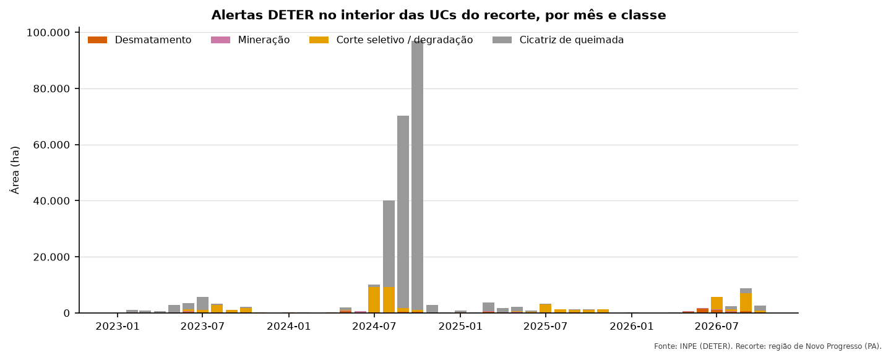

::: {.callout-tip appearance="simple"}
## Neste módulo
- Juntar tabelas por chave e empilhar resultados
- Resumir dados com GROUP BY, FILTER e funções de janela
- Criar tabelas, views e consultas em etapas com WITH

**Tempo estimado:** 60 min · **Módulo anterior:** [Módulo 1: SQL básico](01-sql-basico.qmd)
:::

---

## 1. Um espaço para praticar

Os scripts do projeto apagam e recriam tabelas (`DROP TABLE ... CASCADE`). Para experimentar sem
estragar nada, crie um schema de treino:

```sql
CREATE SCHEMA IF NOT EXISTS treino;
```

---

## 2. JOIN: juntar tabelas

### INNER JOIN: só as linhas que casam nos dois lados

A tabela de alertas tem o código da UC (`cnuc`); os dados da UC (categoria, área) estão em `limites.ucs`:

```sql
SELECT d.id_alerta, d.area_ha, u.nome_uc, u.categoria, u.esfera
FROM desmatamento.deter_ucs d
JOIN limites.ucs u ON u.cnuc = d.cnuc
LIMIT 10;
```

A coluna que liga as duas tabelas (`cnuc`) é a **chave**. `JOIN` sozinho é o mesmo que `INNER JOIN`.

### LEFT JOIN: mantém todas as linhas da esquerda

```sql
-- Todas as UCs, com o total de alertas (inclusive UCs sem nenhum alerta)
SELECT u.nome_uc, count(d.id_alerta) AS alertas
FROM limites.ucs u
LEFT JOIN desmatamento.deter_ucs d ON d.cnuc = u.cnuc AND d.local = 'Interior'
GROUP BY u.nome_uc
ORDER BY alertas DESC;
```

UCs sem alertas aparecem com `0`. Com `JOIN` comum, elas sumiriam.

**Regra prática:** use `LEFT JOIN` quando a tabela da esquerda é a "principal" e você quer mantê-la inteira.

::: {.callout-note}
Repare que a condição `d.local = 'Interior'` está no `ON`, não no `WHERE`. No `WHERE`, ela
eliminaria as UCs sem alertas (`d.local` seria `NULL`) e o `LEFT JOIN` viraria um `JOIN` comum.
:::

### Self join: uma tabela com ela mesma

Para achar alertas vizinhos, comparamos a tabela com ela mesma (o Módulo 3 explica o `ST_DWithin`):

```sql
SELECT a.id_alerta AS alerta, b.id_alerta AS vizinho, b.data - a.data AS dias_depois
FROM desmatamento.deter_ucs a
JOIN desmatamento.deter_ucs b
  ON a.id_alerta <> b.id_alerta
 AND ST_DWithin(a.geom, b.geom, 0.0006)          -- perto no espaço (~66 m)
 AND b.data - a.data BETWEEN 0 AND 182           -- até 6 meses depois
LIMIT 20;
```

---

## 3. UNION: empilhar resultados

DETER e PRODES são tabelas diferentes, mas dá para empilhar as duas numa lista única de
"desmatamento detectado", desde que as colunas sejam iguais:

```sql
SELECT 'DETER' AS fonte, id_alerta, ano, nome_uc, area_ha
FROM desmatamento.deter_ucs
WHERE classname = 'DESMATAMENTO_CR'

UNION ALL

SELECT 'PRODES', id_alerta, ano, nome_uc, area_ha
FROM desmatamento.prodes_ucs;
```

Regras:
- mesmo número de colunas, na mesma ordem, com tipos compatíveis. Quando uma tabela não tem uma
  coluna, crie uma vazia: `NULL::text AS classe`;
- `UNION` remove linhas duplicadas (é mais lento); `UNION ALL` mantém todas.

---

## 4. GROUP BY e agregações

```sql
SELECT nome_uc,
       count(*)                          AS qtd_alertas,
       round(sum(area_ha), 1)            AS area_total_ha,
       round(avg(area_ha), 2)            AS area_media_ha,
       min(data)                         AS primeiro,
       max(data)                         AS ultimo
FROM desmatamento.deter_ucs
WHERE local = 'Interior'
GROUP BY nome_uc
ORDER BY area_total_ha DESC;
```

Regra: toda coluna do `SELECT` precisa estar no `GROUP BY` **ou** dentro de uma função de agregação
(`count`, `sum`, `avg`, `min`, `max`...).

O mesmo tipo de agrupamento, por mês e classe, vira este gráfico:

{fig-alt="Gráfico de barras empilhadas por mês, de 2023 a 2026. A maior parte da área é de cicatriz de queimada, com picos de 40 mil a quase 100 mil hectares entre agosto e outubro de 2024. Corte seletivo e degradação aparecem todo ano na estação seca; desmatamento e mineração são faixas pequenas. De janeiro a abril quase não há alertas, por causa das nuvens."}

```sql
SELECT date_trunc('month', data)::date AS mes, classname, sum(area_ha) AS area_ha
FROM desmatamento.deter_ucs
WHERE local = 'Interior'
GROUP BY 1, 2
ORDER BY 1;
```

::: {.callout-note}
Poucos alertas entre janeiro e abril **não** significam pouco desmatamento: é a estação chuvosa, e as nuvens impedem o satélite de enxergar o chão.
:::

### HAVING: filtrar depois de agrupar

```sql
SELECT nome_uc, count(*) AS qtd
FROM desmatamento.deter_ucs
GROUP BY nome_uc
HAVING count(*) >= 100;      -- WHERE filtra linhas; HAVING filtra grupos
```

### FILTER: contar só parte do grupo

```sql
SELECT nome_uc,
       count(*)                                          AS total,
       count(*) FILTER (WHERE classname = 'MINERACAO')   AS mineracao,
       count(*) FILTER (WHERE classname LIKE 'DESMAT%')  AS desmatamento
FROM desmatamento.deter_ucs
GROUP BY nome_uc;
```

### Tabela cruzada (UC × ano)

```sql
SELECT nome_uc,
       round(sum(area_ha) FILTER (WHERE ano = 2023)) AS "2023",
       round(sum(area_ha) FILTER (WHERE ano = 2024)) AS "2024",
       round(sum(area_ha) FILTER (WHERE ano = 2025)) AS "2025"
FROM desmatamento.prodes_ucs
WHERE local = 'Interior'
GROUP BY nome_uc;
```

---

## 5. Juntar textos e listas: `string_agg` e `array_agg`

```sql
-- Classes de alerta de cada UC, numa string só
SELECT nome_uc, string_agg(DISTINCT classname, ', ') AS classes
FROM desmatamento.deter_ucs
GROUP BY nome_uc;

-- Os alertas de cada UC num array, em ordem de data
SELECT nome_uc, array_agg(id_alerta ORDER BY data) AS alertas
FROM desmatamento.deter_ucs
GROUP BY nome_uc;
```

Operações com arrays:

| Expressão | Significado |
|---|---|
| `unnest(arr)` | "explode" o array em linhas |
| `arr[1]` | primeiro elemento (arrays começam em 1) |
| `array_length(arr, 1)` | tamanho |
| `a && b` | `true` se `a` e `b` têm algum elemento em comum |

```sql
SELECT unnest(ARRAY[10, 20, 30]);      -- 3 linhas
SELECT ARRAY[1,2,3] && ARRAY[3,4];     -- true
```

---

## 6. Funções de janela: `OVER`

Agregam **sem juntar as linhas**: cada linha continua lá, ganhando uma coluna calculada.

```sql
-- Numerar as linhas
SELECT row_number() OVER (ORDER BY data) AS n, id_alerta, data
FROM desmatamento.deter_ucs LIMIT 10;

-- Ranking dos maiores alertas DENTRO de cada UC
SELECT nome_uc, id_alerta, area_ha,
       row_number() OVER (PARTITION BY nome_uc ORDER BY area_ha DESC) AS posicao
FROM desmatamento.deter_ucs;

-- Percentual de cada alerta na área total da UC
SELECT nome_uc, id_alerta, area_ha,
       round(100 * area_ha / sum(area_ha) OVER (PARTITION BY nome_uc), 2) AS pct_da_uc
FROM desmatamento.deter_ucs;

-- Área acumulada mês a mês
SELECT to_char(data, 'YYYY-MM') AS mes, round(sum(area_ha)) AS area,
       round(sum(sum(area_ha)) OVER (ORDER BY to_char(data, 'YYYY-MM'))) AS acumulado
FROM desmatamento.deter_ucs
GROUP BY 1 ORDER BY 1;
```

`PARTITION BY` reinicia o cálculo para cada grupo. `row_number() OVER (ORDER BY ...)` também é
usado para criar um identificador único, que QGIS e Power BI gostam de ter.

### DISTINCT ON: a "primeira" linha de cada grupo

Recurso do PostgreSQL muito útil:

```sql
-- O maior alerta de cada UC
SELECT DISTINCT ON (nome_uc) nome_uc, id_alerta, area_ha
FROM desmatamento.deter_ucs
ORDER BY nome_uc, area_ha DESC;
```

O `01_preparar_tabelas.sql` usa isso para escolher, entre UCs sobrepostas, aquela com maior sobreposição.

---

## 7. Subconsultas e WITH

Uma consulta pode ser usada como tabela, desde que tenha apelido:

```sql
SELECT t.nome_uc, t.total
FROM (
    SELECT nome_uc, sum(area_ha) AS total
    FROM desmatamento.deter_ucs
    GROUP BY nome_uc
) t
WHERE t.total > 10000;
```

Com `WITH` (CTE), fica mais legível, principalmente com várias etapas:

```sql
WITH totais AS (
    SELECT nome_uc, sum(area_ha) AS total
    FROM desmatamento.deter_ucs
    GROUP BY nome_uc
),
media AS (
    SELECT avg(total) AS media FROM totais
)
SELECT t.nome_uc, round(t.total) AS total
FROM totais t, media m
WHERE t.total > m.media;
```

Os scripts de apuração e priorização são escritos inteiros com `WITH`: cada etapa tem um nome.

---

## 8. Criar tabelas e views

### CREATE TABLE AS

```sql
DROP TABLE IF EXISTS treino.resumo_uc CASCADE;

CREATE TABLE treino.resumo_uc AS
SELECT nome_uc, count(*) AS qtd, sum(area_ha) AS area_ha
FROM desmatamento.deter_ucs
GROUP BY nome_uc;
```

- `DROP TABLE IF EXISTS` não dá erro se a tabela não existir.
- `CASCADE` apaga também as views que dependem da tabela. **Elas não voltam sozinhas**: por isso
  os scripts do projeto recriam as views logo depois.

### CREATE TABLE com colunas e chave primária

```sql
CREATE TABLE treino.revisoes (
    id_alerta  text PRIMARY KEY,          -- único e obrigatório
    legalidade text,
    info       text,
    revisado_em date DEFAULT CURRENT_DATE
);

INSERT INTO treino.revisoes (id_alerta, legalidade, info)
VALUES ('exemplo_123', 'Autorizado', 'Plano de manejo aprovado');

SELECT * FROM treino.revisoes;
```

### VIEW: uma consulta salva

```sql
CREATE OR REPLACE VIEW treino.vw_alertas_grandes AS
SELECT id_alerta, nome_uc, area_ha, geom
FROM desmatamento.deter_ucs
WHERE area_ha > 50;
```

| | Tabela (`CREATE TABLE AS`) | View |
|---|---|---|
| Guarda os dados? | Sim, uma "foto" do momento | Não, roda a consulta toda vez |
| Fica desatualizada? | Sim, precisa recriar | Não |
| Velocidade | rápida para ler | depende da consulta |

O projeto usa **tabelas** para as etapas pesadas (apuração, clusters) e **views** no final
(`powerbi.*`), que só juntam e formatam o que já está pronto.

---

## Exercícios

1. Para cada categoria de UC (`limites.ucs.categoria`), mostre a área total de alertas DETER no interior.
2. Para cada UC, mostre o mês (`YYYY-MM`) com maior área de alertas.
3. Crie no schema `treino` uma view com o total de alertas por mês e UC.

<details><summary>Respostas</summary>

```sql
-- 1
SELECT u.categoria, round(sum(d.area_ha)) AS area_ha
FROM desmatamento.deter_ucs d JOIN limites.ucs u USING (cnuc)
WHERE d.local = 'Interior'
GROUP BY u.categoria ORDER BY 2 DESC;

-- 2
SELECT DISTINCT ON (nome_uc) nome_uc, to_char(data, 'YYYY-MM') AS mes, round(sum(area_ha)) AS area
FROM desmatamento.deter_ucs
GROUP BY nome_uc, to_char(data, 'YYYY-MM')
ORDER BY nome_uc, sum(area_ha) DESC;

-- 3
CREATE OR REPLACE VIEW treino.vw_alertas_mes AS
SELECT nome_uc, to_char(data, 'YYYY-MM') AS mes, count(*) AS qtd, sum(area_ha) AS area_ha
FROM desmatamento.deter_ucs
GROUP BY 1, 2;
```
</details>
