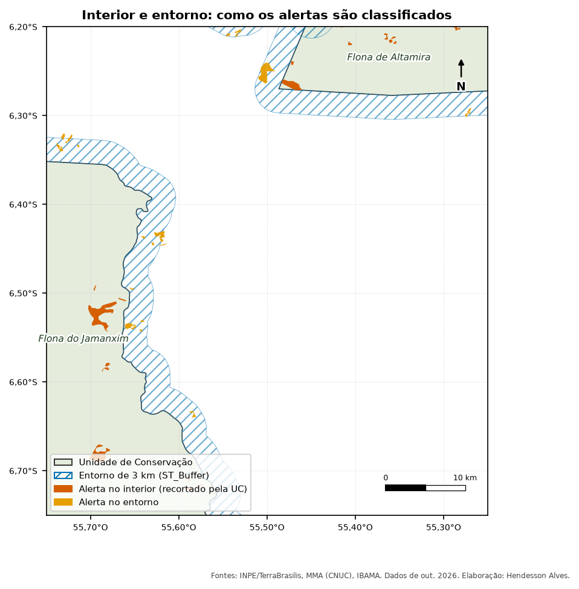
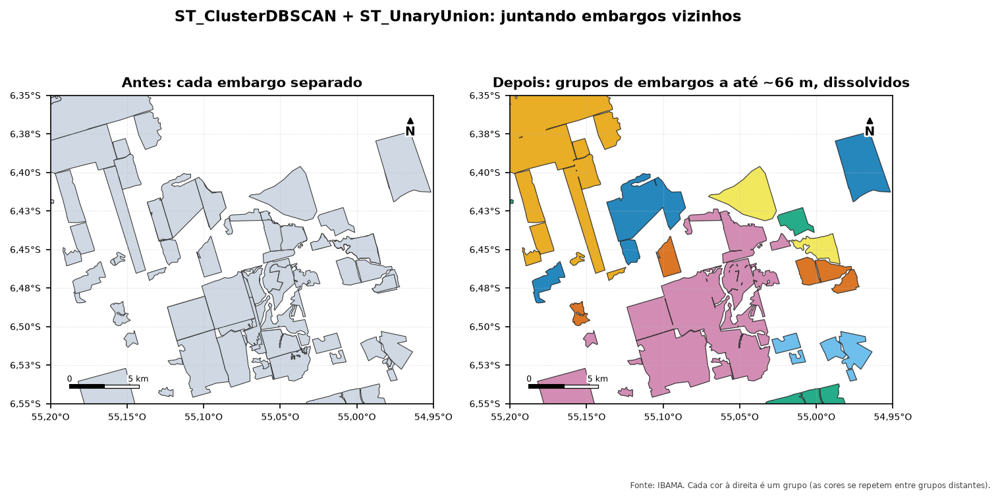
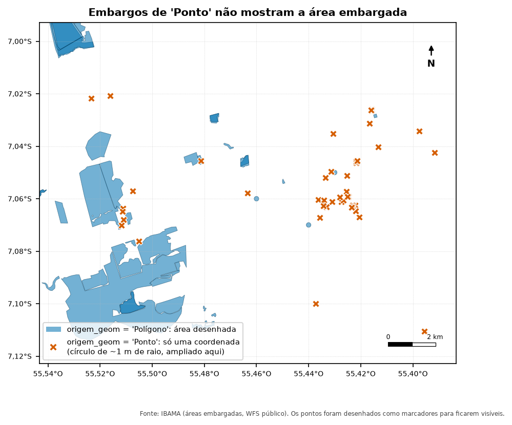
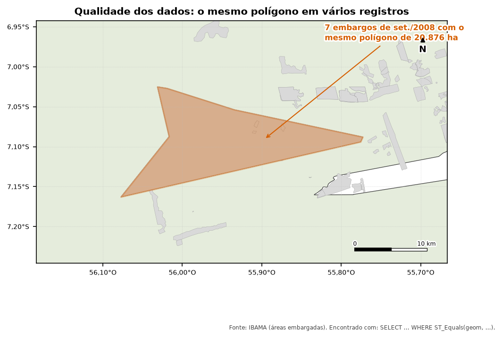

::: {.callout-tip appearance="simple"}
## Neste módulo
- Medir áreas e distâncias corretamente em SIRGAS 2000
- Corrigir geometrias inválidas
- Cruzar camadas e agrupar vizinhos com ST_ClusterDBSCAN

**Tempo estimado:** 75 min · **Módulo anterior:** [Módulo 2: JOINs, agregações e tabelas](02-joins-e-agregacoes.qmd)
:::

O PostGIS adiciona ao PostgreSQL o tipo `geometry` e centenas de funções `ST_*`.
Este módulo cobre as que o projeto usa.

---

## 1. Geometria e SRID

```sql
SELECT id_alerta,
       GeometryType(geom)              AS tipo,     -- MULTIPOLYGON
       ST_SRID(geom)                   AS srid,     -- 4674
       ST_NumGeometries(geom)          AS partes,
       ST_AsText(ST_PointOnSurface(geom)) AS um_ponto_dentro
FROM desmatamento.deter_ucs
LIMIT 5;
```

O **SRID** diz em qual sistema de coordenadas estão os números. Os dados do INPE, MMA e IBAMA
vêm em **4674 (SIRGAS 2000)**, com coordenadas em **graus** (longitude, latitude). Isso muda o
significado das medidas:

| Operação | Em SRID 4674 (graus) | Em metros ou hectares |
|---|---|---|
| `ST_Area(geom)` | graus² (não serve como área) | `ST_Area(geom::geography) / 10000` → hectares |
| `ST_Perimeter(geom)` | graus | `ST_Perimeter(geom::geography)` → metros |
| `ST_DWithin(a, b, 0.0006)` | 0,0006 grau ≈ **66 m** perto do equador | `ST_DWithin(a::geography, b::geography, 60)` → 60 m |
| `ST_Buffer(geom, 0.03)` | buffer em graus (deformado) | `ST_Buffer(geom::geography, 3000)::geometry` → 3 km |

`::geography` faz o cálculo sobre a forma real da Terra e devolve metros:

```sql
SELECT nome_uc,
       round((ST_Area(geom::geography) / 10000)::numeric) AS area_ha,
       round(ST_Area(geom)::numeric, 4)                   AS area_em_graus2   -- sem sentido físico
FROM limites.ucs;
```

::: {.callout-note}
Quando você calcula uma **proporção** (área da interseção ÷ área do alerta), a unidade se
cancela e dá para usar `ST_Area` sem `::geography`, que é mais rápido. Para mostrar área em
hectares, use sempre `::geography`.
:::

### Criar uma coluna de geometria

```sql
CREATE TABLE treino.pontos (
    id   serial PRIMARY KEY,
    nome text,
    geom geometry(Point, 4674)
);

INSERT INTO treino.pontos (nome, geom)
VALUES ('Novo Progresso', ST_SetSRID(ST_MakePoint(-55.38, -7.14), 4674));   -- (longitude, latitude)
```

### Índice espacial

Sem índice, uma consulta espacial compara cada geometria com todas as outras. O índice GiST
deixa `ST_Intersects`, `ST_DWithin` e afins muito mais rápidos:

```sql
CREATE INDEX IF NOT EXISTS pontos_geom_idx ON treino.pontos USING gist (geom);
```

(O `ogr2ogr` e o `01_preparar_tabelas.sql` já criam os índices das tabelas do projeto.)

---

## 2. Geometrias inválidas

Polígonos com auto-interseção ("gravata borboleta") ou anéis mal fechados fazem `ST_Union`,
`ST_Intersection` e outras funções darem erro. Dados de satélite têm bastante disso:

```sql
SELECT count(*) FILTER (WHERE NOT ST_IsValid(geom)) AS invalidas, count(*) AS total
FROM bruto.deter;

-- Por que é inválida?
SELECT gid, ST_IsValidReason(geom)
FROM bruto.deter
WHERE NOT ST_IsValid(geom)
LIMIT 5;
```

Como o projeto corrige:

```sql
ST_Multi(ST_CollectionExtract(ST_MakeValid(geom), 3))
```

Lendo de dentro para fora:
1. `ST_MakeValid(geom)` conserta. Às vezes devolve uma *GeometryCollection* que mistura polígonos, linhas e pontos.
2. `ST_CollectionExtract(..., 3)` mantém só os polígonos (1 = ponto, 2 = linha, 3 = polígono).
3. `ST_Multi(...)` garante o tipo MULTIPOLYGON.

---

## 3. Partes: ST_Dump, ST_Collect, ST_NumGeometries

Um MULTIPOLYGON pode ter vários pedaços separados.

```sql
-- ST_Dump separa cada parte numa linha
SELECT id_alerta, (ST_Dump(geom)).path, ST_Area((ST_Dump(geom)).geom::geography) / 10000 AS ha
FROM desmatamento.deter_ucs
WHERE ST_NumGeometries(geom) > 1
LIMIT 10;
```

`ST_Dump` devolve um registro com `path` (o número da parte) e `geom`, daí a sintaxe `(ST_Dump(geom)).geom`.

```sql
-- ST_Collect junta várias geometrias num MULTI, sem dissolver (rápido)
SELECT nome_uc, ST_NumGeometries(ST_Collect(geom)) AS poligonos
FROM desmatamento.deter_ucs
GROUP BY nome_uc;
```

---

## 4. ST_Union: dissolver

```sql
SELECT nome_uc,
       round(sum(area_ha))                                          AS soma_das_areas,
       round((ST_Area(ST_Union(geom)::geography) / 10000)::numeric) AS area_dissolvida
FROM desmatamento.deter_ucs
GROUP BY nome_uc;
```

Se `soma_das_areas` for maior que `area_dissolvida`, existem alertas sobrepostos (comum entre
cicatrizes de queimada de anos diferentes e desmatamento no mesmo lugar).

| | `ST_Collect` | `ST_Union` |
|---|---|---|
| Junta as geometrias | sim | sim |
| Funde bordas e remove sobreposição | não | sim |
| Velocidade | rápida | lenta |

`ST_UnaryUnion(geom)` faz o mesmo que `ST_Union`, mas dentro de **uma** geometria. Ou seja,
dissolve as partes sobrepostas de um multipolígono.

---

## 5. Relações espaciais: ST_Intersects, ST_DWithin

```sql
-- Embargos que tocam alertas DETER
SELECT DISTINCT e.num_embargo, e.data
FROM fiscalizacao.embargos e
JOIN desmatamento.deter_ucs d ON ST_Intersects(e.geom, d.geom);
```

`ST_Intersects(a, b)` é verdadeiro se `a` e `b` têm **qualquer** ponto em comum, mesmo só a borda.

```sql
-- Pares de alertas a até ~66 m um do outro
SELECT a.id_alerta, b.id_alerta
FROM desmatamento.deter_ucs a
JOIN desmatamento.deter_ucs b
  ON a.id_alerta < b.id_alerta              -- evita comparar consigo mesmo e repetir pares
 AND ST_DWithin(a.geom, b.geom, 0.0006)
LIMIT 20;
```

`ST_DWithin(a, b, d)` é verdadeiro se a distância for ≤ `d`, na unidade do SRID.
É muito mais rápido que `ST_Distance(a, b) < d`, porque usa o índice.

Outras relações: `ST_Contains`, `ST_Within`, `ST_Touches`, `ST_Overlaps`, `ST_Disjoint`.

---

## 6. ST_Intersection: quanto se sobrepõe?

A pergunta central da apuração: **quanto do alerta está coberto por um embargo?**

```sql
SELECT d.id_alerta, e.num_embargo,
       round((ST_Area(ST_Intersection(d.geom, e.geom)) / ST_Area(d.geom))::numeric, 3) AS fracao
FROM desmatamento.deter_ucs d
JOIN fiscalizacao.embargos e ON ST_Intersects(d.geom, e.geom)   -- filtra primeiro, com índice
ORDER BY fracao DESC
LIMIT 20;
```

- `ST_Intersection(a, b)` devolve a geometria da parte comum.
- Dividindo pela área do alerta, você tem a fração coberta, de 0 a 1.

::: {.callout-note}
Coloque sempre o `ST_Intersects` no `ON` ou no `WHERE` antes de calcular `ST_Intersection`.
`ST_Intersection` é cara e não usa índice; `ST_Intersects` usa.
:::

---

## 7. Recortar por um polígono

O `01_preparar_tabelas.sql` recorta cada alerta pela UC:

```sql
SELECT a.id_alerta, u.nome_uc,
       ST_Intersection(a.geom, u.geom) AS parte_dentro_da_uc
FROM desmatamento.deter_alertas a
JOIN limites.ucs u ON ST_Intersects(a.geom, u.geom)
LIMIT 10;
```

E cria o entorno de 3 km com buffer menos a própria UC:

```sql
SELECT nome_uc,
       ST_Difference(ST_Buffer(geom::geography, 3000)::geometry, geom) AS entorno
FROM limites.ucs;
```

{fig-alt="Mapa ampliado de duas UCs, em verde claro, cercadas por uma faixa hachurada em azul que representa o entorno de 3 km. Alertas dentro das UCs estão em vermelho-alaranjado e alertas na faixa de entorno, em laranja."}

---

## 8. ST_ClusterDBSCAN: agrupar vizinhos

Um desmatamento pode ser embargado em vários pedaços vizinhos. A apuração junta embargos próximos num grupo só:

```sql
SELECT num_embargo,
       ST_ClusterDBSCAN(geom, eps => 0.0006, minpoints => 1) OVER () AS grupo
FROM fiscalizacao.embargos
WHERE origem_geom = 'Polígono'
ORDER BY grupo
LIMIT 20;
```

- É uma **função de janela** (`OVER`), como o `row_number()`: dá um número de grupo para cada linha.
- `eps => 0.0006`: geometrias a até 0,0006 grau (~66 m) entram no mesmo grupo.
- `minpoints => 1`: toda geometria forma grupo, mesmo sozinha. Ninguém fica de fora.
- É **transitivo**: se A está perto de B, e B perto de C, os três ficam juntos.

Depois, dissolve cada grupo:

```sql
SELECT grupo, string_agg(num_embargo, ', ') AS embargos, ST_Union(geom) AS geom
FROM (
    SELECT num_embargo, geom,
           ST_ClusterDBSCAN(geom, eps => 0.0006, minpoints => 1) OVER () AS grupo
    FROM fiscalizacao.embargos
    WHERE origem_geom = 'Polígono'
) t
GROUP BY grupo;
```

{fig-alt="Dois mapas lado a lado da mesma área. À esquerda, dezenas de embargos vizinhos em cinza, cada um separado. À direita, os mesmos embargos coloridos por grupo: os vizinhos a até 66 metros ganham a mesma cor e foram fundidos numa área só."}

Alternativas: `ST_ClusterIntersecting` (agrupa só o que se toca) e `ST_ClusterKMeans` (número fixo de grupos).

---

## 9. Embargos "Ponto" e o índice de compacidade

Nos embargos do IBAMA, `origem_geom = 'Ponto'` indica que não havia polígono, só uma
coordenada. A geometria guardada é um **círculo minúsculo**, com cerca de 1 m de raio (uns
3 m²), que só marca o lugar. Ele não diz nada sobre o tamanho da área embargada.

```sql
SELECT origem_geom,
       count(*) AS embargos,
       round(percentile_cont(0.5) WITHIN GROUP (ORDER BY ST_Area(geom::geography))::numeric, 1) AS mediana_m2
FROM fiscalizacao.embargos
GROUP BY origem_geom;
```

{fig-alt="Mapa ampliado com polígonos azuis de áreas embargadas e dezenas de marcadores X vermelhos espalhados, que representam embargos registrados só como coordenada, sem área desenhada."}

Esses círculos são perfeitos, e dá para reconhecê-los pela forma com o **índice de
Polsby-Popper**, `4πA / P²`. Ele vale 1 para um círculo perfeito e cai quanto mais irregular
é a forma:

```sql
SELECT origem_geom,
       count(*)                                                                    AS embargos,
       round(avg(4 * pi() * ST_Area(geom) / ST_Perimeter(geom) ^ 2)::numeric, 3)   AS compacidade_media,
       count(*) FILTER (WHERE 4 * pi() * ST_Area(geom) / ST_Perimeter(geom) ^ 2 >= 0.98) AS quase_circulos
FROM fiscalizacao.embargos
GROUP BY origem_geom;
```

No recorte de exemplo, **todos** os embargos "Ponto" têm compacidade ≥ 0,98, contra uma média
de 0,45 nos polígonos. A apuração usa só os do tipo `'Polígono'`. Se outra base não tiver um
campo como `origem_geom`, o índice de compacidade ajuda a achar geometrias que são só marcadores.

### Outro problema comum: a mesma geometria em vários registros

```sql
-- Geometrias repetidas: o mesmo polígono usado por mais de um embargo
SELECT ST_AsText(ST_Centroid(geom)) AS onde, count(*) AS embargos,
       round((ST_Area(geom::geography) / 10000)::numeric) AS area_ha,
       min(data) AS de, max(data) AS ate
FROM fiscalizacao.embargos
GROUP BY geom
HAVING count(*) > 1
ORDER BY area_ha DESC
LIMIT 10;
```

{fig-alt="Mapa com um grande polígono em forma de seta, destacado em laranja, cercado por embargos menores em cinza. Uma anotação diz que sete embargos de setembro de 2008 usam esse mesmo polígono."}

Um polígono de 20 mil hectares desenhado com 8 vértices, repetido em 7 registros de dois
dias seguidos, quase certamente é uma delimitação aproximada. Ele aparece nos mapas e pode "cobrir"
alertas que não têm relação com ele. Na apuração (Módulo 4), a regra de data evita esse
problema, porque o embargo é de 2008 e os alertas, de 2023 em diante.

::: {.callout-tip}
**Sempre olhe os dados no mapa** antes de confiar no resultado de uma consulta. Formas
estranhas, círculos perfeitos e geometrias repetidas são sinais de problema na origem.
:::

---

## 10. Ver o resultado no mapa

- **QGIS:** *Banco de Dados → Gerenciador BD → Janela SQL*. Escreva a consulta, marque
  "Carregar como nova camada" e escolha a coluna de ID e a de geometria.
- **DBeaver:** a aba "Spatial" mostra as geometrias do resultado num mapa.
- **pgAdmin 4:** clique no ícone de olho na coluna `geom` do resultado (*Geometry Viewer*).

---

## Exercícios

1. Compare `area_ha` com a área calculada por `::geography` para 20 alertas.
2. Quantos embargos (tipo `Polígono`) estão total ou parcialmente dentro de cada UC?
3. Para cada alerta de 2025, mostre o embargo que cobre a maior fração dele.
4. Quantos grupos de embargos o `ST_ClusterDBSCAN` forma com `eps` de 0,0006 e de 0,002?

<details><summary>Respostas</summary>

```sql
-- 1
SELECT id_alerta, area_ha,
       round((ST_Area(geom::geography) / 10000)::numeric, 4) AS calculada
FROM desmatamento.deter_ucs LIMIT 20;

-- 2
SELECT u.nome_uc, count(e.id_embargo) AS embargos
FROM limites.ucs u
LEFT JOIN fiscalizacao.embargos e
       ON ST_Intersects(u.geom, e.geom) AND e.origem_geom = 'Polígono'
GROUP BY u.nome_uc ORDER BY 2 DESC;

-- 3
SELECT DISTINCT ON (d.id_alerta)
       d.id_alerta, e.num_embargo,
       ST_Area(ST_Intersection(d.geom, e.geom)) / ST_Area(d.geom) AS fracao
FROM desmatamento.deter_ucs d
JOIN fiscalizacao.embargos e ON ST_Intersects(d.geom, e.geom)
WHERE d.ano = 2025
ORDER BY d.id_alerta, fracao DESC;

-- 4
SELECT count(DISTINCT g) FROM (
  SELECT ST_ClusterDBSCAN(geom, eps => 0.0006, minpoints => 1) OVER () AS g
  FROM fiscalizacao.embargos WHERE origem_geom = 'Polígono') t;
-- troque 0.0006 por 0.002 e compare
```
</details>
