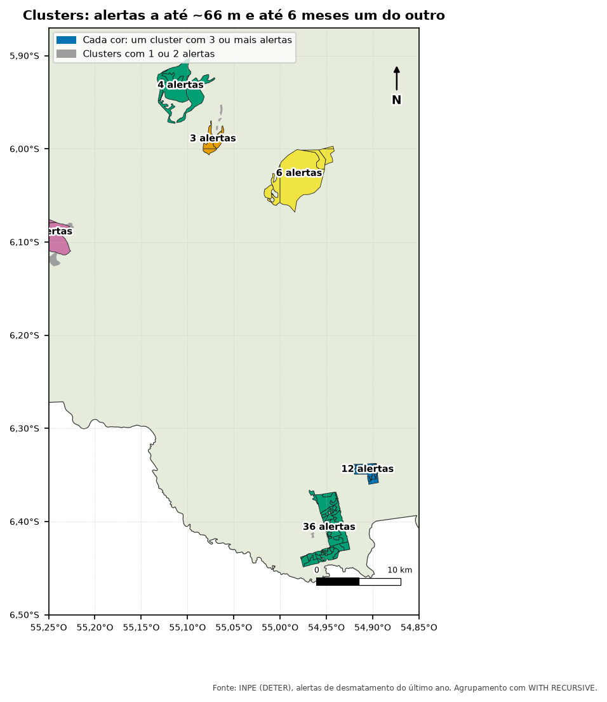
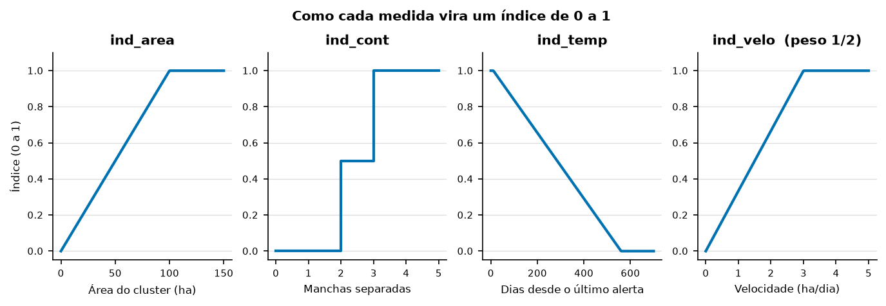

::: {.callout-tip appearance="simple"}
## Neste módulo
- Usar WITH RECURSIVE para encontrar grupos conectados
- Normalizar medidas em índices de 0 a 1
- Transformar uma nota numérica em classes

**Tempo estimado:** 60 min · **Módulo anterior:** [Módulo 4: Apuração, alertas × embargos](04-apuracao.qmd)
:::

Script: [`sql/03_priorizacao.sql`](../sql/03_priorizacao.sql)

Com centenas de alertas por mês, a fiscalização precisa escolher por onde começar. A ideia:

::: {.callout-note}
Olhar o **conjunto** de alertas em volta de cada alerta (o "cluster") e dar uma nota de
prioridade, que considera tamanho, fragmentação, quão recente e quão rápido o desmatamento está crescendo.
:::

---

## 1. Etapas

```{mermaid}
%%| eval: true
%%| fig-cap: "Etapas da priorização"
flowchart TD
    A["Alertas de desmatamento<br/>do último ano"] --> B["Pares de vizinhos<br/>até ~66 m e até 182 dias"]
    B --> C["WITH RECURSIVE<br/>vizinho de vizinho"]
    C --> D[("deter_cluster<br/>um número por cluster")]
    D --> E["Medidas por cluster<br/>área, manchas, idade, velocidade"]
    E --> F["4 índices de 0 a 1"]
    F --> G["Nota = área/6 + manchas/6<br/>+ idade/6 + velocidade/2"]
    G --> H[("deter_cluster_2<br/>Muito Alta ... Muito Baixa")]
    H --> I["vw_deter_prioridade<br/>já embargado vira 'Apurado'"]
```

---

## 2. Etapa 1: clusters de alertas

### A regra

Dois alertas são vizinhos se:
- estão a até **0,0006 grau (~66 m)** um do outro, e
- foram detectados com até **182 dias** (6 meses) de diferença.

E vizinho de vizinho entra no mesmo cluster (transitividade).

{fig-alt="Mapa ampliado com grupos de polígonos de alertas, cada grupo de uma cor e rotulado com o número de alertas: 36, 12, 6, 4 e 3 alertas. Alertas isolados aparecem em cinza."}

Por que não usar `ST_ClusterDBSCAN`, como na apuração? Porque ele só olha o espaço e não
consegue incluir a condição de tempo.

### Passo a passo

**a) Quem entra:** só classes de desmatamento do último ano.

```sql
recentes AS (
    SELECT id_alerta, data, geom
    FROM desmatamento.deter_ucs
    WHERE classname IN ('DESMATAMENTO_CR', 'DESMATAMENTO_VEG', 'MINERACAO',
                        'CS_DESORDENADO', 'CS_GEOMETRICO')
      AND data >= CURRENT_DATE - 365
)
```

Cicatrizes de queimada e degradação ficam de fora porque têm outra dinâmica.
É uma escolha: mude a lista se quiser.

**b) Arestas:** os pares de vizinhos diretos (self join, Módulo 2).

```sql
arestas AS (
    SELECT a.id_alerta AS id1, b.id_alerta AS id2
    FROM recentes a
    JOIN recentes b
      ON ST_DWithin(a.geom, b.geom, 0.0006)
     AND abs(a.data - b.data) <= 182
)
```

Cada alerta também é vizinho de si mesmo (distância 0, 0 dias). Isso garante que alertas
isolados formem um cluster de um alerta só.

**c) Alcance:** consulta recursiva que segue as arestas até não achar ninguém novo.

```sql
WITH RECURSIVE ...
alcance AS (
    SELECT id1 AS raiz, id2 AS membro FROM arestas          -- ponto de partida: vizinhos diretos
    UNION
    SELECT al.raiz, ar.id2                                  -- passo: vizinhos dos que já alcancei
    FROM alcance al
    JOIN arestas ar ON ar.id1 = al.membro
)
```

Como funciona um `WITH RECURSIVE`:
1. Roda a parte de cima (antes do `UNION`) uma vez.
2. Roda a parte de baixo usando **só as linhas novas** da rodada anterior.
3. Repete o passo 2 até uma rodada não trazer nenhuma linha nova.

O `UNION` (sem `ALL`) descarta linhas repetidas. Sem isso, a consulta rodaria para sempre.

**d) Número do cluster:** todos os alertas de um mesmo grupo alcançam os mesmos membros, então o
menor `id` alcançável identifica o grupo.

```sql
SELECT membro AS id_alerta,
       dense_rank() OVER (ORDER BY min(raiz)) AS cluster_id
FROM alcance
GROUP BY membro;
```

`dense_rank()` numera 1, 2, 3... sem pular números (diferente de `rank()`).

::: {.callout-note}
A recursão compara cada alerta com todos os do seu grupo. Para grupos muito grandes (milhares
de alertas encostados) ela fica lenta. No recorte de exemplo roda em menos de 1 segundo.
:::

---

## 3. Etapa 2: medidas e índices de cada cluster

### As medidas

| Medida | SQL | Significado |
|---|---|---|
| `area_ha` | `ST_Area(ST_Union(geom)::geography) / 10000` | área total, sem contar sobreposição duas vezes |
| `contiguo` | `ST_NumGeometries(ST_Union(geom))` | número de manchas separadas (fragmentação) |
| `dias_desde_ultimo` | `CURRENT_DATE - max(data)` | idade do alerta mais recente |
| `velocidade` | `area_ha / (CURRENT_DATE - min(data))` | hectares por dia desde o primeiro alerta |

### Os índices (todos de 0 a 1)

| Índice | Vale 1 quando | Vale 0 quando | Entre os dois |
|---|---|---|---|
| `ind_area` | ≥ 100 ha | 0 ha | `area / 100` |
| `ind_cont` | 3 ou mais manchas | 1 mancha | 0,5 com 2 manchas |
| `ind_temp` | último alerta há 11 dias ou menos | há 560 dias ou mais | `(560 − dias) / 549` |
| `ind_velo` | ≥ 3 ha/dia | 0 ha/dia | `velocidade / 3` |


{fig-alt="Quatro gráficos de linha. O índice de área sobe de 0 a 1 entre 0 e 100 hectares. O de manchas vale 0 com uma mancha, 0,5 com duas e 1 com três ou mais. O de tempo cai de 1 a 0 entre 11 e 560 dias desde o último alerta. O de velocidade sobe de 0 a 1 entre 0 e 3 hectares por dia."}

O truque para "prender" um valor entre 0 e 1:

```sql
least(1, greatest(0, valor))      -- greatest corta o que for menor que 0; least, o que passar de 1
```

### Nota final e classes

```
ind_priori = ind_area/6 + ind_cont/6 + ind_temp/6 + ind_velo/2
```

A **velocidade vale metade** da nota; os outros três dividem a outra metade.

| `ind_priori` | Classe |
|---|---|
| ≥ 0,98 | Muito Alta |
| ≥ 0,80 | Alta |
| ≥ 0,60 | Média |
| ≥ 0,40 | Baixa |
| < 0,40 | Muito Baixa |

### Por que escrever em camadas com WITH

O SQL não deixa usar, no mesmo `SELECT`, uma coluna que acabou de ser calculada:

```sql
SELECT area_ha / 100 AS ind_area,
       ind_area / 6  AS parte       -- ERRO: coluna "ind_area" não existe
```

Por isso o script calcula em camadas: `medidas` → `indices` → `final`. Cada camada usa as
colunas da anterior. A alternativa seria repetir a fórmula inteira em cada lugar, o que deixa o
código enorme e fácil de errar.

---

## 4. Etapa 3: a view por alerta

```sql
CREATE OR REPLACE VIEW desmatamento.vw_deter_prioridade AS
SELECT d.id_alerta, ..., k.ind_priori,
       CASE WHEN a.apuracao = 'Sim' THEN 'Apurado' ELSE k.prioridade END AS prioridade,
       d.geom
FROM desmatamento.deter_cluster c
JOIN desmatamento.deter_ucs d       USING (id_alerta)
JOIN desmatamento.deter_cluster_2 k USING (cluster_id)
LEFT JOIN desmatamento.apuracao_deter a USING (id_alerta);
```

Cada alerta herda a nota do seu cluster. Se já tem embargo, vira `'Apurado'`: não precisa ir
para a fila de fiscalização.

---

## 5. Rodar e conferir

```bash
psql -d monitoramento_ambiental -f sql/03_priorizacao.sql
```

```sql
-- Distribuição das classes
SELECT prioridade, count(*) AS alertas, round(sum(area_ha)) AS area_ha
FROM desmatamento.vw_deter_prioridade
GROUP BY prioridade;

-- Os 10 clusters mais urgentes, e o que puxou a nota
SELECT cluster_id, qtd_alertas, area_ha, contiguo, dias_desde_ultimo, velocidade,
       ind_area, ind_cont, ind_temp, ind_velo, ind_priori, prioridade
FROM desmatamento.deter_cluster_2
ORDER BY ind_priori DESC
LIMIT 10;
```

{fig-alt="Mapa da região de exemplo. Os alertas do último ano estão coloridos do amarelo-claro (prioridade muito baixa) ao vermelho-escuro (alta), e os já embargados em azul. Os de prioridade alta se concentram na Flona de Altamira e no norte da Flona do Jamanxim."}

---

## 6. Pontos de atenção

| Ponto | Detalhe |
|---|---|
| Resultado muda todo dia | `dias_desde_ultimo`, `velocidade` e a janela de 365 dias usam `CURRENT_DATE`. Guarde a data junto ao publicar |
| Graus × metros | 0,0006 grau ≈ 66 m no equador, um pouco menos longe dele. Para exatos 60 m: `ST_DWithin(a.geom::geography, b.geom::geography, 60)` (mais lento) |
| Pesos e limites | 1/6, 1/2, 100 ha, 3 ha/dia, 560 dias são escolhas, não verdades. Teste outras e veja como a lista muda |
| Classe "Muito Alta" é rara | Exige quase todos os índices no máximo (≥ 0,98) |

---

## Exercícios

1. Quantos clusters têm mais de um alerta? Qual o maior?
2. Calcule à mão: cluster de 50 ha, 2 manchas, último alerta há 30 dias, velocidade de 1,5 ha/dia. Qual a classe?
3. Mude o peso da velocidade para 1/4 e dos outros três para 1/4 cada. Quantos alertas mudam de classe?

<details><summary>Respostas</summary>

```sql
-- 1
SELECT count(*) FILTER (WHERE qtd_alertas > 1) AS com_varios, max(qtd_alertas) AS maior
FROM desmatamento.deter_cluster_2;
```

2. `ind_area = 0,5` · `ind_cont = 0,5` · `ind_temp = (560 − 30)/549 ≈ 0,965` · `ind_velo = 0,5`
   `ind_priori = 0,5/6 + 0,5/6 + 0,965/6 + 0,5/2 ≈ 0,577` → **Baixa**.

3. No CTE `final`, troque por `ind_area/4 + ind_cont/4 + ind_temp/4 + ind_velo/4`. Antes, salve a
   classe atual numa tabela (`CREATE TABLE treino.antes AS SELECT id_alerta, prioridade FROM desmatamento.vw_deter_prioridade;`)
   e depois compare com um `JOIN`.
</details>
