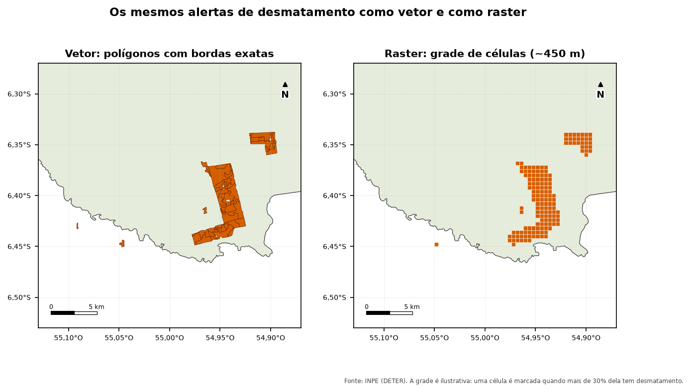
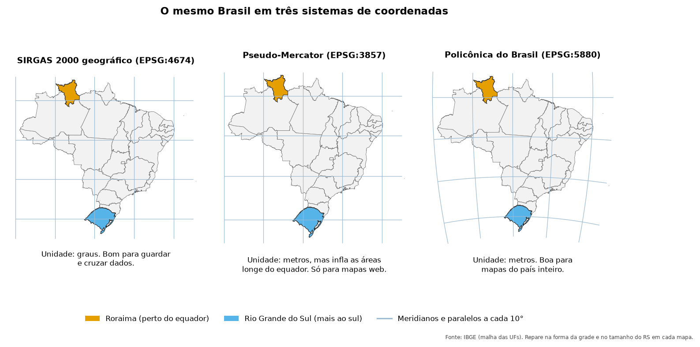

Antes de baixar qualquer dado, vale entender **o que** ele é e **onde** estão as coordenadas.
Esta página resume o mínimo necessário para o monitoramento ambiental.

## Vetor e raster

| | Vetor | Raster |
|---|---|---|
| O que é | Formas descritas por coordenadas: pontos, linhas e polígonos | Uma grade de células (pixels), cada uma com um valor |
| Exemplos no monitoramento | Alertas DETER, desmatamento PRODES, limites de UCs, embargos, imóveis do CAR | Imagens de satélite, mapas de uso e cobertura (MapBiomas), modelos de elevação |
| Atributos | Uma tabela: cada forma tem colunas (data, classe, área...) | Cada pixel tem um valor (refletância, classe, temperatura) |
| Onde brilha | Contar, cruzar, medir áreas exatas, relacionar com cadastros | Cobertura contínua, séries temporais, cálculos por pixel |

Este guia trabalha principalmente com **vetores**, que o PostGIS manipula muito bem.
Os mapas de alerta (DETER, PRODES) são produzidos a partir de imagens (raster) e entregues como polígonos (vetor).

{fig-alt="Dois mapas lado a lado da mesma área. À esquerda, polígonos de desmatamento com bordas detalhadas. À direita, a mesma área representada por quadradinhos de cerca de 450 metros, com contorno em degraus."}

## Tipos de geometria

| Tipo | Exemplo |
|---|---|
| `POINT` / `MULTIPOINT` | foco de calor, sede de um imóvel, ponto de coleta |
| `LINESTRING` / `MULTILINESTRING` | rio, estrada, trilha |
| `POLYGON` / `MULTIPOLYGON` | alerta de desmatamento, UC, área embargada |

O prefixo **MULTI** indica uma feição com várias partes separadas, por exemplo uma UC com ilhas.
Na prática, padronize polígonos como `MULTIPOLYGON` para evitar erros ao misturar os dois tipos.

Uma geometria escrita como texto, no formato **WKT** (*Well-Known Text*):

```
POINT(-55.38 -7.14)
POLYGON((-55.40 -7.10, -55.36 -7.10, -55.36 -7.14, -55.40 -7.14, -55.40 -7.10))
```

O primeiro número é a **longitude** (x) e o segundo, a **latitude** (y). O polígono termina no mesmo ponto em que começa.

## Sistemas de coordenadas (SRC)

Um número como `-55.38` só faz sentido se você souber em qual sistema ele está. Cada sistema
tem um código **EPSG** (consulte em [epsg.io](https://epsg.io/4674)).

### Geográficos × projetados

| | Geográfico | Projetado |
|---|---|---|
| Unidade | graus (latitude e longitude) | metros |
| Exemplo | SIRGAS 2000 (**EPSG:4674**), WGS 84 (EPSG:4326) | SIRGAS 2000 / UTM 21S (EPSG:31981), SIRGAS 2000 / Brazil Polyconic (EPSG:5880) |
| Bom para | guardar e trocar dados; cobrir o país inteiro | medir distâncias e áreas numa região; mapas impressos |

{fig-alt="Três mapas do Brasil. No SIRGAS 2000 geográfico, a grade de meridianos e paralelos é quadrada. No Pseudo-Mercator, a grade fica mais espaçada no sul e o Rio Grande do Sul parece maior. Na Policônica do Brasil, meridianos e paralelos são curvos e as proporções do país ficam mais próximas da realidade."}

### SIRGAS 2000

É o sistema de referência **oficial do Brasil**. INPE, MMA, IBAMA, IBGE e INCRA entregam seus
dados nele, quase sempre em coordenadas geográficas (EPSG:4674). Para monitoramento, a diferença
para o WGS 84 (usado por GPS e serviços globais) é pequena, menor que 1 metro, mas misturar os
códigos causa avisos e reprojeções desnecessárias. Padronize tudo em **4674**.

### Quando usar cada um

| Tarefa | Recomendação |
|---|---|
| Guardar e cruzar dados do país | EPSG:4674 (geográfico) |
| Área em hectares de um polígono | `ST_Area(geom::geography)` no PostGIS: cálculo sobre o elipsoide, sem precisar reprojetar |
| Distância e buffer em metros | `::geography` no PostGIS, ou reprojetar para a zona UTM da região |
| Mapa do Brasil inteiro | EPSG:5880 (Policônica do Brasil) |
| Mapa de uma região pequena | a zona UTM correspondente (EPSG:31978 a 31985 cobrem as zonas 18S a 25S) |
| Mapas na web | EPSG:3857 (Pseudo-Mercator) só para exibir; **nunca** para medir áreas |

::: {.callout-warning}
**O erro mais comum:** calcular área ou distância em graus. `ST_Area` sobre EPSG:4674 devolve
"graus quadrados", um número sem sentido físico. O [Módulo 3](../curso/03-postgis.qmd) mostra
como fazer certo.
:::

### Quanto vale um grau?

Um grau de latitude tem cerca de 111 km em qualquer lugar. Um grau de longitude tem 111 km no
equador e encolhe para o sul (cerca de 96 km a 30° S). Por isso, uma distância escrita em graus,
como `0.0006`, é só uma aproximação (cerca de 66 m perto do equador).

## Escala, resolução e área mínima

- **Resolução espacial** é o tamanho do pixel da imagem usada. Imagens de 30 m (Landsat) não
  enxergam uma clareira de 10 m.
- **Área mínima mapeável** é o menor polígono que um sistema registra. Alertas abaixo do limite
  não aparecem, e isso não significa que não houve desmatamento.
- **Escala** de um mapa vetorial indica o nível de detalhe com que as linhas foram desenhadas.
  Limites desenhados em 1:250.000 não servem para decidir se um ponto está a 10 m de uma divisa.

::: {.callout-note}
Ao cruzar camadas, o resultado nunca é mais preciso que a camada **menos** precisa. Um alerta
de 30 m "encostando" num limite de UC desenhado em escala pequena pode estar dentro ou fora.
:::

## Tempo: data da imagem × data de publicação

Dados de monitoramento têm pelo menos duas datas:

- **data da observação** (data da imagem de satélite: `view_date` no DETER, `image_date` no PRODES);
- **data de publicação** (quando o dado entrou na base).

Para medir quando o desmatamento aconteceu, use a data da observação. Para saber o que estava
disponível num certo dia (por exemplo, para avaliar a fiscalização), use a de publicação.

O PRODES usa o **ano PRODES**, de 1º de agosto a 31 de julho: o "PRODES 2025" cobre agosto de
2024 a julho de 2025.

## Próximo passo

[Formatos e serviços](02-formatos-e-servicos.qmd): em que arquivos esses dados chegam e como
acessá-los pela internet.
