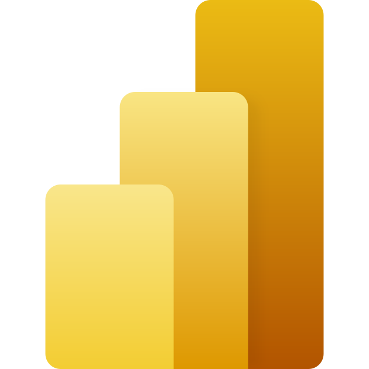

Todas as ferramentas abaixo são gratuitas, menos o serviço online do Power BI.

## Como elas se encaixam

```{mermaid}
%%| eval: true
%%| fig-cap: "Do download ao painel: o caminho dos dados no curso"
flowchart LR
    A["Fontes públicas<br/>INPE, MMA, IBAMA<br/>(WFS, zip)"] -->|ogr2ogr| B[("PostgreSQL<br/>+ PostGIS")]
    A -->|abrir direto| Q["QGIS<br/>ver e conferir"]
    B <--> Q
    B --> P["Python / R<br/>automatizar, gráficos"]
    B --> BI["Power BI<br/>painéis"]
```

## As ferramentas

::: {.grid .ferramentas}

::: {.g-col-12 .g-col-sm-6 .g-col-lg-4 .ferramenta}
{fig-alt="Ícone do QGIS"}

**[QGIS](https://qgis.org)**\
Ver os dados no mapa, conferir resultados, editar e fazer mapas. Traz o GDAL junto.\
*Use para:* olhar antes e depois de cada análise.
:::

::: {.g-col-12 .g-col-sm-6 .g-col-lg-4 .ferramenta}
{fig-alt="Ícone do PostgreSQL"}

**[PostgreSQL](https://www.postgresql.org/download/)**\
Banco de dados: guarda as tabelas e roda o SQL.\
*Use para:* guardar tudo num lugar só e repetir análises.
:::

::: {.g-col-12 .g-col-sm-6 .g-col-lg-4 .ferramenta}
{fig-alt="Ícone do PostGIS"}

**[PostGIS](https://postgis.net/documentation/)**\
Extensão espacial do PostgreSQL: geometrias, áreas, distâncias, interseções.\
*Use para:* cruzar camadas com milhares de polígonos.
:::

::: {.g-col-12 .g-col-sm-6 .g-col-lg-4 .ferramenta}
{fig-alt="Ícone do GDAL"}

**[GDAL / OGR](https://gdal.org)**\
Lê, converte e baixa quase qualquer formato (`ogr2ogr`, `ogrinfo`, `gdalwarp`).\
*Use para:* trazer WFS, shapefile e zip para o banco.
:::

::: {.g-col-12 .g-col-sm-6 .g-col-lg-4 .ferramenta}
{fig-alt="Ícone do Python"}

**[Python](https://geopandas.org)** (geopandas, psycopg2)\
Automatizar, analisar e gerar gráficos e mapas.\
*Use para:* rodar o fluxo toda semana sem cliques.
:::

::: {.g-col-12 .g-col-sm-6 .g-col-lg-4 .ferramenta}
{fig-alt="Ícone do R"}

**[R](https://cran.r-project.org)** (sf, terra)\
A mesma ideia do Python, forte em estatística e mapas para artigos.\
*Use para:* análises estatísticas e figuras de publicação.
:::

::: {.g-col-12 .g-col-sm-6 .g-col-lg-4 .ferramenta}
{fig-alt="Ícone do Power BI"}

**[Power BI](https://powerbi.microsoft.com/desktop)**\
Painéis interativos para quem não usa SIG. Desktop só no Windows.\
*Use para:* mostrar resultados para gestores.
:::

::: {.g-col-12 .g-col-sm-6 .g-col-lg-4 .ferramenta}
{fig-alt="Ícone do DBeaver"}

**[DBeaver](https://dbeaver.io)** ou pgAdmin\
Escrever e testar SQL com interface gráfica; o DBeaver mostra geometrias num mapa.\
*Use para:* aprender SQL testando consulta por consulta.
:::

::: {.g-col-12 .g-col-sm-6 .g-col-lg-4 .ferramenta}
{fig-alt="Ícone do Docker"}

**[Docker](https://www.docker.com)** (opcional)\
Sobe um PostgreSQL com PostGIS em um comando, em qualquer sistema.\
*Use para:* não instalar o banco direto no computador.
:::

::: {.g-col-12 .g-col-sm-6 .g-col-lg-4 .ferramenta}
{fig-alt="Ícone do DuckDB"}

**[DuckDB](https://duckdb.org)** (opcional)\
Banco leve, sem servidor, com extensão espacial.\
*Use para:* análises rápidas em arquivos, sem instalar PostgreSQL.
:::

::: {.g-col-12 .g-col-sm-6 .g-col-lg-4 .ferramenta}
{fig-alt="Ícone do Google Earth"}

**[Google Earth Engine](https://earthengine.google.com)** (opcional)\
Processa séries de imagens de satélite na nuvem.\
*Use para:* trabalhar com raster em grande escala.
:::

::: {.g-col-12 .g-col-sm-6 .g-col-lg-4 .ferramenta}
{fig-alt="Ícone do Git"}

**[Git](https://git-scm.com)** (opcional)\
Guarda o histórico dos scripts.\
*Use para:* saber o que mudou e voltar atrás quando algo quebrar.
:::

:::

## Por onde começar

| Se você quer... | Comece por |
|---|---|
| Só ver e explorar os dados | QGIS + os WFS da página [Fontes de dados](03-fontes-de-dados.qmd) |
| Repetir uma análise toda semana | PostgreSQL + PostGIS com scripts SQL, como no [curso](../index.qmd#curso) |
| Mostrar resultados para gestores | Banco + Power BI ([Módulo 7](../curso/07-power-bi.qmd)) |

## Comandos do GDAL que valem ouro

```bash
ogrinfo arquivo.gpkg                                 # lista as camadas
ogrinfo -so arquivo.gpkg camada                      # resumo: campos, SRC, extensão, total
ogr2ogr -f GPKG saida.gpkg entrada.shp               # converter formato
ogr2ogr -t_srs EPSG:4674 saida.gpkg entrada.gpkg     # reprojetar
ogr2ogr -clipsrc limite.gpkg recorte.gpkg dados.gpkg # recortar por um polígono
ogr2ogr -where "classname = 'MINERACAO'" mineracao.gpkg deter.gpkg   # filtrar
ogr2ogr -f PostgreSQL "PG:dbname=meu_banco" dados.gpkg -nln schema.tabela   # carregar no banco
```

[Os ícones são marcas de seus respectivos donos e aparecem só para identificar cada ferramenta.
Ícones do [Simple Icons](https://simpleicons.org) (licença CC0); logotipos do PostGIS e do Power BI
dos sites oficiais e do Wikimedia Commons.]{.small}

## Próximo passo

Comece o [curso](../index.qmd#curso) pelo [Módulo 0: Ambiente e dados](../curso/00-ambiente-e-dados.qmd).
