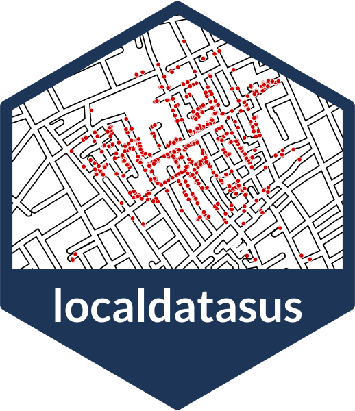
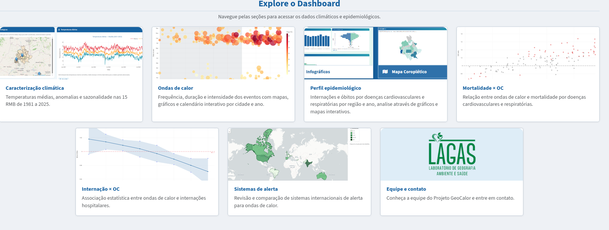
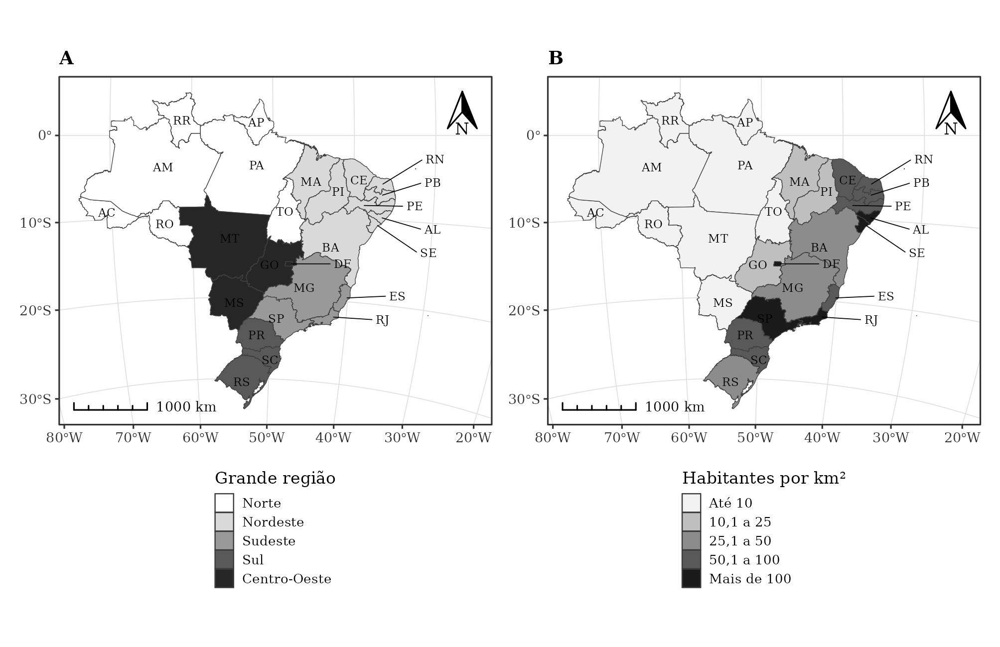

::: {.inicio}

:::: {.grid}

::::: {.g-col-12 .g-col-md-4 .inicio-perfil}
{.foto fig-alt="Foto de Hendesson Alves"}

# Hendesson Alves

Geógrafo · Mestrando em Geografia (UnB)<br>Pesquisador no LAGAS/UnB

[<i class="bi bi-github"></i>](https://github.com/Hendesson){.icone title="GitHub" aria-label="GitHub"} [<i class="bi bi-linkedin"></i>](https://www.linkedin.com/in/hendesson-alves){.icone title="LinkedIn" aria-label="LinkedIn"} [<i class="bi bi-mortarboard"></i>](http://lattes.cnpq.br/7900166623696256){.icone title="Lattes" aria-label="Lattes"} [<i class="bi bi-journal-text"></i>](https://www.researchgate.net/profile/Hendesson-Pereira){.icone title="ResearchGate" aria-label="ResearchGate"} [<i class="bi bi-envelope"></i>](mailto:hendesson124@gmail.com){.icone title="E-mail" aria-label="E-mail"}

```{=html}
<div class="visitantes">
<script type="text/javascript" id="mapmyvisitors" src="//mapmyvisitors.com/map.js?d=rALDXoi4NW4BgsXmeYVq61UX1vEchz5kaop0hJQSnUU&cl=ffffff&w=200"></script>
</div>
```
:::::

::::: {.g-col-12 .g-col-md-8}
Trabalho na interface entre **geografia, clima e saúde pública**: análise espacial, geoprocessamento e visualização de dados para entender como o território e os eventos climáticos extremos afetam a saúde da população. No **Laboratório de Geografia, Ambiente e Saúde (LAGAS/UnB)**, participo do GeoCalor e desenvolvo o localdatasus.

[Geografia da saúde]{.chip} [Epidemiologia espacial]{.chip} [Clima e ondas de calor]{.chip} [Sensoriamento remoto]{.chip} [Dashboards]{.chip} [R · Python · QGIS · ArcGIS · PostGIS]{.chip}

### Destaques

:::::: {.grid .destaques}

::::::: {.g-col-12 .g-col-md-4}
[](projetos/localdatasus/index.qmd)

**[localdatasus](projetos/localdatasus/index.qmd)**<br>
Pacote R com dados de saúde do SUS por bairro.
:::::::

::::::: {.g-col-12 .g-col-md-4}
[](projetos/geocalor/index.qmd)

**[GeoCalor](projetos/geocalor/index.qmd)**<br>
Dashboard sobre ondas de calor e saúde.
:::::::

::::::: {.g-col-12 .g-col-md-4}
[](tutoriais/mapas-preto-e-branco.qmd)

**[Mapas acadêmicos no R](tutoriais/mapas-preto-e-branco.qmd)**<br>
Tutorial de mapas em preto e branco para artigos.
:::::::

::::::

[Projetos](projetos.qmd){.btn .btn-primary .btn-sm} [Pacotes](codigo.qmd){.btn .btn-outline-primary .btn-sm} [Tutoriais](tutoriais.qmd){.btn .btn-outline-primary .btn-sm} [Currículo](cv.qmd){.btn .btn-outline-primary .btn-sm}
:::::

::::

:::
