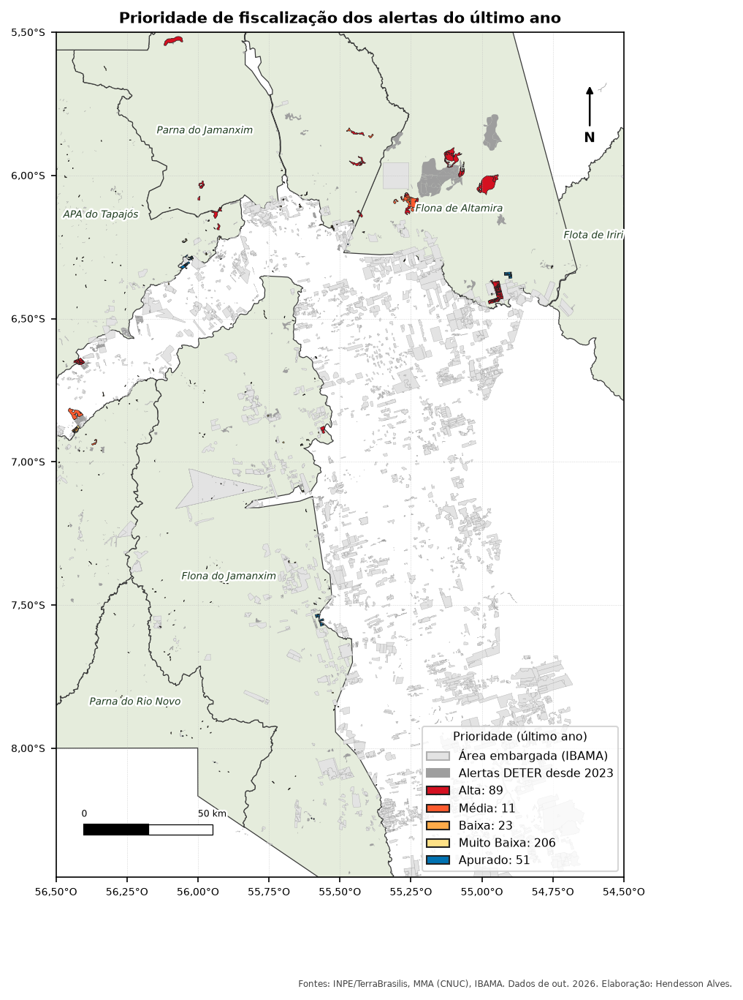
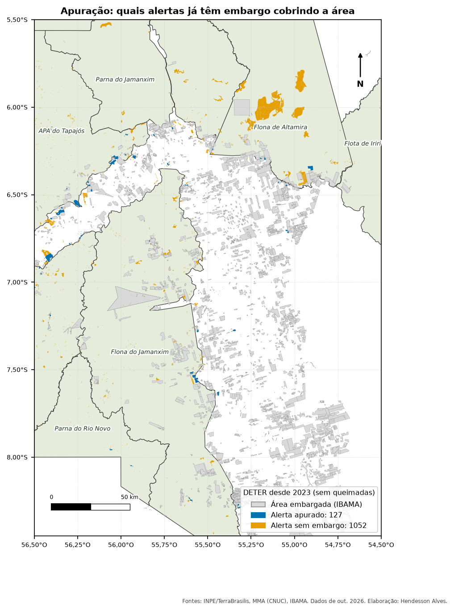
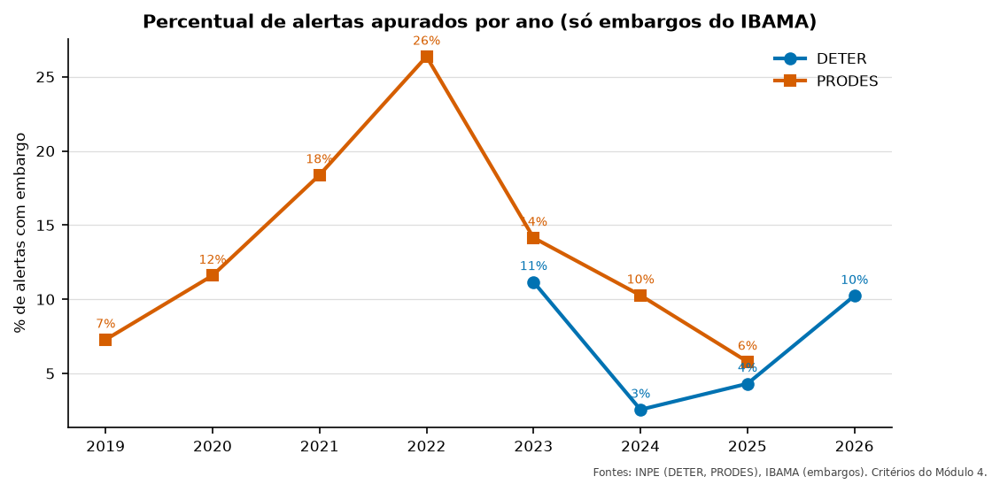
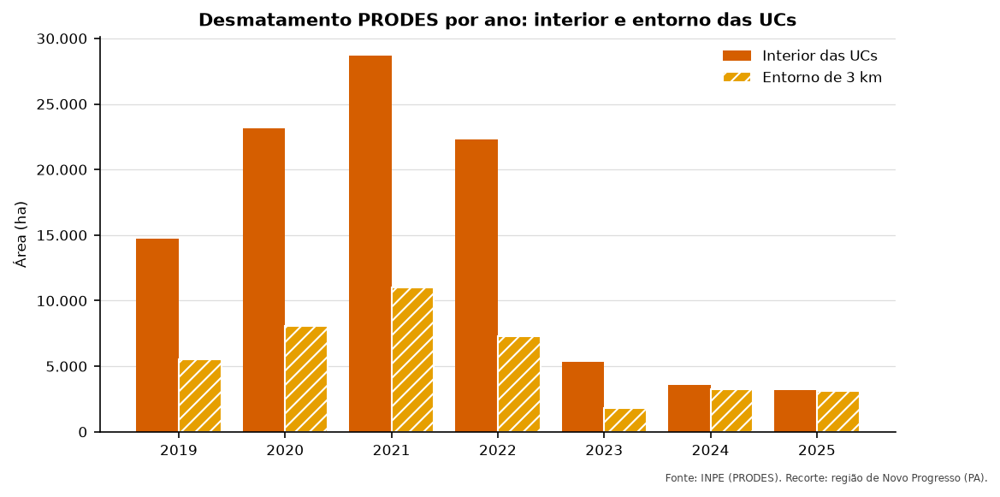

[Abrir o guia e o curso](../../guia-espacial/index.qmd){.btn .btn-primary role="button"}
[Ver os artigos](../../artigos/index.qmd){.btn .btn-outline-primary role="button"}
[Baixar os scripts (.zip)](../../guia-espacial/curso-sql.zip){.btn .btn-outline-primary role="button"}

Um guia e um curso, gratuitos e abertos, para quem quer trabalhar com **monitoramento ambiental
usando dados espaciais**. Tudo usa dados públicos do **INPE** (DETER e PRODES), do **MMA**
(Unidades de Conservação) e do **IBAMA** (áreas embargadas).

O projeto nasceu da minha experiência com monitoramento de desmatamento em Unidades de
Conservação e foi refeito do zero só com dados abertos, para que qualquer pessoa possa reproduzir.

{fig-alt="Mapa da região de Novo Progresso, no Pará, com Unidades de Conservação em verde claro, embargos em cinza e alertas coloridos do amarelo-claro ao vermelho-escuro conforme a prioridade, além dos já embargados em azul." width="70%" fig-align="center"}

## O que tem

| Parte | Conteúdo |
|---|---|
| **Guia** (5 páginas) | Conceitos de dados espaciais, formatos e serviços WFS, catálogo de fontes públicas, ferramentas e glossário |
| **Curso** (8 módulos) | Montar um banco PostGIS, SQL do básico ao espacial, cruzar alertas com embargos, priorizar a fiscalização e publicar um painel no Power BI |
| **[Artigos](../../artigos/index.qmd)** (13, seção à parte) | A mesma análise em ArcGIS Pro, QGIS, PostGIS e Python: interior e entorno, PRODES, focos de calor, CAR, Kernel, mapas e relatórios automáticos, priorização e carga incremental |
| **Scripts** | Baixam os dados das fontes oficiais e rodam o projeto inteiro em uns 2 minutos |

## Alguns resultados do recorte de exemplo

::: {.grid}

::: {.g-col-12 .g-col-md-6}
{fig-alt="Mapa com alertas sem embargo em laranja e alertas apurados em azul, sobre embargos em cinza. A maioria dos alertas está em laranja."}
:::

::: {.g-col-12 .g-col-md-6}
{fig-alt="Gráfico de linhas: no PRODES, o percentual de alertas com embargo sobe de 7% em 2019 para 26% em 2022 e cai para 6% em 2025. No DETER, fica entre 3% e 11%."}

{fig-alt="Gráfico de barras: o desmatamento no interior das UCs do recorte sobe até quase 29 mil hectares em 2021 e cai para cerca de 3 mil em 2025."}
:::

:::

## Ferramentas

PostgreSQL, PostGIS, GDAL, QGIS, ArcGIS Pro, Python (geopandas, fpdf2), Quarto e Power BI.
